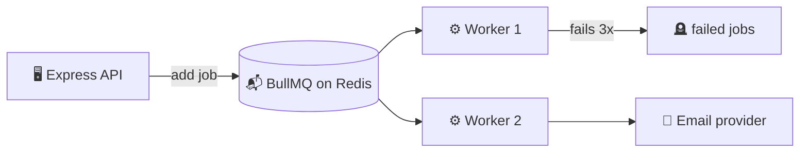

# 19 · Background Jobs

> [!info] Topic info
> **Subject:** Node.js Backend · **Part:** Building Production Backends · **Priority:** 🔥 High · **Status:** ✅ done · **Last reviewed:** 2026-11-19
>
> [← Back to Node.js Backend](README.md) · [Interview questions →](questions/building-backends-qa.md)

> [!abstract] In one line
> Move slow or unreliable work (emails, PDFs, image resizing, webhooks) out of the request into a **queue** like **BullMQ** (on Redis), processed by **separate workers** with **retries, backoff and idempotency**.

---

## 1. The problem

`POST /signup` creates the user, sends a welcome email (800 ms) and generates a PDF (3 s). The user waits 4 seconds, and if the email provider is down, signup fails.

Fix: save the user, **enqueue** "send welcome email", return **201** in 50 ms. A worker does the rest. Concepts: [message queues](../system-design/communication-patterns/06-message-queues.md).

---

## 2. How it works



```js
const { Queue, Worker } = require('bullmq');
const emailQueue = new Queue('email', { connection });

// in the API
await emailQueue.add('welcome', { userId }, {
  jobId: `welcome:${userId}`,                       // dedupe: same id = same job
  attempts: 5, backoff: { type: 'exponential', delay: 2000 },
});

// in a separate worker process
new Worker('email', async (job) => {
  await sendWelcomeEmail(job.data.userId);          // throw → BullMQ retries
}, { connection, concurrency: 10 });
```

Run workers as a **separate process/deployment** so CPU-heavy jobs don't slow the API's event loop, and so you can scale them independently.

---

## 3. Reliability rules

- **Retries + exponential backoff** — 2 s, 4 s, 8 s… for flaky providers.
- **Idempotency** — a job can run **more than once** (worker crash after sending, before acking). Make the handler safe to repeat: check `emailSentAt`, use a unique `jobId`, or pass an idempotency key to the provider. See [delivery semantics](../system-design/communication-patterns/09-delivery-semantics.md).
- **Failed jobs** — after max attempts, keep them in a failed set (like a [dead letter queue](../system-design/communication-patterns/10-dead-letter-queues.md)), alert, and allow replay.
- **Small payloads** — pass IDs, not whole objects; the worker reads fresh data.
- **Scheduling** — BullMQ supports delayed jobs and repeatable (cron) jobs, so you don't need `setInterval` on every API pod (which would run N times).

| Tool | When |
|---|---|
| **BullMQ** | Redis-based, the default for Node |
| **RabbitMQ / SQS** | Cross-language, managed, stronger delivery guarantees |
| **Kafka** | Event streaming, replay, very high throughput |

> [!tip] 🎤 Say it like this
> "Anything slow or flaky goes on a BullMQ queue — the API just enqueues a job with the user ID and returns. Workers run as a separate deployment with retries and exponential backoff. Because jobs can run twice, every handler is idempotent, and jobs that fail all retries go to a failed set that we alert on and can replay."

> [!failure] Interview traps
> - Fire-and-forget `sendEmail()` without awaiting — lost on crash, no retry.
> - Assuming exactly-once processing.
> - Cron with `setInterval` inside a horizontally scaled API → runs on every pod.
> - Heavy CPU work in the API process instead of a worker.

---

## Summary

- Enqueue in the request, process in workers.
- Retries + backoff, then a failed/DLQ set.
- **Idempotent** handlers — at-least-once delivery.
- Pass IDs, scale workers separately.

> [!success] Key takeaway
> Queues make the API fast and failures recoverable — but only if every job is safe to run twice.
