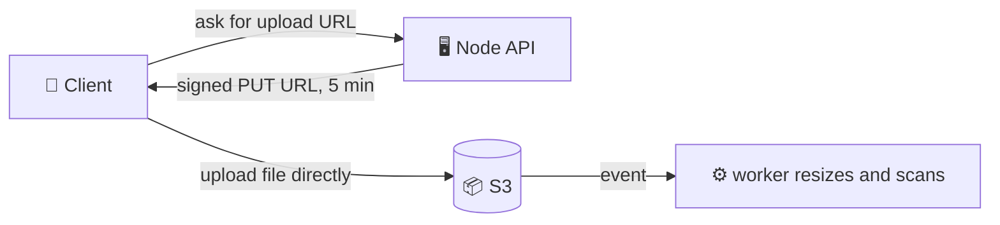

# 20 · File Uploads

> [!info] Topic info
> **Subject:** Node.js Backend · **Part:** Building Production Backends · **Priority:** ⚡ Medium · **Status:** ✅ done · **Last reviewed:** 2026-11-19
>
> [← Back to Node.js Backend](README.md) · [Interview questions →](questions/building-backends-qa.md)

> [!abstract] In one line
> Small uploads go through Node as **multipart/form-data** (parsed by **multer**) and are **streamed** to object storage like **S3**; large uploads skip your server entirely using **presigned URLs**.

---

## 1. The problem

Users upload 2 GB videos. If Node buffers each file in memory, 10 parallel uploads = 20 GB of RAM → crash. Saving to the server's local disk also breaks when you have 5 pods or the container restarts.

Rule: **never buffer big files in memory, never keep them on local disk** — stream to object storage.

---

## 2. Three ways to upload

| Approach | How | Use when |
|---|---|---|
| **multer memoryStorage** | File in a Buffer in RAM | Tiny files (avatars < 5 MB) with size limit |
| **Stream through Node** | Pipe request stream → S3 (`@aws-sdk/lib-storage` `Upload`) | Need to inspect / process on the way |
| **Presigned URL** ⭐ | Client uploads **directly** to S3 | Large files, scale |

```js
const upload = multer({
  storage: multer.memoryStorage(),
  limits: { fileSize: 5 * 1024 * 1024 },                 // 5 MB cap
  fileFilter: (req, f, cb) => cb(null, ['image/png', 'image/jpeg'].includes(f.mimetype)),
});
router.post('/avatar', requireAuth, upload.single('avatar'), avatarCtrl.save);
```

---

## 3. Presigned URLs



1. API checks auth, picks the key (`uploads/user42/uuid.jpg`), signs a URL valid for ~5 min with size/type conditions.
2. Client `PUT`s the file straight to S3 — your server never touches the bytes.
3. An S3 event or a "confirm" call triggers a [background job](19-background-jobs.md) for thumbnails or virus scanning.

Downloads work the same way: presigned **GET** URLs for private files, or a CDN in front.

> [!tip] 🎤 Say it like this
> "For anything bigger than a small avatar I use presigned S3 URLs: the API authorizes the user and returns a short-lived signed URL, the browser uploads directly, and an S3 event kicks off processing in a worker. That keeps big bytes off Node's event loop and memory. For small files I use multer with strict size and type limits."

> [!failure] Interview traps
> - No `fileSize` limit → one request fills RAM or disk.
> - Trusting the file name or `mimetype` from the client — generate your own key, check magic bytes for sensitive cases.
> - Storing files on the pod's local disk in a scaled / containerised app.
> - Serving user uploads from your own domain without `Content-Disposition` → stored XSS via uploaded HTML/SVG.

---

## Summary

- Small: multer + limits. Medium: stream to S3. Large: **presigned URL**.
- Generate keys server-side, validate type and size.
- Post-processing in a worker, not in the request.

> [!success] Key takeaway
> The best upload is one that never passes through your Node server — sign it, let S3 take the bytes.
