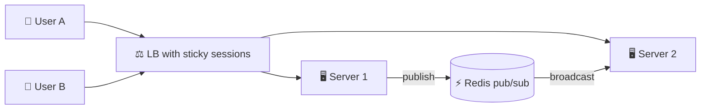

# 21 · Realtime with Socket.IO

> [!info] Topic info
> **Subject:** Node.js Backend · **Part:** Building Production Backends · **Priority:** ⚡ Medium · **Status:** ✅ done · **Last reviewed:** 2026-11-19
>
> [← Back to Node.js Backend](README.md) · [Interview questions →](questions/building-backends-qa.md)

> [!abstract] In one line
> **Socket.IO** adds **rooms, auto-reconnect, acknowledgements and fallbacks** on top of WebSockets; to run it on many servers you need **sticky sessions** and the **Redis adapter** so an event emitted on one server reaches clients on all of them.

---

## 1. The problem

A chat app: user A on server 1 sends a message to a room; user B is connected to server 2. Server 1 only knows its own sockets, so B never sees it.

WebSocket basics are in [WebSockets](../system-design/communication-patterns/03-websockets.md). Node is a great fit here — one process can hold **tens of thousands** of idle connections cheaply thanks to the event loop.

---

## 2. Basics

```js
const io = new Server(httpServer, { cors: { origin: 'https://app.example.com' } });

io.use((socket, next) => {                       // auth on handshake
  try { socket.user = jwt.verify(socket.handshake.auth.token, SECRET); next(); }
  catch { next(new Error('unauthorized')); }
});
io.on('connection', (socket) => {
  socket.join(`room:${socket.user.teamId}`);
  socket.on('message', (msg, ack) => {
    io.to(`room:${socket.user.teamId}`).emit('message', msg);
    ack({ ok: true });                           // client knows it was received
  });
});
```

**Socket.IO vs raw `ws`:** Socket.IO has rooms, reconnect, acks and HTTP long-polling fallback, but uses its own protocol (a plain WebSocket client can't talk to it). `ws` is lighter and standard.

---

## 3. Scaling to many servers



- **Redis adapter** (`@socket.io/redis-adapter`) — `io.to(room).emit()` is published to Redis, every server delivers to its local sockets in that room.
- **Sticky sessions** — needed because the long-polling handshake makes several HTTP requests that must hit the same server. (Not needed if you force `transports: ['websocket']`.)
- With PM2 cluster mode, use `@socket.io/sticky` or run one process per container.

> [!tip] 🎤 Say it like this
> "I authenticate on the handshake with a JWT, put users in rooms, and use acknowledgements for important events. To scale horizontally I add the Redis adapter so broadcasts reach sockets on every server, and sticky sessions on the load balancer because of the polling fallback."

> [!failure] Interview traps
> - Scaling out without the Redis adapter → messages only reach users on the same server.
> - No auth on the connection — anyone can join any room.
> - Assuming delivery is guaranteed — offline users miss events; store messages in a DB and fetch on reconnect.
> - Load balancer idle timeout (e.g. 60 s) killing connections — rely on heartbeats.

---

## Summary

- Socket.IO = WebSocket + rooms, acks, reconnect, fallback.
- Auth in `io.use` middleware.
- Scale: **Redis adapter + sticky sessions**.
- Persist messages; realtime is a delivery layer, not storage.

> [!success] Key takeaway
> One server is easy; the interview question is always "what happens with two?" — answer: Redis adapter and sticky sessions.
