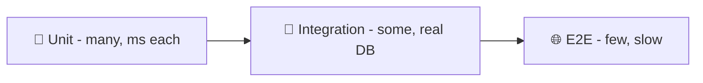

# 22 · Testing

> [!info] Topic info
> **Subject:** Node.js Backend · **Part:** Building Production Backends · **Priority:** 🔥 High · **Status:** ✅ done · **Last reviewed:** 2026-11-19
>
> [← Back to Node.js Backend](README.md) · [Interview questions →](questions/building-backends-qa.md)

> [!abstract] In one line
> Test a Node backend with **unit tests** for services (dependencies **mocked**), **integration tests** for HTTP routes with **Supertest** against a **real test database**, and a few **end-to-end** tests — using **Jest** or **Vitest**.

---

## 1. The problem

You change the discount logic and break checkout. Nobody notices until Monday's revenue drops 30%. Manual testing of 60 endpoints before every deploy isn't possible.

Automated tests in CI catch it in minutes, before merge.

---

## 2. The testing pyramid



| Type | Tests | Speed | Tools |
|---|---|---|---|
| **Unit** | One function / service, deps mocked | ~ms | Jest, Vitest |
| **Integration** | Route → controller → service → real DB | ~100 ms | **Supertest** + Docker DB / Testcontainers |
| **E2E** | Whole system like a user | seconds | Playwright, Postman / Newman |

Node's built-in `node:test` runner also works for small projects.

---

## 3. Unit test with a mock

```js
jest.mock('../repositories/userRepo');
const userRepo = require('../repositories/userRepo');

test('register rejects duplicate email', async () => {
  userRepo.findByEmail.mockResolvedValue({ id: 1 });
  await expect(userService.register({ email: 'a@b.com' })).rejects.toThrow('EMAIL_TAKEN');
  expect(userRepo.create).not.toHaveBeenCalled();
});
```

Mock **things you don't own or that are slow**: DB in unit tests, email/payment APIs (`nock`, `msw`), time (`jest.useFakeTimers()`).

---

## 4. Integration test with Supertest

```js
const request = require('supertest');
const app = require('../src/app');           // app without listen() — see Express basics

test('POST /users creates a user', async () => {
  const res = await request(app).post('/api/v1/users').send({ email: 'x@y.com', name: 'X' });
  expect(res.status).toBe(201);
  expect(res.body.email).toBe('x@y.com');
});
```

**Test database:** run Postgres in Docker (or Testcontainers), apply migrations once, and **reset between tests** — truncate tables or wrap each test in a transaction that rolls back. Never point tests at a shared dev DB.

> [!tip] 🎤 Say it like this
> "Most of my tests are fast unit tests on services with the repository and external APIs mocked. Then integration tests hit the real Express app through Supertest against a Postgres container, resetting data between tests. A handful of E2E tests cover the critical flows like signup and checkout. All of it runs in CI on every PR."

> [!failure] Interview traps
> - Mocking everything, including the DB in integration tests → tests pass, prod breaks on a real SQL error.
> - Tests that depend on each other's data or run order.
> - Testing implementation details instead of behaviour.
> - Chasing 100% coverage instead of covering critical paths and edge cases.

---

## Summary

- **Pyramid:** many unit, some integration, few E2E.
- Unit: mock repos, external APIs, time.
- Integration: **Supertest + real test DB**, reset per test.
- Export `app` separately so tests don't open ports.

> [!success] Key takeaway
> Mock at the edges, test real wiring in integration tests, and run it all in CI — confidence to deploy on a Friday.
