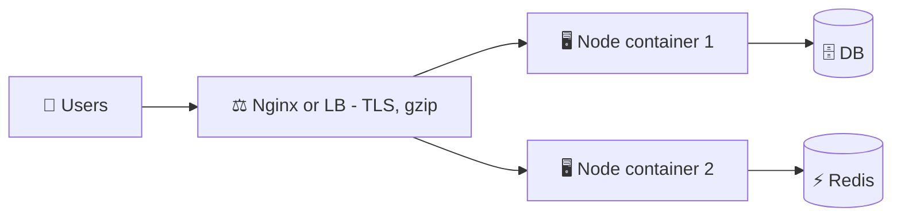

# 25 · Production Deployment

> [!info] Topic info
> **Subject:** Node.js Backend · **Part:** Building Production Backends · **Priority:** 🔥 High · **Status:** ✅ done · **Last reviewed:** 2026-11-19
>
> [← Back to Node.js Backend](README.md) · [Interview questions →](questions/building-backends-qa.md)

> [!abstract] In one line
> Run Node in production behind a **reverse proxy**, use **all CPU cores** (PM2 cluster or multiple containers), package it with **Docker**, expose **health checks**, and **shut down gracefully** on **SIGTERM** so deploys drop zero requests.

---

## 1. The problem

`node server.js` on a 4-core VM uses **one core**, dies forever on the first crash, and every deploy kills in-flight requests — users see 502s for a few seconds each release.

---

## 2. The production setup



- **Reverse proxy** (Nginx, ALB, ingress) — TLS termination, compression, static files, load balancing. Set `app.set('trust proxy', 1)` so `req.ip` is the real client. See [proxy vs reverse proxy](../system-design/networking/06-proxy-vs-reverse-proxy.md).
- **Use all cores:**
  - On a VM: **PM2 cluster mode** (`pm2 start app.js -i max`) — forks one worker per core, restarts crashed ones, zero-downtime `pm2 reload`.
  - On Kubernetes: **one Node process per container**, scale with more replicas. Don't run PM2 inside K8s — the orchestrator already restarts and scales.

---

## 3. Docker

```dockerfile
FROM node:22-alpine
WORKDIR /app
COPY package*.json ./
RUN npm ci --omit=dev              # reproducible, no dev deps
COPY . .
ENV NODE_ENV=production
USER node                          # don't run as root
CMD ["node", "src/server.js"]      # not "npm start": npm doesn't forward SIGTERM well
```

Copy `package*.json` first so the dependency layer is cached between builds. Use multi-stage builds for TypeScript.

---

## 4. Graceful shutdown + health checks

On deploy, K8s / PM2 sends **SIGTERM**, waits (default 30 s), then **SIGKILL**. Use that window:

```js
process.on('SIGTERM', async () => {
  isShuttingDown = true;                       // readiness now returns 503
  server.close(async () => {                   // stop new conns, finish in-flight
    await Promise.all([db.$disconnect(), redis.quit(), worker?.close()]);
    process.exit(0);
  });
  setTimeout(() => process.exit(1), 25_000).unref();   // hard stop if stuck
});
```

| Endpoint | Question | If it fails |
|---|---|---|
| **Liveness** `/healthz` | Is the process alive? | Restart the container |
| **Readiness** `/readyz` | Can it take traffic now? (DB reachable, not shutting down) | Remove from load balancer |

Keep liveness **cheap** — if it checks the DB, a DB blip restarts every pod at once.

Also: let the process **crash on `uncaughtException`** (log it, then exit) and let PM2/K8s restart it — state may be corrupt. Rollout strategies: [rolling](../system-design/deployment/03-rolling-deployments.md), [blue-green](../system-design/deployment/04-blue-green.md), [canary](../system-design/deployment/05-canary-releases.md).

> [!tip] 🎤 Say it like this
> "I ship a small Docker image running node directly as a non-root user, one process per container, scaled by Kubernetes behind a load balancer that terminates TLS. On SIGTERM the app fails readiness, stops accepting connections, finishes in-flight requests, closes DB and Redis, then exits. Liveness is a cheap ping; readiness checks dependencies. On a plain VM I'd use PM2 cluster mode instead."

> [!failure] Interview traps
> - `CMD npm start` → SIGTERM not forwarded, pod killed after 30 s with requests dropped.
> - PM2 cluster inside Kubernetes — two layers fighting over restarts.
> - Liveness probe that checks the database → cascading restarts.
> - In-memory sessions or uploads on one instance — breaks with multiple replicas.

---

## Summary

- **Reverse proxy** in front, `trust proxy` set.
- **All cores:** PM2 cluster on VMs, replicas on K8s.
- **Docker:** `npm ci`, non-root, `CMD ["node", ...]`.
- **SIGTERM** → stop accepting, drain, close, exit.
- **Liveness** cheap, **readiness** checks deps.

> [!success] Key takeaway
> Production Node is about the boring lifecycle: start fast, use every core, report health honestly, and leave gracefully.
