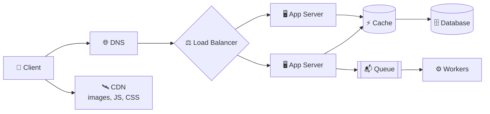

# 01 · What is System Design

> [!info] Topic info
> **Subject:** System Design · **Priority:** 🔥 High · **Status:** ✅ done · **Last reviewed:** 2026-11-18
>
> [← Back to System Design](README.md) · [Interview questions →](questions/01-what-is-system-design-qa.md)

> [!abstract] In one line
> System design is deciding **which parts** a system needs, **how they talk to each other**, and **where the data lives**, so it works for users today *and* keeps working when millions of people use it.

---

## 1. The problem

You write a to-do app. It runs on your laptop. One user — you. It works perfectly.

Now imagine **10 million people** use it every day:

- Where do you store billions of to-do items?
- What happens when the server crashes at 2 AM?
- How do users in India and the US both get fast responses?
- How do you send reminder emails to 10M people without slowing the app?

The **code** for "add a to-do" is the same. What changes is everything **around** the code. That's system design.

> [!tip] 🎤 Say it like this
> "System design is planning the architecture of a system before building it — the components, how data flows between them, and how it handles growth and failures. Coding solves the problem on one machine. System design makes it work for millions of users, across many machines, without going down."

---

## 2. A simple way to think about it

> [!example] Building analogy
> - **Coding** = building one room well.
> - **System design** = the blueprint of the whole building — how many floors, where the lifts go, what happens in a fire, how to add floors later.

There are two levels:

| | 🏙️ High-Level Design (HLD) | 🔧 Low-Level Design (LLD) |
|---|---|---|
| **Focus** | Big boxes: services, DBs, caches, queues | Inside one box: classes, functions, schema |
| **Question** | "What are the parts and how do they connect?" | "How exactly is this part built?" |
| **Example** | App servers → Redis → Postgres | `Order` class, `OrderRepository` |
| **Interview** | "Design Instagram" | "Design a parking lot" |

> [!note]
> When people say **"system design interview"**, they usually mean **HLD**.

---

## 3. Why it matters

A design that works for 100 users can fall over at 1 million. Bad design shows up as:

- 💥 **Site goes down on sale day** — can't handle traffic spikes
- 🔌 **One server crash kills everything** — single point of failure
- 🐢 **App gets slower every month** — data grows, no caching or indexes
- 💸 **Cloud bill explodes** — scaling the wrong thing

> [!tip] 🎤 Say it like this
> "Good system design lets us scale, stay available when things fail, keep latency low, and control cost. And it's all about trade-offs — there's no perfect design, only the right one for the requirements."

---

## 4. Requirements come first

Every design starts with two kinds of requirements.

**✅ Functional — *what* the system does**
- User can sign up and log in
- User can upload a photo
- User sees a feed of people they follow

**⚙️ Non-functional — *how well* it does it**
- 10M daily active users
- Feed loads in under 200 ms
- 99.99% uptime
- Photos are never lost

> [!important] The real challenge is non-functional
> "Upload a photo" is easy.
> "Upload a photo for 500M users, in under 200 ms, never losing one" — **that's** system design.

> [!tip] 🎤 Say it like this
> "Functional requirements are the features. Non-functional requirements are the qualities — scale, latency, availability, consistency. I always clarify both before I draw anything."

---

## 5. Core concepts — the vocabulary

These words come up in **every** system design discussion. Each gets its own detailed note.

| Concept | Simple meaning | Note |
|---|---|---|
| **Scalability** | Handle more load by adding resources | [02 →](02-scalability.md) |
| **Availability** | Is it up and responding? | [03 →](03-availability.md) |
| **Reliability** | Does it give *correct* results, even when parts fail? | 📝 |
| **Latency** | How long one request takes | 📝 |
| **Throughput** | How many requests per second | 📝 |
| **Consistency** | Does everyone see the latest data? | 📝 |
| **Fault tolerance** | Keeps working when a part breaks | 📝 |
| **Durability** | Saved data is never lost | 📝 |

### Quick versions

> [!example] Latency vs throughput
> Think of a highway.
> - **Latency** = how long one car takes to reach the end.
> - **Throughput** = how many cars reach the end per hour.
>
> A wide but slow road has high throughput **and** high latency.

> [!example] Availability in "nines"
> | Uptime | Downtime per year |
> |---|---|
> | 99% | ~3.65 days |
> | 99.9% | ~8.76 hours |
> | 99.99% | ~52 minutes |
> | 99.999% | ~5 minutes |
>
> Every extra nine = **10x less downtime** and a lot more cost.

> [!example] Availability vs reliability
> - **Available** = it answers.
> - **Reliable** = it answers **correctly**.
>
> A system returning wrong data quickly is available, but not reliable.

> [!example] Strong vs eventual consistency
> - **Strong** — every read sees the latest write. Needed for 🏦 bank balance, payments.
> - **Eventual** — copies catch up after a short delay. Fine for ❤️ like counts, feeds.

---

## 6. The common building blocks

Most web systems are made from the same Lego pieces:

| Block | What it does | Examples |
|---|---|---|
| 🌐 **DNS** | Domain name → IP address | Route 53, Cloudflare |
| 🛰️ **CDN** | Serves static files from near the user | CloudFront, Akamai |
| ⚖️ **Load balancer** | Spreads traffic, skips dead servers | Nginx, AWS ALB |
| 🖥️ **App servers** | Run the business logic | Node.js, Java, Go |
| ⚡ **Cache** | Hot data in memory, super fast | Redis, Memcached |
| 🗄️ **Database** | Stores data durably | Postgres, MongoDB |
| 📦 **Object storage** | Big files — images, videos | S3, GCS |
| 📬 **Message queue** | Background work, decoupling | Kafka, RabbitMQ, SQS |

> [!tip] 🎤 Say it like this
> "Most systems use the same building blocks — DNS, CDN, load balancer, stateless app servers, cache, database, and a queue with workers. The design is about choosing and connecting them for the requirements."

---

## 7. How to answer a design question

A 45-minute interview, step by step:

| # | Step | What you do | ⏱️ |
|---|---|---|---|
| 1 | **Clarify** | Features, scale, read vs write heavy | 5 min |
| 2 | **Estimate** | Users → requests/sec, storage | 5 min |
| 3 | **High-level design** | Boxes and arrows | 10 min |
| 4 | **APIs & data model** | Endpoints, tables, SQL vs NoSQL | 5 min |
| 5 | **Deep dive** | Bottlenecks, caching, sharding, failures | 15 min |
| 6 | **Wrap up** | Trade-offs, improvements, monitoring | 5 min |

> [!question] Good questions to ask the interviewer
> - How many users? How fast are we growing?
> - Read-heavy or write-heavy?
> - Strong consistency needed, or is eventual OK?
> - Any latency target? Global or one region?
> - What's in scope, what's out?

### Back-of-envelope math

> [!example] Cheat sheet
> - 1 day ≈ **100,000 seconds** (86,400 rounded — that's fine)
> - 1M requests/day ≈ **12 req/s**
> - Peak ≈ **2–3x** the average
> - 1 KB × 1M = **1 GB** · 1 MB × 1M = **1 TB**
>
> **Example:** 10M users × 10 requests/day = 100M/day → **~1,200 req/s** average → **~3,000 req/s** peak.

---

## 8. Mistakes to avoid

> [!failure] Don't do this
> - ❌ Drawing Kafka and Redis before understanding the problem
> - ❌ Not asking about scale — over- or under-engineering
> - ❌ Staying silent — think out loud, they grade your reasoning
> - ❌ "This is the best way" — always say **"the trade-off is…"**
> - ❌ Ignoring failures — what if the DB dies?

---

## Summary

> [!success] Key takeaways
> - System design = **components + connections + data + scale + failures**.
> - **HLD** = big boxes, **LLD** = classes and code.
> - Start with **requirements**, never with components.
> - Non-functional requirements drive the design.
> - Every decision is a **trade-off** — say it out loud.

---

## References

- [AlgoMaster — System Design](https://algomaster.io/learn/system-design)
- [System Design Primer](https://github.com/donnemartin/system-design-primer)
- *Designing Data-Intensive Applications* — Martin Kleppmann, Ch. 1
- *System Design Interview* — Alex Xu, Vol. 1, Ch. 1–3
