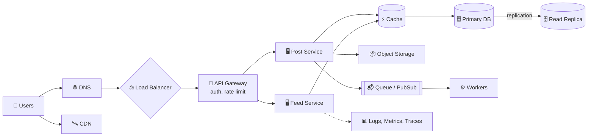

# 02 · 30 Must-Know Concepts

> [!info] Topic info
> **Subject:** System Design · **Priority:** 🔥 High · **Status:** ✅ done · **Last reviewed:** 2026-11-19
>
> [← Back to System Design](README.md) · [← Previous: What is System Design](01-what-is-system-design.md)

> [!abstract] In one line
> A **one-page map** of the 30 ideas that show up in almost every system design interview: each in **2–3 simple lines**, with a link to the full note.

---

## 1. How to use this page

Think of this as the **table of contents for your brain**. Before an interview, read it top to bottom in 10 minutes.
If any line feels fuzzy, click through to the detailed note.

Here is where most of these concepts live in a typical app, like our social media app:

---

## 2. Foundations — the qualities we design for

**1 · Scalability** — Handle more users by adding resources. **Vertical** = bigger machine (simple, has a ceiling). **Horizontal** = more machines (needs stateless servers). → [note](core-concepts/01-scalability.md)

**2 · Availability** — Is the system up and answering? Measured in "nines": 99.99% ≈ 52 min downtime a year. Bought with redundancy and failover. → [note](core-concepts/02-availability.md)

**3 · Reliability & fault tolerance** — Does it give **correct** results even when parts fail? Fast but wrong = available, not reliable. → [note](core-concepts/03-reliability.md)

**4 · Single point of failure (SPOF)** — Any one part whose death takes the whole system down. Fix: have at least two of everything that matters. → [note](core-concepts/04-single-point-of-failure.md)

**5 · Latency & throughput** — Latency = time for one request (ms). Throughput = requests per second. Always talk in **p99**, not averages. → [note](core-concepts/05-latency-throughput-bandwidth.md)

**6 · CAP theorem** — When the network splits, you choose **consistency** (refuse or wait) or **availability** (answer, maybe stale). Bank → C, likes counter → A. → [note](core-concepts/07-cap-theorem.md)

**7 · Consistency models** — **Strong**: every read sees the latest write. **Eventual**: copies catch up in a moment. Middle ground: read-your-writes. → [note](distributed-systems/06-consistency-models.md)

> [!tip] 🎤 Say it like this
> "Before choosing components I pin down the non-functional goals — scale, availability, latency and consistency — because those decide almost every trade-off later."

---

## 3. Traffic & networking — getting requests in

**8 · DNS** — The internet's phone book: `app.com` → IP address. Answers are cached (TTL), so changes take time to spread. → [note](networking/05-dns.md)

**9 · Load balancing** — Spreads traffic across servers and skips dead ones via health checks. Algorithms: round robin, least connections, hashing. → [note](load-balancing/01-load-balancers.md) · [algorithms](load-balancing/02-load-balancing-algorithms.md)

**10 · Reverse proxy & API gateway** — One front door for all backend servers. Handles TLS, auth, rate limits and routing to the right service. → [proxy](networking/06-proxy-vs-reverse-proxy.md) · [gateway](microservices-patterns/02-api-gateway.md)

> [!note]
> A load balancer **spreads** traffic. A gateway **understands** it (who is the user, which service, are they over the limit). Real setups often use both.

---

## 4. Data & storage — where the data lives

**11 · SQL vs NoSQL** — SQL: fixed schema, joins, strong transactions (orders, payments). NoSQL: flexible schema, easy to scale out (feeds, sessions, logs). → [note](databases/02-sql-vs-nosql.md)

**12 · ACID transactions** — A group of writes that all succeed or all fail. Atomic, Consistent, Isolated, Durable — the reason money doesn't vanish. → [note](databases/03-acid-transactions.md)

**13 · Indexing** — A sorted lookup (usually a B-tree) so the DB jumps to rows instead of scanning millions. Faster reads, slightly slower writes. → [note](database-scaling/01-indexing.md)

**14 · Replication** — Copies of the DB on many machines. Writes go to the leader, reads spread to replicas. Catch: **replication lag** gives stale reads. → [note](database-scaling/03-replication.md)

**15 · Sharding & partitioning** — Split one huge table across machines by a key (e.g. `user_id`). Scales writes, but cross-shard queries and hot keys hurt. → [sharding](database-scaling/04-sharding.md) · [partitioning](database-scaling/02-partitioning.md)

**16 · Consistent hashing** — Places keys and servers on a ring, so adding a server moves only ~1/N of the data, not all of it. → [note](core-concepts/06-consistent-hashing.md)

**17 · Object storage** — Cheap, near-infinite storage for big files (photos, videos) like S3. Store the file there, keep only the URL in the DB. → [note](storage-systems/03-object-storage.md)

> [!important] Golden rule
> Replication = **more copies** (reads + availability). Sharding = **split the data** (writes + size). Big systems use both.

---

## 5. Caching & speed — making reads fast

**18 · Caching strategies** — Keep hot data in memory (Redis): ~1 ms vs ~10–50 ms from the DB. Most common: **cache-aside** — check cache, on miss read DB and fill. → [note](caching/02-caching-strategies.md)

**19 · Cache invalidation & eviction** — Invalidation = removing stale data when the source changes (TTL or delete on write). Eviction = what to drop when full (LRU). → [invalidation](caching/04-cache-invalidation.md) · [eviction](caching/03-cache-eviction-policies.md)

**20 · CDN** — Servers around the world that serve static files (images, JS) from near the user. Cuts latency from ~200 ms to ~20 ms. → [note](caching/05-cdn.md)

> [!warning]
> Caching adds a second copy of the truth. Always say how you keep it fresh — and what happens if the cache dies (all traffic hits the DB at once).

---

## 6. Communication — how services talk

**21 · Message queues** — Producer drops a job, a worker picks it up later. Keeps the API fast and absorbs spikes (e.g. resize uploaded photos). → [note](communication-patterns/06-message-queues.md)

**22 · Pub/sub & event-driven** — One event ("post created") goes to **many** subscribers — feed, notifications, search — without the poster knowing them. → [pub/sub](communication-patterns/07-pub-sub.md) · [event-driven](architectural-patterns/05-event-driven.md)

**23 · Real-time updates** — For chat and live feeds: **WebSockets** (two-way, always open), SSE (server → client), or long polling as a fallback. → [websockets](communication-patterns/03-websockets.md) · [long polling](communication-patterns/01-long-polling.md)

**24 · Rate limiting** — Cap requests per user (e.g. 100/min) to stop abuse and protect servers. Common algorithm: **token bucket**. Returns HTTP 429. → [note](api-fundamentals/08-rate-limiting.md)

**25 · Idempotency** — Doing the same request twice has the same effect as once. Use an **idempotency key** so a retried payment isn't charged twice. → [note](api-fundamentals/03-idempotency.md)

> [!example] Sync vs async
> **Sync** (REST call): the user waits for the answer — use it when they need the result now.
> **Async** (queue): "we'll handle it" — use it for emails, video encoding, fan-out.

---

## 7. Reliability & operations — keeping it alive

**26 · Monolith vs microservices** — Monolith: one app, simple to build and deploy — the right start. Microservices: independent services that scale and deploy alone, but add network and ops pain. → [monolith](architectural-patterns/02-monolith.md) · [microservices](architectural-patterns/03-microservices.md)

**27 · Circuit breaker** — If a service keeps failing, stop calling it for a while and fail fast. Stops one slow service from dragging everything down. → [note](microservices-patterns/05-circuit-breaker.md)

**28 · Consensus & leader election** — How many nodes agree on one value or one leader, even if some crash. Raft and Paxos; needs a **majority** (3 of 5). → [consensus](distributed-systems/11-consensus.md) · [leader election](distributed-systems/14-leader-election.md)

**29 · Saga (distributed transactions)** — A transaction across services as a chain of local steps. If one fails, run **compensating** steps (refund, release stock). → [note](distributed-transactions/04-saga-pattern.md)

**30 · Observability** — Logs (what happened), metrics (how much, how fast), traces (where time went across services). You can't fix what you can't see. → [note](observability/01-three-pillars.md)

> [!failure] Mistakes to avoid
> - ❌ Starting with microservices for a small app — start with a monolith
> - ❌ Retrying without idempotency — duplicate orders and payments
> - ❌ Ending the design without saying how you'd **monitor** it

---

## 8. Using these in an interview

> [!tip] 🎤 How to use this in an interview
> 1. **Clarify requirements** — features, users, read vs write heavy, consistency needs.
> 2. **Estimate** — requests/sec, storage, bandwidth (1M/day ≈ 12 req/s).
> 3. **High-level design** — draw the diagram above: LB → services → cache → DB → queue.
> 4. **APIs & data model** — key endpoints, SQL vs NoSQL, shard key.
> 5. **Deep dive** — pick the hard part: caching, sharding, real-time, consistency.
> 6. **Bottlenecks & trade-offs** — SPOFs, failures, monitoring, "the trade-off is…".

The full framework with timings is in [01 · What is System Design](01-what-is-system-design.md).

---

## Summary

| Group | Concepts |
|---|---|
| **Foundations** | Scalability, availability, reliability, SPOF, latency, CAP, consistency |
| **Traffic** | DNS, load balancing, reverse proxy / API gateway |
| **Data** | SQL vs NoSQL, ACID, indexing, replication, sharding, consistent hashing, object storage |
| **Caching** | Caching strategies, invalidation & eviction, CDN |
| **Communication** | Queues, pub/sub, real-time, rate limiting, idempotency |
| **Operations** | Monolith vs microservices, circuit breaker, consensus, saga, observability |

> [!success] Key takeaway
> You don't need every detail — you need to know **which tool fixes which problem** and **what it costs**. Master these 30 and you can reason through almost any design question.
