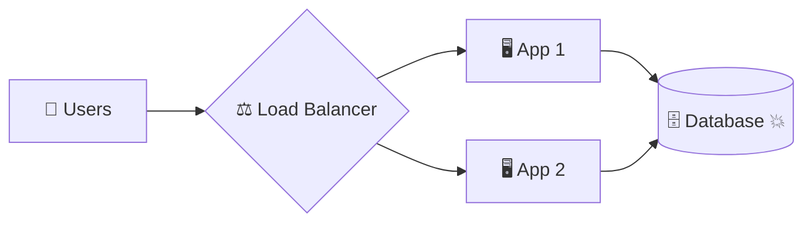
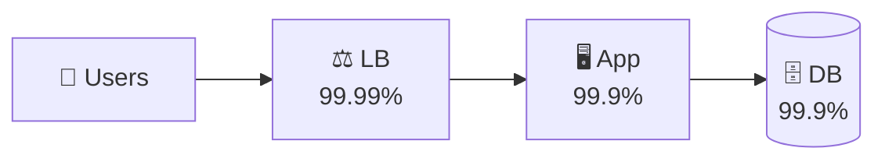
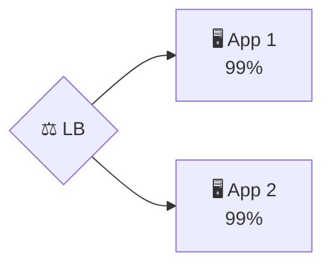
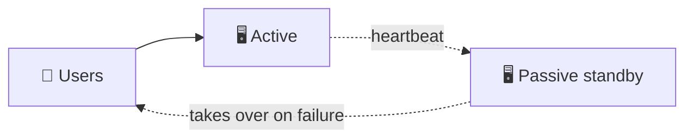
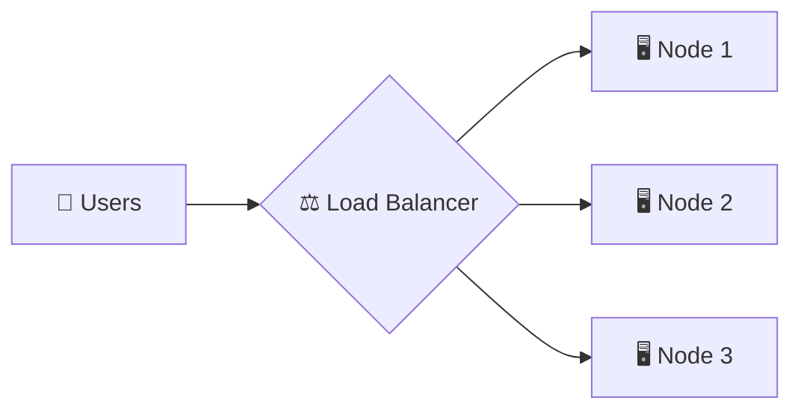
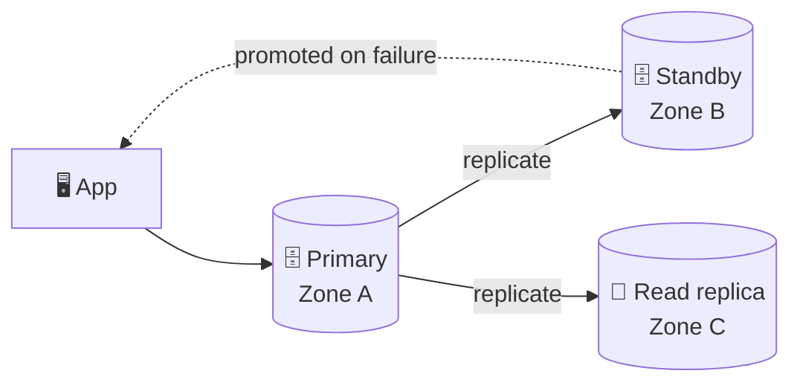
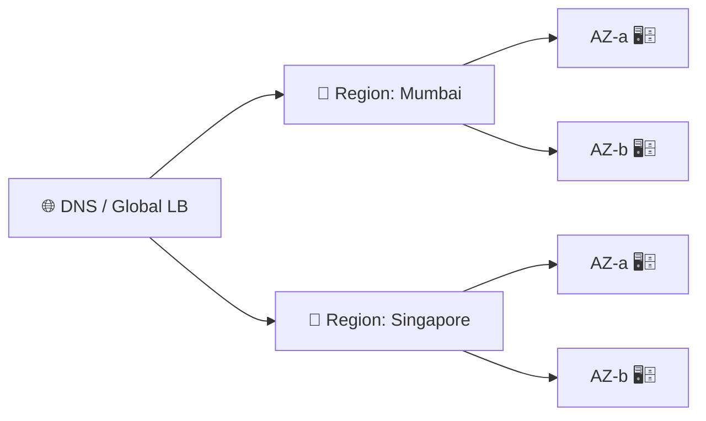
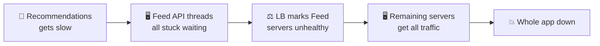
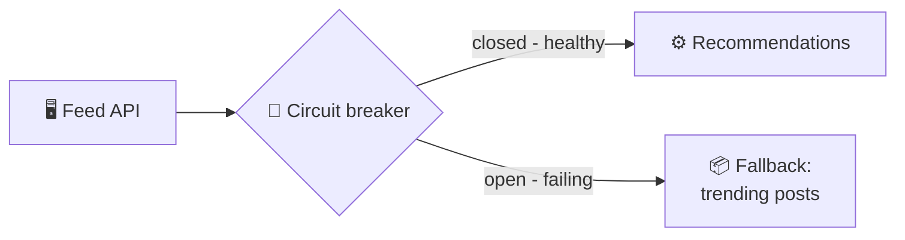

# 03 · Availability

> [!info] Topic info
> **Subject:** System Design · **Priority:** 🔥 High · **Status:** ✅ done · **Last reviewed:** 2026-11-18
>
> [← Back to System Design](README.md) · [Interview questions →](questions/03-availability-qa.md)

> [!abstract] In one line
> **Availability** is the percentage of time a system is **up and answering requests** — and we get it by removing **single points of failure** with **redundancy**, **fast failover**, and **graceful degradation**.

---

## 1. The problem

Our social media app from the [Scalability](02-scalability.md) note now handles **500,000 users**. It's fast. Then one night at 2 AM, the **database server's disk dies**.



We have 2 app servers, a load balancer, a cache — but **only one database**. The whole app shows errors for **3 hours** until someone wakes up and restores a backup.

Users can't post, can't log in, and start tweeting "is the app down?". The system was **scalable**, but it was not **available**.

> [!tip] 🎤 Say it like this
> "Availability is how much of the time the system is up and serving requests. Scalability is about handling more load; availability is about surviving failures. A system can be fast and still go down because one machine dies."

---

## 2. What availability means

The simple formula:

```
Availability = uptime / (uptime + downtime)
```

We measure it in **"nines"**:

| Availability | Downtime per year | Per month | Per day |
|---|---|---|---|
| **99%** (two nines) | ~3.65 days | ~7.3 hours | ~14 min |
| **99.9%** (three nines) | ~8.76 hours | ~43.8 min | ~1.4 min |
| **99.99%** (four nines) | ~52.6 min | ~4.4 min | ~8.6 s |
| **99.999%** (five nines) | ~5.3 min | ~26 s | ~0.9 s |

Every extra nine = **10x less downtime**, and usually a lot more cost and effort.

> [!note] "Up" means "useful", not "server is on"
> If the homepage loads but login is broken, users think the app is down. Measure from the **user's view**: the % of requests that succeed.
>
> `Availability = successful requests / total requests`
>
> 1M requests, 500 failed → **99.95%**.

> [!example] Availability vs reliability vs durability
> - **Available** = it answers.
> - **Reliable** = it answers **correctly**, even when parts fail.
> - **Durable** = data you saved is **never lost**.
>
> A system can be available but not durable — it's up, but yesterday's posts are gone.

---

## 3. SLI, SLO, SLA and error budgets

Interviewers love these terms. They sound similar, so keep them straight:

| Term | Meaning | Example |
|---|---|---|
| **SLI** — Service Level *Indicator* | The **metric** you measure | % of requests that return 2xx in < 500 ms |
| **SLO** — Service Level *Objective* | The internal **target** | SLI ≥ 99.9% over 30 days |
| **SLA** — Service Level *Agreement* | The **contract** with customers, with a penalty | 99.5% or we refund 10% of the bill |

The SLA is always **looser** than the SLO. That gap gives you a warning before you owe money.

### Error budget

If the SLO is 99.9%, you're **allowed** to fail 0.1% of the time. Over 30 days, that's **~43 minutes** of downtime. That's your **error budget**.

- Budget left? Ship features, take risks, deploy often.
- Budget used up? **Freeze risky releases**, focus on stability.

> [!tip] 🎤 Say it like this
> "The SLI is what I measure, the SLO is my target, and the SLA is the promise to customers with a penalty. With a 99.9% SLO I have about 43 minutes of error budget a month — if we burn it, we slow down releases and fix reliability."

> [!warning] 100% is the wrong target
> Users can't tell 99.999% from 100% — their own Wi-Fi and phone fail more often than that. Chasing 100% costs a fortune and stops you shipping anything.

---

## 4. MTBF and MTTR — two ways to improve

Two numbers describe how often you break and how fast you recover:

- **MTBF** — *Mean Time Between Failures*: how long it runs before something breaks.
- **MTTR** — *Mean Time To Recovery*: how long it takes to fix it.

```
Availability = MTBF / (MTBF + MTTR)
```

Worked example — the app fails **once a month** (~720 hours):

| MTTR | Availability |
|---|---|
| 3 hours (manual restore at 2 AM) | 99.58% |
| 1 hour | 99.86% |
| 5 minutes (automatic failover) | **99.99%** |

Same number of failures, **way** better availability — just by recovering faster.

> [!success] In real life, focus on MTTR
> Failures **will** happen: disks die, deploys go wrong, regions go down. You can't stop all of them, but you can make recovery **automatic and fast**.

---

## 5. Availability math — series vs parallel

Your system is a chain of parts. How they're connected changes the total.

### In series — all must work

A request goes LB → App → DB. If **any one** fails, the request fails. **Multiply** the availabilities:



`0.9999 × 0.999 × 0.999 ≈ 99.79%` — **lower than every single part.**

> [!warning] More dependencies = less availability
> Each new dependency in the request path drags the total down. 10 services at 99.9% each, in a chain = only **~99%**.

### In parallel — only one needs to work

Two copies of the same thing; the system fails only if **both** fail at once:



`1 − (0.01 × 0.01) = 99.99%` — two **cheap 99%** servers give you **four nines**.

> [!tip] 🎤 Say it like this
> "Components in series multiply, so every extra dependency lowers availability. Components in parallel multiply their *failure* chances, so two 99% servers together give 99.99%. That's why redundancy is the main tool for availability."

> [!note] The math assumes failures are independent
> Two servers in the **same rack**, on the same power supply, can die together. Real redundancy means spreading copies across racks, zones, or regions.

---

## 6. Find the single points of failure

A **single point of failure (SPOF)** is any part that takes down the whole system when it dies.

Walk through the request path and ask *"what if this dies?"* for every box:

| Component | SPOF? | Fix |
|---|---|---|
| App servers (2) | ✅ No | Already redundant |
| Load balancer (1) | ❌ Yes | Run a pair, or use a managed LB |
| Database (1) | ❌ Yes | Primary + standby with failover |
| Redis cache (1) | ⚠️ Partly | Replica + Sentinel, or fall back to DB |
| One data center | ❌ Yes | Spread across availability zones |
| DNS provider | ❌ Yes | Managed DNS with high SLA, or two providers |

> [!important] Golden rule
> **Anything you have only one of will eventually take you down.** Find it before it finds you.

Don't forget the "invisible" SPOFs: one person who knows how to deploy, one SSL certificate that expires, one config file everyone shares.

---

## 7. Redundancy — active-passive vs active-active

**Redundancy** = keeping extra copies so one can take over. There are two styles.

### Active-passive (standby)

One copy serves traffic. A **standby** waits and takes over when the active one fails.



- **Hot standby** — running and in sync, takes over in **seconds**
- **Warm standby** — running but needs some catch-up, **minutes**
- **Cold standby** — must be started from scratch, **hours**

### Active-active

**All** copies serve traffic at the same time. If one dies, the others just take its share.



| | Active-passive | Active-active |
|---|---|---|
| **Uses capacity** | Standby sits idle | All nodes do work |
| **Failover time** | Seconds–minutes | Near zero |
| **Complexity** | Lower | Higher — writes must sync between nodes |
| **Good for** | Databases (one writer) | Stateless app servers, caches, reads |

> [!warning] Leave headroom
> With 3 active nodes each at 80% CPU, losing one puts **120%** load on the other two — and they fall over too. That's a **cascading failure** (more in section 11). Plan for **N+1**: enough capacity to survive losing one node.

---

## 8. Health checks and failover

Redundancy only helps if the system **notices** a failure and **switches** automatically.

**Health checks** — the load balancer calls `/health` on each server every few seconds. After e.g. **3 failures in a row**, it stops sending traffic there.

- **Liveness** — "is the process alive?" → if not, restart it.
- **Readiness** — "can it serve traffic right now?" (DB connected, warm-up done) → if not, take it out of the LB.

**Heartbeats** — in active-passive, the standby listens for a "I'm alive" ping from the primary. Pings stop → standby promotes itself.

> [!warning] Split brain
> The network between primary and standby breaks, but **both** are actually alive. The standby thinks the primary is dead and promotes itself. Now **two primaries** accept writes, and data diverges. 😱
>
> **Fixes:** use a **quorum** (majority vote of 3+ nodes) to decide who's leader, and **fence** the old primary (cut it off) before promoting the new one.

> [!tip] 🎤 Say it like this
> "Redundancy is useless without detection and failover. The load balancer health-checks every server and removes bad ones in seconds. For databases I use automatic failover with a quorum, so we never end up with two primaries — the split-brain problem."

---

## 9. Making the database available

The database is usually the hardest part — it has **state**. Our 2 AM disaster fix:



### Sync vs async replication

| | Synchronous | Asynchronous |
|---|---|---|
| **How** | Primary waits for standby to confirm each write | Primary confirms first, copies later |
| **Data loss on failover** | None | Last few seconds of writes |
| **Write latency** | Higher | Lower |
| **If standby is down** | Writes may block | Writes continue |

A common middle ground: **semi-sync** — wait for **at least one** replica, not all.

### RPO and RTO

Two numbers you'll be asked about for disaster recovery:

- **RPO** — *Recovery Point Objective*: how much **data** can we afford to lose? (e.g. 5 seconds of writes)
- **RTO** — *Recovery Time Objective*: how long can we be **down**? (e.g. 1 minute)

> [!example] Quick cheat sheet
> | Setup | RPO | RTO |
> |---|---|---|
> | Nightly backups only | up to 24 h | hours |
> | Async standby + auto failover | seconds | ~1 min |
> | Sync standby + auto failover | 0 | ~30 s |
> | Multi-region active-active | ~0 | ~0 |
>
> Lower RPO/RTO = more cost. Payments need RPO = 0; a "likes" counter doesn't.

> [!note] Backups are still needed
> Replication copies **mistakes** too. If someone runs `DELETE FROM posts`, it's deleted on every replica in milliseconds. Keep backups — and **test restoring** them.

---

## 10. Zones and regions

A whole data center can fail: power cut, fire, network outage. Cloud providers split infrastructure into:

- **Availability Zone (AZ)** — a separate data center in the same city, with its own power and network. ~1–2 ms apart.
- **Region** — a different geographic area (Mumbai, Frankfurt, Virginia). 50–200 ms apart.



| Setup | Survives | Cost / complexity |
|---|---|---|
| **Single AZ** | A server dying | Low |
| **Multi-AZ** | A data center dying | Medium — the standard for production |
| **Multi-region** | A whole region dying | High — data sync across 100+ ms is hard |

> [!success] In real life
> **Multi-AZ** is the sweet spot for most apps — cheap and covers most outages. Go **multi-region** only when the business needs it (global users, strict SLAs, regulations).

---

## 11. Cascading failures — when one failure spreads

Redundancy protects us when **one** part dies. But the scariest outages start small and **spread**: one part fails, its load or slowness gets pushed onto the next part, which fails too. Like dominoes.



A **cascading failure** = a failure that grows by feeding on itself. The first problem is often tiny; the **reaction** of the rest of the system is what kills you.

> [!tip] 🎤 Say it like this
> "A cascading failure is when one small failure spreads — a slow service ties up threads in its callers, retries multiply the load, overloaded servers crash and push traffic to the next ones. Redundancy alone doesn't stop it; you need timeouts, load shedding, and limits on retries."

### How failures spread

**1. Overload moves to the survivors**

3 servers at 80% CPU. One dies → the other two get **120%** each → they crash → the last one gets everything. The same happens between **regions**: one region fails over to another that's too small for double traffic.

**2. A slow dependency exhausts resources**

Slow is **worse than dead**. A dead service fails fast; a slow one holds your threads and connections.

- Feed API has **200 threads**. Normal call = 50 ms → it can handle **~4,000 req/s**.
- Recommendations slows to **5 s** → the same 200 threads handle only **~40 req/s**.
- Requests queue up, memory grows, health checks time out → the Feed API dies **even though it has no bug**.

**3. Retry storms**

Every layer retries "to be safe". The browser retries 3x, the API retries 3x, the service retries 3x → one user click becomes **27 calls** to an already struggling database.

**4. Cache stampede (thundering herd)**

Redis restarts and comes back **empty**. Or a hot key (the homepage feed) expires. Suddenly **every** request misses the cache and hits the database at once. The DB was sized for 20% of traffic and now gets 100% → it falls over.

**5. Death spiral on recovery**

A crashed server restarts and the load balancer sends it **full traffic immediately**. Its cache is cold, connections aren't warmed up → it crashes again. Servers keep flapping up and down and the system never recovers.

**6. Shared dependency fails**

Everything quietly depends on one thing: auth service, config service, DNS, a logging agent that fills the disk. When it fails, **all** services fail together — your redundancy didn't help because every copy had the same dependency.

### How to stop the spread

| Cause | Fix |
|---|---|
| **Overload moves to survivors** | N+1 headroom (keep nodes under ~60–70%), auto-scaling, **load shedding** — reject extra requests fast with 503 |
| **Slow dependency** | **Timeouts**, **circuit breakers**, **bulkheads** (separate pools per dependency) |
| **Retry storms** | Retry at **one layer only**, exponential backoff + jitter, a **retry budget** (e.g. retries ≤ 10% of traffic) |
| **Cache stampede** | **Request coalescing** (only one request rebuilds a key, others wait), random **TTL jitter** so keys don't expire together, **cache warming** before traffic |
| **Death spiral** | **Slow start** — LB ramps traffic to a new server gradually; queue limits; restart in batches |
| **Shared dependency** | Find it, make it redundant, **cache** its answers (e.g. config, auth tokens) so you survive it being down for a while |

> [!warning] Health checks can make it worse
> If `/health` checks the database, a slow DB makes **every** app server "unhealthy" at once, and the LB removes them all — total outage. Keep **liveness** checks shallow (is the process OK?), and don't let one shared dependency fail every health check.

> [!important] Golden rule
> **Fail fast, and protect yourself under load.** A system that rejects 10% of requests quickly stays up. A system that tries to serve 100% slowly goes down for everyone.

---

## 12. Graceful degradation — fail small, not big

Not every failure needs a backup server. Sometimes the best move is to **keep the core working** and turn off the extras.

Back to our slow **recommendations service** from section 11. Without protection, every feed request waits 30 s, threads pile up, and the **whole app** goes down because of one non-critical feature.

Tools to stop this:

| Pattern | What it does |
|---|---|
| **Timeouts** | Never wait forever — give up after e.g. 300 ms |
| **Retries with backoff + jitter** | Retry a few times, waiting longer each time (100 ms, 200 ms, 400 ms) with randomness so clients don't retry together |
| **Circuit breaker** | After many failures, stop calling the service for a while and fail fast |
| **Fallback** | Return something useful instead — cached feed, "trending posts", default value |
| **Bulkhead** | Separate thread/connection pools per dependency, so one slow service can't use them all |
| **Rate limiting / load shedding** | When overloaded, reject some requests fast (HTTP 429/503) instead of everyone timing out |



> [!warning] Retries can make it worse
> If 10,000 clients retry instantly 3 times, a struggling service suddenly gets **40,000** requests. That's a **retry storm**. Always use backoff, jitter, and a retry limit — and only retry **idempotent** operations (safe to repeat).

> [!tip] 🎤 Say it like this
> "I separate critical from non-critical features. If recommendations fail, users still see a feed — just a simpler one. I use timeouts, circuit breakers and fallbacks so one slow dependency can't take down the whole app."

---

## 13. Safe deployments

Most outages aren't caused by hardware — they're caused by **our own changes**: bad code, bad config, bad migrations.

| Strategy | How it works | Rollback |
|---|---|---|
| **Rolling** | Update servers a few at a time | Medium — roll forward/back gradually |
| **Blue-green** | Run new version (green) next to old (blue), switch traffic at once | Instant — switch back to blue |
| **Canary** | Send 1–5% of traffic to the new version, watch metrics, then expand | Fast — only a few users affected |
| **Feature flags** | Ship code turned off, enable for some users | Instant — flip the flag |

> [!failure] Mistakes to avoid
> - Deploying to **all** servers at once
> - Database migrations that **break the old code** (do expand → migrate → contract instead)
> - No automatic rollback when error rate jumps
> - Deploying on Friday evening 🙃

---

## 14. Monitoring and incident response

You can't fix what you don't see. Good monitoring cuts **MTTR** more than anything else.

- **Metrics** — error rate, latency (p99), traffic, saturation (CPU, memory). These four are the **golden signals**.
- **Logs** and **traces** — to find *why* it broke.
- **Alerts** — on **user-facing symptoms** (error rate > 1%), not every CPU spike.
- **Synthetic checks** — a bot that logs in and posts every minute from outside, like a real user.

When something breaks: **mitigate first** (roll back, fail over), **debug later**. Then write a **blameless post-mortem** — what happened, why, and how to stop it happening again.

> [!example] Chaos engineering
> Netflix's **Chaos Monkey** randomly kills production servers on purpose. If your system can't survive a planned failure on Tuesday afternoon, it won't survive a real one at 2 AM.

---

## 15. The trade-offs

Availability is never free.

- **Cost** — every extra nine roughly needs double the infrastructure and much more engineering.
- **Complexity** — more moving parts, more ways to fail.
- **Consistency** — during a network split, you must choose: stay **available** (maybe show stale data) or stay **consistent** (refuse some requests). This is the **CAP theorem**.

> [!example] Pick per feature, not per app
> - 💬 Likes, feed, view counts → **availability** — slightly stale is fine.
> - 💰 Payments, wallet balance → **consistency** — better to say "try again" than to double-charge.

> [!question] Questions to ask the interviewer
> - What availability target do we need — 99.9% or 99.99%?
> - Which features are critical and which can degrade?
> - How much data loss is acceptable (RPO)? How long can we be down (RTO)?
> - Are users global? Do we need multi-region?

---

## Summary

| Step | Fixes this problem |
|---|---|
| 1️⃣ Define SLI / SLO / error budget | No clear target for "up" |
| 2️⃣ Find SPOFs | One box can take everything down |
| 3️⃣ Redundancy (N+1, active-active) | A server dying = outage |
| 4️⃣ Health checks + auto failover | Slow, manual recovery (high MTTR) |
| 5️⃣ DB standby + backups (RPO/RTO) | Losing the database or its data |
| 6️⃣ Multi-AZ / multi-region | A whole data center or region failing |
| 7️⃣ Load shedding, retry budgets, slow start | Cascading failures — one failure spreading |
| 8️⃣ Timeouts, circuit breakers, fallbacks | One slow dependency taking down the app |
| 9️⃣ Canary / blue-green deploys | Our own changes breaking prod |
| 🔟 Monitoring + alerts + chaos testing | Not noticing, or noticing too late |

> [!success] Key takeaway
> **Assume everything fails.** Remove single points of failure, detect problems fast, recover automatically, stop failures from spreading, and degrade gracefully.
> Pick the number of nines the business actually needs — every extra nine costs much more.

---

## References

- [AlgoMaster — Availability](https://algomaster.io/learn/system-design/availability)
- [System Design Primer — Availability](https://github.com/donnemartin/system-design-primer#availability-vs-consistency)
- [Google SRE Book — Service Level Objectives](https://sre.google/sre-book/service-level-objectives/)
- *Designing Data-Intensive Applications* — Ch. 1, 5, 8
- *Release It!* — Michael Nygard (stability patterns: circuit breaker, bulkhead)
- [Google SRE Book — Addressing Cascading Failures](https://sre.google/sre-book/addressing-cascading-failures/)
