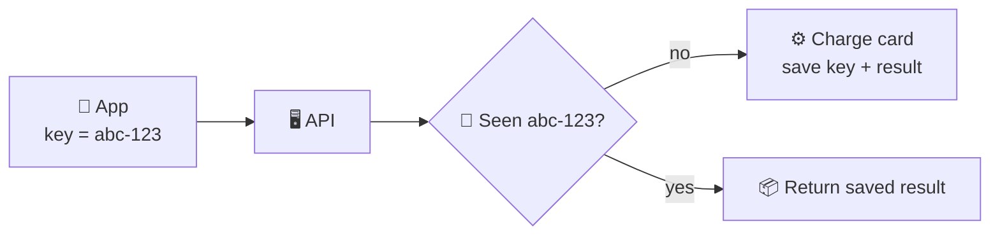
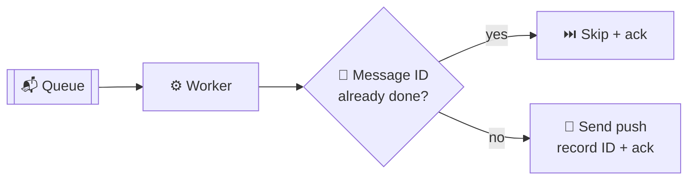
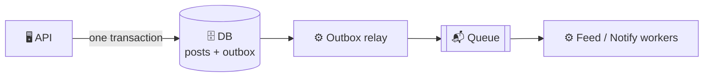
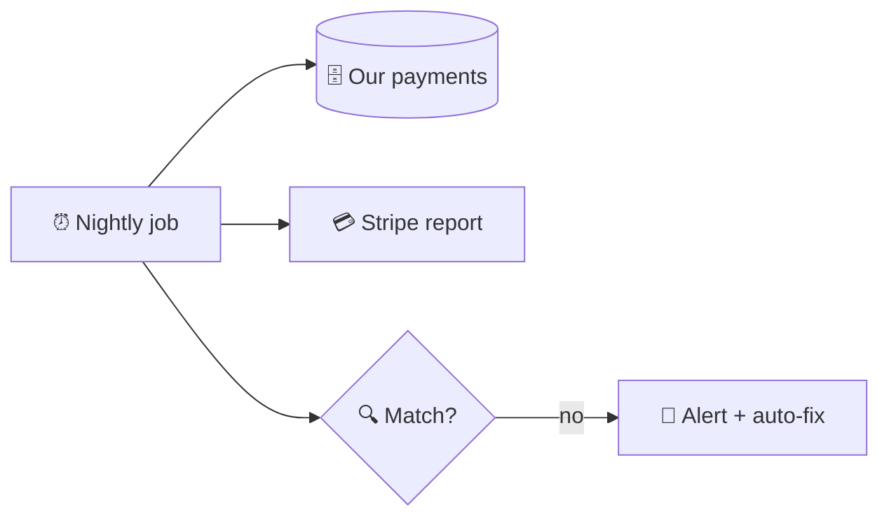

# 04 · Reliability

> [!info] Topic info
> **Subject:** System Design · **Priority:** 🔥 High · **Status:** ✅ done · **Last reviewed:** 2026-11-18
>
> [← Back to System Design](README.md) · [Interview questions →](questions/04-reliability-qa.md)

> [!abstract] In one line
> **Reliability** means the system keeps doing the **right thing** — correct results, no lost or duplicated data — **even when parts fail**. We get it with **fault tolerance**, **idempotent retries**, **safe data handling**, and **guardrails against human mistakes**.

---

## 1. The problem

Our social media app from the [Availability](03-availability.md) note is now **99.99% available**. Multi-AZ, auto failover, circuit breakers. The dashboard is all green. ✅

But the support inbox tells a different story:

- 📝 "I clicked **Post** once and my post appeared **three times**."
- 💳 "I was **charged twice** for Premium."
- 🔔 "I got the same notification **5 times**."
- 📷 "My photo from last week is **gone**."
- ❤️ "My post shows 120 likes, but the list has only 80 people."

The app is **up**. It answers fast. But it gives **wrong** answers. Users don't trust it anymore.

> [!tip] 🎤 Say it like this
> "Availability is whether the system answers. Reliability is whether it answers correctly and keeps data safe, even when servers, networks, or people make mistakes. A system can be 99.99% up and still be unreliable if it loses or duplicates data."

---

## 2. What reliability means

A reliable system:

- Does what the user expects — **correct results**.
- Doesn't **lose** data and doesn't **duplicate** it.
- Keeps working correctly when **things go wrong** — hardware, bugs, bad input, human mistakes.

### Fault vs failure

These two words are the core of the topic:

- **Fault** — one **part** goes wrong: a disk dies, a request times out, a bug throws an error.
- **Failure** — the **whole system** stops giving the user the right result.

Reliability is about **stopping faults from turning into failures**. That's called **fault tolerance**.

> [!example] Car analogy
> A flat tyre is a **fault**. Being stuck on the highway is a **failure**. A spare tyre is **fault tolerance** — the fault still happens, but you still get home.

### Reliability vs availability

| | Availability | Reliability |
|---|---|---|
| **Question** | Is it up and answering? | Is the answer correct, and is data safe? |
| **Measured by** | % uptime, % successful requests | Correct results, data loss, MTBF |
| **Bad example** | Site shows 503 errors | Site is up but double-charges users |
| **Main tools** | Redundancy, failover | Idempotency, transactions, validation, backups |

> [!note] They overlap
> A **reliable** system is usually also available — but not always the other way round. You can return stale or wrong data very quickly and look "available".

---

## 3. Three kinds of faults

Everything that breaks falls into one of three groups.

### 🔧 Hardware faults

Disks die, RAM gets corrupted, power cuts, network cables get unplugged.

- A hard disk fails roughly **once every 10–50 years**. Sounds rare.
- But with **10,000 disks**, that's about **one dead disk per day**.

At scale, hardware failure is **normal**, not an exception. Fix: redundancy (RAID, replicas, multi-AZ) — see [Availability](03-availability.md).

### 🐛 Software faults

Bugs, memory leaks, a runaway process eating all CPU, a dependency returning garbage, a leap-second or date bug.

These are **worse** than hardware faults because they're **correlated** — the same bug runs on **every** server at once. Redundancy doesn't help when all 10 copies have the same bug.

### 🙋 Human errors

Wrong config pushed, wrong database dropped, wrong command run in prod.

Studies of large services show **config and human mistakes cause more outages than hardware**. Humans aren't careless — the system just made the mistake easy.

> [!tip] 🎤 Say it like this
> "Faults come from hardware, software, and humans. Hardware faults are random and independent, so redundancy handles them. Software bugs are correlated — they hit every server at once — so I need testing, canary deploys, and fast rollback. Human errors cause most outages, so I design guardrails that make the wrong thing hard to do."

---

## 4. Retries are needed — and dangerous

Networks are unreliable. A request can fail in three ways:

1. It never reached the server.
2. The server did the work but **crashed** before replying.
3. The server did the work, but the **reply got lost**.

From the client's side, all three look **the same**: a timeout. So the client retries. In cases 2 and 3, the work happens **twice**.

```mermaid
flowchart LR
    U[📱 App] -- 1. POST /posts --> API[🖥️ API]
    API -- 2. saved --> DB[(🗄️ DB)]
    API -. 3. reply lost .-> U
    U -- 4. retry POST /posts --> API
    API -- 5. saved again --> DB
```

That's exactly our **"post appeared three times"** bug — and the **double charge**.

> [!important] Golden rule
> A timeout means **"I don't know"**, not **"it failed"**. Any operation that might be retried must be **safe to repeat**.

---

## 5. Idempotency — making retries safe

An operation is **idempotent** if doing it **once or many times** gives the **same result**.

| Operation | Idempotent? | Why |
|---|---|---|
| `GET /posts/42` | ✅ Yes | Just reads |
| `PUT /users/7 {name: "Bharat"}` | ✅ Yes | Sets the same value each time |
| `DELETE /posts/42` | ✅ Yes | Already deleted = still deleted |
| `POST /posts` | ❌ No | Creates a new post each time |
| `POST /payments` | ❌ No | Charges again each time |
| `likes = likes + 1` | ❌ No | Adds 1 each time |

### Idempotency keys

For non-idempotent actions, the client sends a **unique ID** with the request. The server remembers which IDs it already handled.



1. The app creates a key (a UUID) **once**, when the user taps **Pay**.
2. Every retry sends the **same** key.
3. The server stores `key → result` (e.g. in the DB with a **unique constraint**, kept for 24 h).
4. Second time it sees the key, it just returns the stored result — no second charge.

This is how **Stripe** and most payment APIs work.

> [!tip] 🎤 Say it like this
> "Because a timeout doesn't tell me if the request succeeded, retries can create duplicates. So I make writes idempotent — the client sends an idempotency key, the server stores it with a unique constraint, and a repeat request just returns the first result. Retries become safe."

> [!warning] Make it idempotent by design, too
> - Use `likes` as a **set of user IDs** (`INSERT … ON CONFLICT DO NOTHING`), not `likes = likes + 1`. That also fixes our "120 likes but only 80 people" bug.
> - Prefer "set status to `PAID`" over "add ₹500".

---

## 6. Messages and queues — delivery guarantees

Our app uses a queue to send notifications. The worker reads a message, sends a push, and then **acknowledges** (acks) it. What if the worker crashes in between?

| Guarantee | How | Risk |
|---|---|---|
| **At-most-once** | Ack **before** processing | Crash = message **lost** 📭 |
| **At-least-once** | Ack **after** processing | Crash = message **processed again** 🔁 |
| **Exactly-once** | At-least-once + **dedupe** | More work, but no loss and no duplicates |

Most real systems (Kafka, SQS, RabbitMQ) give you **at-least-once**. "Exactly-once" in practice means **at-least-once delivery + idempotent processing**.



That fixes our **"same notification 5 times"** bug.

> [!tip] 🎤 Say it like this
> "Queues usually give at-least-once delivery, so duplicates will happen. I don't fight that — I make consumers idempotent by storing processed message IDs. At-least-once plus dedupe is effectively exactly-once."

> [!failure] Mistake to avoid
> Choosing at-most-once "to avoid duplicates". You don't get duplicates — you **lose** messages instead, silently. For anything important, losing is worse.

---

## 7. The dual-write problem — outbox pattern

When a user posts, we must do **two** things: save the post in the DB **and** publish a `PostCreated` event (for feeds, notifications, search).

```
save post to DB      ✅
publish to queue     💥 server crashes here
```

Now the post exists, but nobody's feed shows it. Doing it in the other order is just as bad: the event exists, but the post doesn't. Two systems can't be updated **atomically** (all-or-nothing) without help.

### Fix: transactional outbox

Write the event into an **`outbox` table** in the **same DB transaction** as the post. A separate relay process reads the outbox and publishes to the queue.



- Post and event are saved **together or not at all**.
- The relay may publish twice (at-least-once) → consumers are idempotent (section 6). ✅

> [!note] Change Data Capture (CDC)
> Instead of polling the outbox table, tools like **Debezium** read the DB's change log and stream changes to Kafka. Same idea, less load on the DB.

> [!tip] 🎤 Say it like this
> "Writing to the database and a queue separately can leave them out of sync if we crash in between. I use the outbox pattern — the event goes into an outbox table in the same transaction, and a relay publishes it. Combined with idempotent consumers, nothing is lost or doubled."

---

## 8. Keeping data correct

Bugs and bad input can write **wrong** data that looks perfectly fine. Defend at every layer.

**Transactions (ACID)** — group steps so they all succeed or all roll back. "Debit wallet + create order" must never half-happen.

**Constraints in the database** — the last line of defence, even if the app has a bug:
- `UNIQUE` (one like per user per post, one row per idempotency key)
- `NOT NULL`, `FOREIGN KEY`, `CHECK (balance >= 0)`

**Validation at the edges** — reject bad input early: wrong types, huge payloads, negative amounts.

**Checksums** — a small fingerprint of the data. Storage systems (S3, HDFS, Kafka) use them to catch **silent corruption** ("bit rot") from bad disks or network.

**Optimistic locking** — avoid two users overwriting each other: `UPDATE … SET …, version = 6 WHERE id = 7 AND version = 5`. If 0 rows change, someone else won — reload and retry.

> [!example] Defence in depth
> Validation in the API **and** a `CHECK (balance >= 0)` in the DB. If a new bug skips the API check, the DB still refuses to let a balance go negative.

---

## 9. Durability — never lose saved data

**Durability** = once we say "saved", it stays saved — through crashes, disk failures, and mistakes. That fixes our **"my photo is gone"** bug.

| Layer | What it protects against |
|---|---|
| **Write-ahead log (WAL)** | Server crash — the DB replays the log on restart |
| **Replication** (sync / semi-sync) | One disk or machine dying |
| **Object storage** (S3: "11 nines" durability) | Photos/videos — copies across many devices and zones |
| **Backups** | Bugs and humans: `DELETE FROM posts`, ransomware, bad migration |
| **Point-in-time recovery** | Restore the DB to "2:14 PM, just before the bad deploy" |

> [!important] The 3-2-1 backup rule
> **3** copies of data, on **2** different types of storage, with **1** copy off-site (different region or account).

> [!warning] Replication is not a backup
> Replicas copy **mistakes** instantly. A bad `DELETE` is gone on every replica in milliseconds. And a backup you've **never restored** is just a hope — test restores regularly and time them.

> [!tip] 🎤 Say it like this
> "For durability I rely on the database's write-ahead log, replication across zones, and object storage for media. But replication copies mistakes too, so I also keep point-in-time backups in another region — and we regularly test restoring them."

---

## 10. Software faults — catch bugs before users do

Bugs are correlated, so they're the scariest faults. Layers of defence:

- **Testing** — unit, integration, and end-to-end tests in CI. Test the **failure paths** too: timeouts, retries, crashes mid-way.
- **Canary deploys** — release to 1–5% first, compare error rates, **auto-rollback** if worse. (More in [Availability](03-availability.md), section 13.)
- **Feature flags** — turn off a broken feature in seconds without a redeploy.
- **Timeouts and limits everywhere** — no request, query, or loop runs forever.
- **Process supervision** — crashed process? Kubernetes / systemd restarts it automatically.

> [!warning] Gray failures
> The sneakiest kind: the server is "healthy" (passes health checks) but returns **wrong or partial** results — e.g. a cache node serving stale data, or a service returning empty lists after a bad config. Health checks say ✅, users see ❌. Catch these with **correctness checks**, not just "is it up?" checks (section 12).

---

## 11. Human errors — design guardrails

You can't stop people from making mistakes. You **can** make mistakes hard to make and easy to undo.

| Guardrail | Example |
|---|---|
| **Good defaults and safe APIs** | Admin tool asks "type the post ID to confirm delete" |
| **Least privilege** | Engineers get read-only prod DB access by default |
| **Config as code + review** | Config changes go through PR review and CI validation, then canary |
| **Soft delete** | `deleted_at` column instead of real `DELETE`; restore within 30 days |
| **Staging / sandbox** | Try changes on a production-like copy first |
| **Automation + runbooks** | Scripts for common fixes instead of typing commands at 3 AM |
| **Blameless post-mortems** | Fix the **system** that allowed the mistake, not the person |

> [!tip] 🎤 Say it like this
> "Most outages come from changes people make — configs, deploys, scripts. So I make the safe path the easy path: config goes through review and canary, prod access is least-privilege, deletes are soft, and we have runbooks and fast rollback. After incidents we do blameless post-mortems to fix the system."

---

## 12. Measuring reliability

You can't improve what you don't measure. Uptime alone isn't enough.

- **MTBF** — Mean Time Between Failures. Higher = fails less often.
- **MTTR** — Mean Time To Recovery. Lower = fixes faster. (Both covered in [Availability](03-availability.md), section 4.)
- **Error rate** — % of requests returning errors.
- **Correctness SLIs** — e.g. "% of payments where our record matches the payment provider".
- **Data loss** — RPO met? Any lost writes?

### Reconciliation — catch what slipped through

A scheduled job compares two sources that **should agree** and flags differences.

- Our payments table vs Stripe's report → finds double charges and missing payments.
- `like_count` column vs `COUNT(*)` of the likes table → finds drifted counters and fixes them.



> [!success] In real life
> Banks and payment companies **always** run reconciliation. It's the safety net that catches the bugs every other layer missed.

> [!example] Chaos and fault injection
> Deliberately kill servers, add 2 s of latency, or drop 5% of network packets in a test environment (or carefully in prod). If retries, dedupe and failover really work, users won't notice.

---

## 13. The trade-offs

Reliability isn't free.

- **Latency** — sync replication, transactions, and idempotency checks add a few ms per write.
- **Storage** — idempotency keys, outbox rows, backups, and processed-message IDs all take space.
- **Complexity** — outbox relays, dedupe tables, and reconciliation jobs are more code to run.
- **Speed of shipping** — reviews, canaries, and tests slow down releases a bit.

> [!example] Pick per feature
> - 💳 Payments, wallet, orders → **maximum** reliability: idempotency keys, transactions, sync replication, reconciliation.
> - ❤️ Like counts, view counts → **"good enough"**: at-least-once + periodic recount is fine.
> - 📊 Analytics events → losing 0.01% is OK; don't pay for exactly-once.

> [!question] Questions to ask the interviewer
> - Which operations must **never** be lost or duplicated (payments, orders)?
> - Is it OK to show slightly stale or approximate data (counts, feeds)?
> - How much data loss is acceptable after a disaster (RPO)?
> - Do we talk to external systems (payment provider) that need reconciliation?

---

## Summary

| Step | Fixes this problem |
|---|---|
| 1️⃣ Separate faults from failures | Treating every broken part as an outage |
| 2️⃣ Redundancy for hardware faults | A dead disk or server losing data |
| 3️⃣ Idempotency keys | Retries creating duplicate posts and double charges |
| 4️⃣ At-least-once + dedupe consumers | Lost or repeated queue messages |
| 5️⃣ Transactional outbox | DB and queue getting out of sync |
| 6️⃣ Transactions, constraints, checksums | Wrong or corrupted data being saved |
| 7️⃣ WAL, replication, tested backups (3-2-1) | Saved data disappearing |
| 8️⃣ Tests, canaries, feature flags | Bugs hitting every server at once |
| 9️⃣ Guardrails, soft delete, least privilege | Human mistakes in prod |
| 🔟 Correctness SLIs + reconciliation | Silent wrong data nobody noticed |

> [!success] Key takeaway
> **Availability keeps you up; reliability keeps you right.** Assume every network call can fail or repeat, make writes idempotent, keep data changes atomic, back up and test restores, and add checks that catch the wrong answers your health checks can't see.

---

## References

- *Designing Data-Intensive Applications* — Martin Kleppmann, Ch. 1 (Reliability), Ch. 7 (Transactions), Ch. 11 (Streams)
- [Google SRE Book — Embracing Risk](https://sre.google/sre-book/embracing-risk/)
- [Stripe — Designing robust and predictable APIs with idempotency](https://stripe.com/blog/idempotency)
- [microservices.io — Transactional Outbox](https://microservices.io/patterns/data/transactional-outbox.html)
- [AWS Well-Architected — Reliability Pillar](https://docs.aws.amazon.com/wellarchitected/latest/reliability-pillar/welcome.html)
