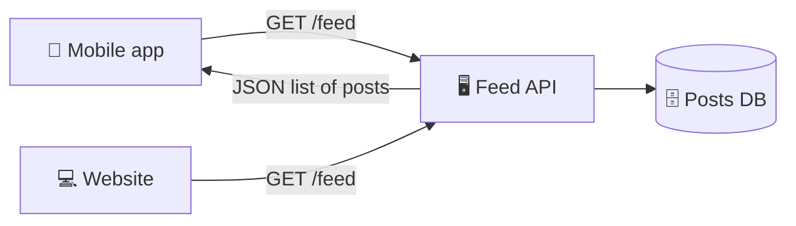

# 01 · What is an API

> [!info] Topic info
> **Subject:** System Design · **Chapter:** API Fundamentals · **Priority:** 🔥 High · **Status:** ✅ done · **Last reviewed:** 2026-11-19
>
> [← Back to API Fundamentals](README.md) · [Interview questions →](questions/api-fundamentals-qa.md)

> [!abstract] In one line
> An **API** (Application Programming Interface) is a **contract** — a fixed set of requests and responses — that lets one program **use another** without knowing how it works inside.

---

## 1. The problem

Our social media app has a mobile app, a website, and a dozen backend services. The mobile app needs to show a feed, but it can't (and shouldn't) open the database directly.

We need a clear, stable "menu" of what the backend can do — so the app team and backend team can work independently.

---

## 2. How it works

The client sends a **request** to an **endpoint**; the server does the work and sends back a **response**. The client only knows the contract, not the code, DB, or language behind it.



> [!example] Restaurant analogy
> The **menu** is the API. You order "Paneer Tikka" — you don't walk into the kitchen. The kitchen can change chefs or ovens, and as long as the menu stays the same, you don't care.

### What the contract defines

- **Endpoint** — where to call: `GET /users/42/posts`
- **Input** — params, body, headers (e.g. auth token)
- **Output** — response shape + status codes (`200`, `404`, `429`…)
- **Rules** — auth, rate limits, error format, versioning

---

## 3. Types of APIs you'll meet

| Type | Who calls it | Example |
|---|---|---|
| **Public / external** | Third-party developers | Stripe, Twitter, Google Maps APIs |
| **Internal / private** | Your own services | Feed service calling User service |
| **Partner** | Selected companies | Bank API shared with a fintech partner |
| **Library / OS API** | Code in the same process | `fs.readFile`, Java Collections |

In system design interviews, "API" almost always means a **web API over the network** (REST, GraphQL, gRPC).

---

## 4. What makes a good API

- **Simple and consistent** — same naming, same error format everywhere.
- **Stable** — don't break old clients; **version** when you must change (`/v2/...`).
- **Safe to retry** — writes are **idempotent** (see [Idempotency](03-idempotency.md)).
- **Protected** — **auth** + **rate limits** (see [Rate Limiting](08-rate-limiting.md)).
- **Efficient** — paginate big lists; don't return 10 MB when the client needs 10 rows.
- **Documented** — e.g. an OpenAPI spec so clients know exactly what to send.

> [!tip] 🎤 Say it like this
> "An API is a contract between two programs: what you can ask for, what you send, and what you get back. It hides the implementation, so the backend can change its database or language without breaking clients. A good API is consistent, versioned, idempotent for writes, paginated, and protected with auth and rate limits."

---

## 5. APIs in a system design interview

Right after clarifying requirements, interviewers expect you to **define the API**. Keep it to the 3–5 core endpoints:

```
POST   /v1/posts                 → create a post
GET    /v1/feed?cursor=abc&limit=20 → get home feed
POST   /v1/posts/{id}/likes      → like a post
GET    /v1/users/{id}            → get profile
```

For each one, mention: method, path, key params, response, and auth. This becomes the skeleton of your high-level design.

> [!failure] Interview traps
> - Jumping into databases before defining the API — the API shows what the system must actually do.
> - Designing 20 endpoints. Pick the **core** ones that match the functional requirements.
> - Forgetting **pagination** on list endpoints (feeds, comments, search).
> - Putting the user ID in the body for "my" resources — the server should take it from the **auth token**.

---

## Summary

- API = **contract** between programs; hides the implementation.
- Defines endpoint, input, output, and rules (auth, limits, errors, versions).
- Good APIs: consistent, versioned, idempotent writes, paginated, protected.
- In interviews: define 3–5 core endpoints right after requirements.

> [!success] Key takeaway
> Clients depend on the **contract**, not the code. Keep the contract small, stable, and safe — and everything behind it can change freely.
