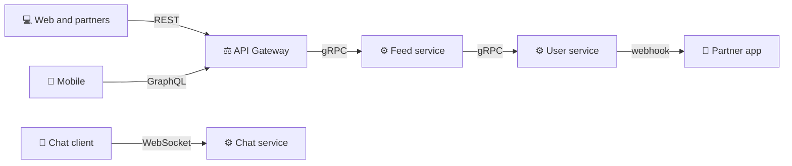

# 02 · API Styles

> [!info] Topic info
> **Subject:** System Design · **Chapter:** API Fundamentals · **Priority:** ⚡ Medium · **Status:** ✅ done · **Last reviewed:** 2026-11-19
>
> [← Back to API Fundamentals](README.md) · [Interview questions →](questions/api-fundamentals-qa.md)

> [!abstract] In one line
> **API styles** are different ways for programs to talk — **REST** (resources over HTTP), **GraphQL** (ask for exact fields), **gRPC** (fast typed calls), plus **WebSockets** and **webhooks** for real-time and push.

---

## 1. The problem

Our social media app has very different conversations happening:

- The website loads profiles and posts — simple reads.
- The mobile app on slow 4G needs a feed with **just** the fields it shows.
- 30 internal microservices call each other **thousands of times per second**.
- Chat needs messages pushed **instantly**.

No single style is best at all of these. Picking the right one is a common interview question.

---

## 2. The main styles

| Style | How it works | Best for |
|---|---|---|
| **REST** | Resources (`/users/42`) + HTTP methods, usually JSON | Public APIs, CRUD, web — the default |
| **GraphQL** | One endpoint; client sends a query listing the fields it wants | Mobile / complex UIs, many data sources |
| **gRPC** | Call remote functions; Protobuf (binary) over HTTP/2 | Internal service-to-service, low latency |
| **WebSocket** | One long-lived, two-way connection | Chat, live games, collaborative editing |
| **Webhook** | Server calls **your** URL when an event happens | Payment done, PR merged — event push to partners |
| **SOAP** | XML messages with a strict contract | Old enterprise / banking systems |

Deep dives: [REST](05-rest.md) · [GraphQL](06-graphql.md) · [gRPC](07-grpc.md) · [WebSockets](../communication-patterns/03-websockets.md) · [Webhooks](../communication-patterns/04-webhooks.md)

---

## 3. REST vs GraphQL vs gRPC

| | REST | GraphQL | gRPC |
|---|---|---|---|
| **Format** | JSON (text) | JSON (text) | Protobuf (binary) |
| **Endpoints** | Many (`/users`, `/posts`) | One (`/graphql`) | Methods (`GetUser`) |
| **Over/under-fetching** | Common | Solved | Fixed by schema |
| **HTTP caching** | Easy (GET + URL) | Hard (all POST) | Hard |
| **Browser support** | Native | Native | Needs a proxy (gRPC-Web) |
| **Speed** | Good | Good | Fastest |
| **Learning curve** | Low | Medium | Medium |

> [!tip] 🎤 Say it like this
> "I'd use REST for the public API because it's simple, cacheable, and every client understands it. Internally, services talk over gRPC for speed and strict typed contracts. If the mobile app needs flexible, nested data on a slow network, I'd add GraphQL — often as a layer in front of the services. For real-time I'd use WebSockets, and webhooks to notify partners."

---

## 4. Quick decision guide

- Public or partner API, simple CRUD → **REST**
- Many client types needing different shapes of data → **GraphQL**
- Internal microservices, high QPS, streaming → **gRPC**
- Server must push to client continuously → **WebSocket** (or SSE if one-way)
- Notify another company's system on an event → **Webhook**

> [!note] It's not either/or
> Most real systems mix styles: REST or GraphQL at the edge, gRPC inside, WebSockets for live features.

> [!failure] Interview traps
> - Saying "GraphQL is always better than REST" — you lose easy HTTP/CDN caching and gain query complexity.
> - Using gRPC for a browser-facing public API without mentioning gRPC-Web or a gateway.
> - Polling every second for chat instead of WebSockets.

---

## Summary

| Need | Pick |
|---|---|
| **Public CRUD API** | REST |
| **Flexible client-driven data** | GraphQL |
| **Fast internal calls** | gRPC |
| **Two-way real-time** | WebSocket |
| **Event push to partners** | Webhook |

> [!success] Key takeaway
> Pick the style by **who the client is** and **how they talk** — REST outside, gRPC inside, GraphQL for flexible UIs, WebSockets for live.
