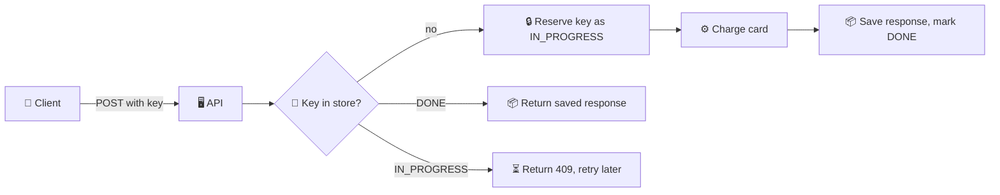

# 03 · Idempotency

> [!info] Topic info
> **Subject:** System Design · **Chapter:** API Fundamentals · **Priority:** 🔥 High · **Status:** ✅ done · **Last reviewed:** 2026-11-19
>
> [← Back to API Fundamentals](README.md) · [Interview questions →](questions/api-fundamentals-qa.md)

> [!abstract] In one line
> An API call is **idempotent** if sending it **once or many times** has the **same effect** — which makes **retries safe**. For non-idempotent calls like `POST /payments`, we add an **Idempotency-Key**.

---

## 1. The problem

A user taps **Pay ₹499 for Premium**. The request reaches our server, the card is charged, but the response is lost on a flaky network. The app times out and retries.

Without protection, the user is **charged twice**. A timeout means "I don't know", not "it failed".

> [!note] Already covered
> Why retries create duplicates, and the basic idempotency-key idea, are explained in [Reliability §4–5](../core-concepts/03-reliability.md). This note focuses on the **API design** side.

---

## 2. Which HTTP methods are idempotent

| Method | Idempotent? | Safe (no change)? | Why |
|---|---|---|---|
| **GET** | ✅ | ✅ | Only reads |
| **PUT** | ✅ | ❌ | Replaces with the same value every time |
| **DELETE** | ✅ | ❌ | Deleted once = still deleted (2nd call may return 404, but state is same) |
| **PATCH** | ⚠️ Depends | ❌ | `set name=X` yes; `add 1 to count` no |
| **POST** | ❌ | ❌ | Creates a new thing each time |

Idempotency is about the **server state**, not the response. A second `DELETE` returning `404` is still idempotent.

> [!tip] 🎤 Say it like this
> "GET, PUT and DELETE are idempotent by definition, POST isn't. So for any POST that matters — payments, orders, sending messages — I ask the client for an Idempotency-Key header. The server stores the key with the result, and a retry with the same key just gets the saved response instead of running again."

---

## 3. The Idempotency-Key pattern

1. Client generates a **UUID once** per user action (when the user taps Pay — not per retry).
2. Sends it as a header: `Idempotency-Key: 7f3a-…` on every retry.
3. Server checks a store (DB table or Redis) for that key, **scoped to the user**.

### What to store

- `key`, `user_id`, a **hash of the request body**, `status`, saved `response` (code + body), `created_at`.
- If the **same key** comes with a **different body** → reject with `422` (client bug).

### How long to keep it (TTL)

Keep keys for **~24 hours** — long enough to cover all realistic retries. After that, delete them (a TTL in Redis or a cleanup job) so the table doesn't grow forever.

---

## 4. Concurrent duplicate requests

The tricky case: two copies of the same request arrive **at the same time** on two servers. Both check "seen key?" → both say no → double charge.

Fix: make the **reservation atomic**.

- DB: `INSERT key … ` with a **unique constraint** — only one insert wins, the other gets a conflict.
- Redis: `SET key IN_PROGRESS NX EX 86400` — `NX` means "only if not exists".

The loser returns `409 Conflict` (or waits and returns the saved result). If the winner **crashes** mid-way, the `IN_PROGRESS` entry needs a short lock timeout so the key can be retried.

> [!warning] Store the key and do the work together
> Best case: save the key and the business change (e.g. the order row) in the **same DB transaction**. If they're in different systems, a crash between them can leave a key with no work done — or work with no key.

> [!failure] Interview traps
> - Generating a **new key on each retry** — then every retry looks new and dedupe does nothing.
> - Check-then-insert without a unique constraint → race condition under concurrency.
> - Thinking PUT is enough for payments — "create a charge" is naturally a POST; use a key.
> - Keeping keys forever, or for only a few seconds (retries with backoff can take minutes).

---

## Summary

| Step | What it fixes |
|---|---|
| **GET / PUT / DELETE** | Naturally safe to retry |
| **Idempotency-Key on POST** | Retries don't create duplicates |
| **Atomic reserve (unique / SET NX)** | Concurrent duplicates don't both run |
| **Request hash** | Same key reused with different data is caught |
| **TTL ~24h** | Store doesn't grow forever |

> [!success] Key takeaway
> Every write that can be retried must be idempotent. For POST, that means a **client-generated key**, an **atomic** check on the server, and the **saved response** returned on repeats.
