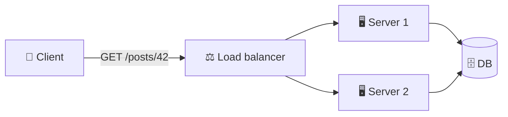

# 05 · REST

> [!info] Topic info
> **Subject:** System Design · **Chapter:** API Fundamentals · **Priority:** 🔥 High · **Status:** ✅ done · **Last reviewed:** 2026-11-19
>
> [← Back to API Fundamentals](README.md) · [Interview questions →](questions/api-fundamentals-qa.md)

> [!abstract] In one line
> **REST** is an API style where everything is a **resource** with a URL (`/posts/42`), you act on it with **HTTP methods** (GET, POST, PUT, DELETE), and every request is **stateless**.

---

## 1. The problem

Early on, our app's API was a mess: `/getPostById`, `/createNewPost`, `/deletePostNow`, `/doLike`. Every endpoint had its own naming, error format, and rules.

New developers couldn't guess anything. REST gives one predictable pattern so any developer can guess the endpoint before reading the docs.

---

## 2. Core ideas

- **Resources are nouns** — `/users`, `/posts/42`, `/posts/42/comments`.
- **HTTP methods are the verbs** — no verbs in URLs.
- **Stateless** — each request carries everything needed (auth token, params). The server keeps no client session in memory, so **any server** behind the load balancer can handle it. See [Scalability](../core-concepts/01-scalability.md).
- **Standard status codes** — clients know what `404` or `429` means.
- **Cacheable** — GET responses can be cached by browsers and CDNs.

### Methods and status codes

| Action | Request | Success code |
|---|---|---|
| **List posts** | `GET /posts` | `200 OK` |
| **Get one** | `GET /posts/42` | `200 OK` |
| **Create** | `POST /posts` | `201 Created` |
| **Replace** | `PUT /posts/42` | `200` / `204` |
| **Partial update** | `PATCH /posts/42` | `200` |
| **Delete** | `DELETE /posts/42` | `204 No Content` |

Errors to know: `400` bad input · `401` not logged in · `403` not allowed · `404` not found · `409` conflict · `429` too many requests · `500` server bug · `503` overloaded/down. Full list: [HTTP and HTTPS](../../computer-networks/02-http-and-https.md).

> [!tip] 🎤 Say it like this
> "In REST, everything is a resource with a URL, and HTTP methods are the actions — GET reads, POST creates, PUT replaces, PATCH updates, DELETE removes. It's stateless, so any server can handle any request, which makes horizontal scaling easy. And GET responses are cacheable by CDNs and browsers."

---

## 3. Design details interviewers ask about

### Pagination

Never return a whole list. Two ways:

| | Offset (`?page=5&limit=20`) | Cursor (`?cursor=abc&limit=20`) |
|---|---|---|
| **How** | Skip N rows | "Give me items after this one" |
| **Jump to page 50** | ✅ Easy | ❌ No |
| **Speed on deep pages** | ❌ Slow — DB still scans skipped rows | ✅ Fast — uses an index |
| **New items inserted** | ❌ Duplicates / skipped items | ✅ Stable |
| **Use for** | Admin tables, search pages | Feeds, infinite scroll |

For our feed, **cursor** pagination is the right call — new posts arrive every second.

### Filtering and sorting

`GET /posts?author=42&sort=-created_at&limit=20` — use query params, not new endpoints.

### Versioning

- **URL**: `/v1/posts` → simple, visible. Most common.
- **Header**: `Accept: application/vnd.app.v2+json` → cleaner URLs, harder to test.

Add fields freely; create a new version only for **breaking** changes (removing/renaming fields).

---

## 4. Trade-offs

**✅ Pros**
- Simple, universal, works in every browser and tool
- HTTP caching (CDN, ETag) for free
- Stateless → easy horizontal scaling

**❌ Cons**
- **Over-fetching** — `GET /users/42` returns 30 fields when the UI needs 2
- **Under-fetching** — feed screen needs posts + authors + like counts → many round trips (the **N+1** problem)
- No strict schema by default (add OpenAPI for that)

These cons are exactly why [GraphQL](06-graphql.md) exists.

> [!failure] Interview traps
> - Verbs in URLs: `POST /createPost` → should be `POST /posts`.
> - Returning `200` with `{"error": "..."}` — use real status codes.
> - Offset pagination for an infinite feed.
> - Using GET for actions that change data — crawlers and caches will trigger them.
> - Calling any JSON-over-HTTP API "RESTful" even when it ignores methods and status codes.

---

## Summary

| Rule | Why |
|---|---|
| **Nouns in URLs, verbs as methods** | Predictable API |
| **Stateless** | Any server can serve any request |
| **Right status codes** | Clients handle errors correctly |
| **Cursor pagination** | Fast, stable feeds |
| **Version on breaking changes** | Old clients keep working |

> [!success] Key takeaway
> REST is the safe default for public APIs: resources + methods + status codes + stateless. Know its weak spots — over/under-fetching — and when to reach for GraphQL or gRPC instead.
