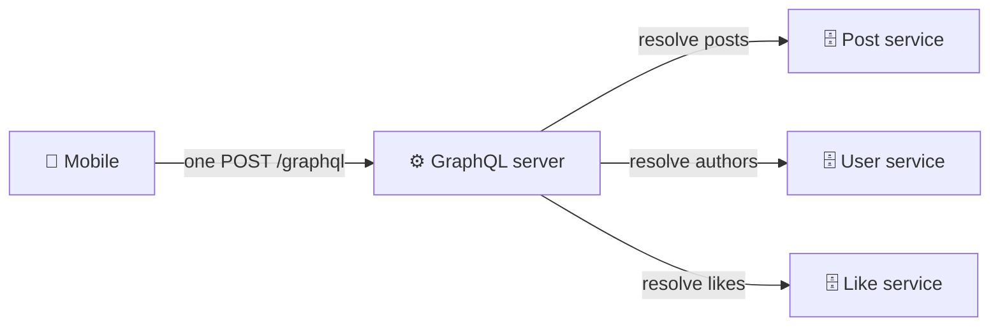

# 06 · GraphQL

> [!info] Topic info
> **Subject:** System Design · **Chapter:** API Fundamentals · **Priority:** ⚡ Medium · **Status:** ✅ done · **Last reviewed:** 2026-11-19
>
> [← Back to API Fundamentals](README.md) · [Interview questions →](questions/api-fundamentals-qa.md)

> [!abstract] In one line
> **GraphQL** is a query language for APIs: the client hits **one endpoint** and asks for **exactly the fields it needs**, across related data, in **one request**.

---

## 1. The problem

Our mobile feed screen shows 20 posts, each with the author's name + avatar and the like count. With [REST](05-rest.md):

- `GET /feed` → 20 posts (each with 40 fields we don't need — **over-fetching**)
- then `GET /users/{id}` × 20 for authors (**under-fetching**, extra round trips)

On a 300 ms mobile network, 21 calls is a slow screen and wasted data.

---

## 2. How it works

The server publishes a **schema** (types and fields). The client sends a query describing the shape it wants; the response has the **same shape**.

```graphql
query {
  feed(first: 20) {
    id
    text
    likeCount
    author { name avatarUrl }
  }
}
```

Each field is filled by a **resolver** — a small function that fetches that piece of data from a DB or service.



Three operation types: **query** (read), **mutation** (write), **subscription** (real-time updates, usually over WebSockets).

> [!tip] 🎤 Say it like this
> "GraphQL gives clients one endpoint and a typed schema. The client asks for exactly the fields it needs, even across related objects, and gets it in one round trip — no over- or under-fetching. It's great for mobile and complex UIs, but caching is harder and you must protect the server from expensive queries."

---

## 3. Problems you must handle

### N+1 queries

Fetching 20 posts, then the author resolver runs **20 separate** user lookups. Fix: **DataLoader** — collect all author IDs in one tick and fetch them in **one batch** query.

### Expensive / malicious queries

A client can ask for `friends → friends → friends → posts` 10 levels deep and melt the DB. Fixes:
- **Depth limit** and **query cost** limit
- **Persisted queries** — only allow pre-approved queries (common for mobile apps)
- Rate limit by **query cost**, not request count

### Caching

Everything goes to `POST /graphql`, so CDNs and browsers can't cache by URL. Fixes: persisted queries sent via GET, or client-side caches (Apollo, Relay) keyed by object ID.

---

## 4. When to use it

**✅ Pros**
- No over/under-fetching — big win on mobile
- One request for nested data
- Strong typed schema, great tooling, self-documenting
- Frontend can change what it shows without backend changes

**❌ Cons**
- HTTP/CDN caching is hard
- N+1 and expensive queries need extra work
- Errors often come back as `200` with an `errors` array — harder monitoring
- Overkill for simple CRUD

> [!example] Where it fits
> Use GraphQL as a **layer in front of microservices** (a gateway or [BFF](../microservices-patterns/03-backend-for-frontend.md)), serving web and mobile. Keep REST for public/partner APIs and gRPC between services.

> [!failure] Interview traps
> - "GraphQL is faster than REST" — not automatically; it saves **round trips**, but a bad resolver is still slow.
> - Forgetting N+1 and DataLoader.
> - Not mentioning depth/cost limits — open GraphQL is a DoS risk.

---

## Summary

- One endpoint, typed schema, client picks fields.
- Fixes REST's over/under-fetching and many round trips.
- Must handle: **N+1** (DataLoader), **query cost limits**, **caching**.
- Best for mobile and complex UIs over many services.

> [!success] Key takeaway
> GraphQL moves control of the response shape to the **client**. Great for flexible UIs — but you pay with harder caching and query protection.
