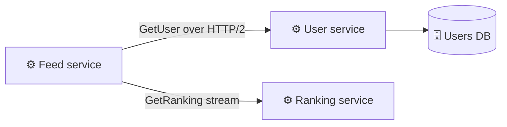

# 07 · gRPC

> [!info] Topic info
> **Subject:** System Design · **Chapter:** API Fundamentals · **Priority:** ⚡ Medium · **Status:** ✅ done · **Last reviewed:** 2026-11-19
>
> [← Back to API Fundamentals](README.md) · [Interview questions →](questions/api-fundamentals-qa.md)

> [!abstract] In one line
> **gRPC** is a framework for calling a function on **another service as if it were local** — using **Protobuf** (binary) messages over **HTTP/2**, with typed client code generated for you.

---

## 1. The problem

Loading one feed triggers ~15 internal calls: feed → user → graph → ranking → media. With JSON over HTTP/1.1, each call pays for text parsing, big payloads, and new connections.

At **200,000 internal calls per second**, those extra milliseconds and bytes add up to real servers and real latency.

---

## 2. How it works

1. Define the service once in a `.proto` file.
2. Generate client and server code in any language (Go, Java, Python…).
3. The client calls `GetUser(id)` like a normal function — gRPC handles the network.

```proto
service UserService {
  rpc GetUser (GetUserRequest) returns (User);
}
message User { int64 id = 1; string name = 2; }
```



### Why it's fast

- **Protobuf** — small binary messages, fast to parse (see [Data Formats](04-data-formats.md)).
- **HTTP/2** — many calls **multiplexed** on one long-lived connection, compressed headers.
- **Generated code** — no hand-written JSON parsing or URL building.

### Four call types

| Type | Example |
|---|---|
| **Unary** — 1 request, 1 response | `GetUser` |
| **Server streaming** | Stream live score updates |
| **Client streaming** | Upload sensor readings in chunks |
| **Bidirectional** | Live chat between two services |

> [!tip] 🎤 Say it like this
> "gRPC lets services call each other like local functions. You define the contract in a proto file, generate typed clients, and messages go as Protobuf over HTTP/2 — so they're small, fast, and multiplexed on one connection. I use it for internal service-to-service traffic, and keep REST or GraphQL for browsers and public clients."

---

## 3. Trade-offs

**✅ Pros**
- Much smaller and faster than JSON/REST
- Strict typed contract; breaking changes caught at compile time
- Built-in streaming, deadlines (timeouts) and cancellation
- Code generation for many languages

**❌ Cons**
- Browsers can't call it directly — need **gRPC-Web** or a gateway
- Binary → can't just `curl` it and read the output
- **Load balancing is tricky**: long-lived HTTP/2 connections stick to one server, so an L4 balancer spreads load badly. Use an L7 (request-aware) balancer or client-side balancing — see [Load Balancers](../load-balancing/01-load-balancers.md)

> [!important] Always set deadlines
> In a chain of gRPC calls, set a **deadline** on each call. Without it, one slow service makes every caller wait — and that cascades. See [Availability](../core-concepts/02-availability.md).

> [!failure] Interview traps
> - Proposing gRPC for a public browser API without mentioning gRPC-Web.
> - Ignoring the HTTP/2 sticky-connection load-balancing issue.
> - Changing field numbers in `.proto` — breaks old clients.

---

## Summary

| Feature | Benefit |
|---|---|
| **Protobuf** | Small, fast, typed |
| **HTTP/2** | Multiplexing, one connection |
| **Code generation** | Call remote functions like local |
| **Streaming** | Real-time between services |

> [!success] Key takeaway
> gRPC is the go-to for **internal, high-volume** service calls. Don't put it straight in front of browsers, and use L7 load balancing.
