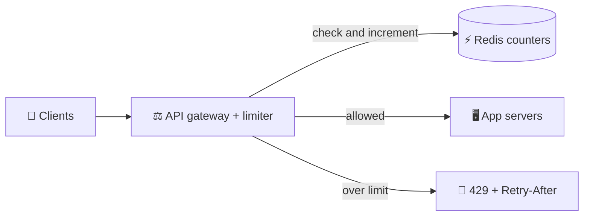

# 08 · Rate Limiting

> [!info] Topic info
> **Subject:** System Design · **Chapter:** API Fundamentals · **Priority:** 🔥 High · **Status:** ✅ done · **Last reviewed:** 2026-11-19
>
> [← Back to API Fundamentals](README.md) · [Interview questions →](questions/api-fundamentals-qa.md)

> [!abstract] In one line
> **Rate limiting** caps how many requests a client can make in a time window (e.g. **100 req/min per user**) to protect the system from **abuse, bots and overload** — extra requests get **429 Too Many Requests**.

---

## 1. The problem

One buggy client script calls `GET /feed` **5,000 times per second** in a loop. A bot tries 1 million passwords on `/login`. Our servers slow down for **everyone**.

We need a way to say: "you've had your share — come back later", per user, IP, or API key.

---

## 2. Where it sits

Usually at the **edge** — API gateway or reverse proxy — before requests reach app servers. Counters live in a **shared store** like Redis so all gateway instances see the same count.



Limit by: **user ID** (logged in), **API key** (partners), **IP** (anonymous / login). Login and OTP endpoints get much stricter limits (e.g. 5/min).

---

## 3. The algorithms

### Token bucket ⭐ most common

A bucket holds up to **N tokens** and refills at **R tokens/sec**. Each request takes one token; empty bucket = reject.
- Bucket 10, refill 1/sec → allows a **burst of 10**, then 1/sec on average.
- Stores just 2 numbers per user: tokens left + last refill time.

### Leaky bucket

Requests go into a queue that drains at a **fixed rate**. Output is perfectly smooth, but bursts wait or are dropped. Good when the **downstream** can only handle a steady rate.

### Fixed window counter

Count requests per clock window (`user42:12:05` → 87). Simple and cheap.
**Problem:** edge bursts — 100 requests at 12:05:59 + 100 at 12:06:00 = **200 in 2 seconds**.

### Sliding window log

Store a timestamp per request; count those in the last 60 s. **Exact**, but uses memory per request — 1,000 req/min limit = 1,000 timestamps per user.

### Sliding window counter

Blend the current and previous fixed windows:
`count = current + previous × (fraction of previous window still inside the last 60s)`.
Close to exact, only 2 counters. Great default when you need accuracy.

| Algorithm | Bursts | Memory | Accuracy |
|---|---|---|---|
| **Token bucket** | ✅ Allows controlled bursts | Tiny | Good |
| **Leaky bucket** | ❌ Smooths them out | Small (queue) | Good |
| **Fixed window** | ⚠️ 2× burst at edges | Tiny | Low |
| **Sliding log** | ❌ None | High | Exact |
| **Sliding counter** | ⚠️ Small | Tiny | Very good |

> [!tip] 🎤 Say it like this
> "I'd put the rate limiter in the API gateway, keyed by user ID or API key, with counters in Redis so all gateway nodes share them. I'd use a token bucket because it allows short bursts while keeping the average rate. Over-limit requests get a 429 with a Retry-After header so well-behaved clients back off."

---

## 4. Distributed rate limiting with Redis

With 10 gateway nodes, **local** counters let a user get 10× the limit. So use Redis:

- Fixed window: `INCR user42:1205` + `EXPIRE 60` — atomic increment.
- Token bucket / sliding window: run the read-and-update as **one Lua script** so two nodes can't race between "read" and "write".

> [!warning] Trade-offs at scale
> - Redis adds ~1 ms per request and becomes a dependency. If Redis is down, decide: **fail open** (allow traffic — usual choice) or **fail closed** (block — safer for login).
> - For extreme scale, keep **local counters** and sync to Redis every few hundred ms — slightly inaccurate, much faster.

---

## 5. Telling the client

```
HTTP/1.1 429 Too Many Requests
Retry-After: 30
X-RateLimit-Limit: 100
X-RateLimit-Remaining: 0
```

Clients should **back off** (exponential backoff + jitter) instead of retrying instantly.

> [!failure] Interview traps
> - Limiting only by IP — thousands of users behind one office NAT share an IP; bots rotate IPs.
> - Per-server counters in a multi-server setup.
> - Fixed window without mentioning the edge-burst issue.
> - Confusing rate limiting (per client) with **load shedding** (dropping traffic when the whole system is overloaded).

---

## Summary

- Protects against abuse, brute force, and noisy clients.
- Put it at the **gateway**, keyed by user / API key / IP.
- **Token bucket** for bursts, **sliding window counter** for accuracy.
- **Redis + atomic ops (Lua)** for distributed limits.
- Return **429 + Retry-After**.

> [!success] Key takeaway
> Rate limiting is cheap insurance: one shared counter per client, checked at the edge, so one bad actor can't take down the system for everyone.
