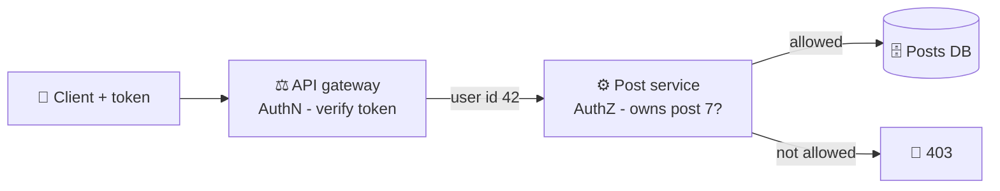

# 09 · Authentication vs Authorization

> [!info] Topic info
> **Subject:** System Design · **Chapter:** API Fundamentals · **Priority:** 🔥 High · **Status:** ✅ done · **Last reviewed:** 2026-11-19
>
> [← Back to API Fundamentals](README.md) · [Interview questions →](questions/api-fundamentals-qa.md)

> [!abstract] In one line
> **Authentication (AuthN)** proves **who you are**; **authorization (AuthZ)** decides **what you're allowed to do**. AuthN comes first, then AuthZ on every protected action.

---

## 1. The problem

User Priya logs into our social media app. Now she tries to **delete post 42**. Two separate questions:

1. Is this really Priya? → **authentication**
2. Is Priya allowed to delete post 42? (Is it her post? Is she a moderator?) → **authorization**

Mixing these up is one of the most common security bugs.

> [!note] Already covered
> The basic definitions and cookie/token details are in [Auth and Security](../../computer-networks/06-auth-and-security.md). This note is the **system design** view: where each check lives.

---

## 2. Side by side

| | Authentication | Authorization |
|---|---|---|
| **Question** | Who are you? | What can you do? |
| **When** | Once at login, then verify the token/session on each request | On **every** protected action |
| **Inputs** | Password, OTP, Google login, passkey | User ID, role, ownership, resource |
| **Output** | Identity (user ID) | Allow / deny |
| **Failure code** | **401 Unauthorized** (really "unauthenticated") | **403 Forbidden** |

> [!example] Hotel analogy
> Showing your ID at the front desk = **authentication**. Your key card opening room 305 but not 306 or the gym after 10 pm = **authorization**.

---

## 3. Where each check lives

- **AuthN at the edge** — the API gateway verifies the token once and passes the user ID to services. Services don't each re-do the login.
- **AuthZ in the service** — only the Post service knows who owns post 7, so it decides. Coarse checks ("is admin?") can be at the gateway; fine checks ("owns this post?") must be in the service.

---

## 4. Authorization models

| Model | Idea | Example |
|---|---|---|
| **RBAC** (role-based) | Permissions attached to roles | `admin` can delete any post |
| **ABAC** (attribute-based) | Rules on user/resource/context attributes | Can edit if `post.author == user.id` and within 15 min |
| **ReBAC** (relationship-based) | Based on graph of relationships | Can view if you're a **friend** of the author (Google Zanzibar style) |
| **ACL** | List of who can access each resource | Google Doc shared with 3 emails |

Most apps start with **RBAC + ownership checks**. More in [RBAC](../security/05-rbac.md).

> [!tip] 🎤 Say it like this
> "Authentication is proving identity — login, then verifying a session or token on each request. Authorization is checking permissions for each action — usually roles plus ownership. I verify identity once at the gateway and pass the user ID down, but the actual authorization decision stays in the service that owns the data, because only it knows who owns what. 401 means not authenticated, 403 means authenticated but not allowed."

> [!failure] Interview traps
> - Checking only "is logged in?" and not "is this **your** resource?" — this is **IDOR** (Insecure Direct Object Reference): changing `/orders/101` to `/orders/102` shows someone else's order.
> - Trusting a `userId` or `role` sent in the request body — always take it from the verified token/session.
> - Doing authorization only in the frontend (hiding buttons) — the API must enforce it.
> - Mixing up 401 and 403.

---

## Summary

- **AuthN** = who you are (401). **AuthZ** = what you can do (403).
- AuthN at the gateway; fine-grained AuthZ in the owning service.
- Models: RBAC, ABAC, ReBAC, ACL — start with roles + ownership.
- Never trust identity from the request body.

> [!success] Key takeaway
> Authenticate once at the edge, **authorize every action** where the data lives — and always check ownership, not just login.
