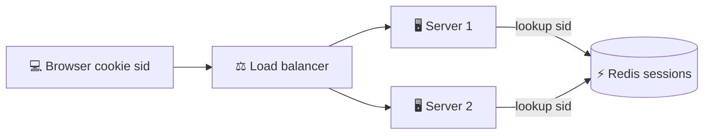
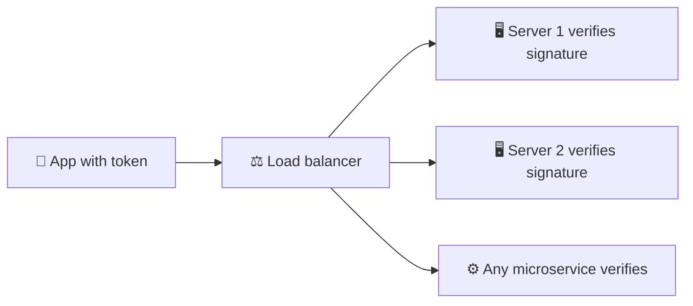

# 10 · Session vs Token Auth

> [!info] Topic info
> **Subject:** System Design · **Chapter:** API Fundamentals · **Priority:** 🔥 High · **Status:** ✅ done · **Last reviewed:** 2026-11-19
>
> [← Back to API Fundamentals](README.md) · [Interview questions →](questions/api-fundamentals-qa.md)

> [!abstract] In one line
> With **session auth**, the **server remembers** you (a session store holds your login, you carry an ID); with **token auth**, **you carry the proof** (a signed token) and the server just verifies it — **stateful vs stateless**.

---

## 1. The problem

HTTP is stateless — every request is a stranger. After Priya logs in, how does request #2 know it's her?

At first we stored her login in the **server's memory**. Then we added a second server behind the load balancer — and Priya got logged out every time her request hit the other server.

---

## 2. Session-based auth (stateful)

On login, the server creates a session `{sid: abc, userId: 42}` in a store and sends back only `sid=abc` in a cookie. Each request: look up `abc` → user 42.

To scale, move sessions out of server memory into a **shared store** (Redis). Now any server can find any session.

> [!note] Sticky sessions
> Another option: the load balancer always sends a user to the **same** server. Simple, but uneven load, and that server dying logs everyone out. A shared store is usually better. See [Scalability](../core-concepts/01-scalability.md).

---

## 3. Token-based auth (stateless)

On login, the server gives a **signed token** (usually a [JWT](11-jwt.md)) containing `userId: 42, exp: 15 min`. The client sends it in `Authorization: Bearer <token>`. Any server checks the **signature** — no lookup at all.

---

## 4. Comparison

| | Session | Token (JWT) |
|---|---|---|
| **State lives** | Server (Redis) | Inside the token |
| **Per-request cost** | Store lookup (~1 ms with Redis) | Signature check (CPU only) |
| **Logout / ban** | ✅ Instant — delete session | ❌ Hard — valid until expiry |
| **Scaling** | Needs shared session store | Any server/service can verify |
| **Microservices** | Each must call session store | Each verifies on its own |
| **Size on wire** | Tiny ID (~32 bytes) | Bigger (~300–1000 bytes) |
| **Typical client** | Browser web app, same domain | Mobile apps, APIs, microservices |

> [!tip] 🎤 Say it like this
> "Sessions are stateful: the server stores the login in Redis and the client holds just an ID — easy to revoke, but every request needs a lookup. Tokens are stateless: the client holds a signed token and any server can verify it without a lookup, which scales nicely across microservices, but revoking is hard. In practice I combine them — short-lived access tokens with a revocable refresh token stored server-side."

---

## 5. The hybrid most systems use

- **Access token** — short-lived (5–15 min), stateless JWT, sent on every call.
- **Refresh token** — long-lived (days), stored **server-side** so it can be revoked; used only to get a new access token.

Logout or ban → revoke the refresh token. The user is fully out within **≤15 minutes**, with zero lookups on normal requests. Details: [Auth and Security §5](../../computer-networks/06-auth-and-security.md).

### Where the credential lives (browser)

- **HttpOnly, Secure, SameSite cookie** — JS can't read it (safe from XSS); add CSRF protection.
- **localStorage** — readable by any injected script (XSS risk) — avoid for auth.
- Mobile apps: the OS secure storage (Keychain / Keystore).

> [!failure] Interview traps
> - "JWT is always better because it's stateless" — you lose instant logout.
> - Storing sessions in server memory with multiple servers.
> - Long-lived (days) access tokens with no refresh/revoke plan.
> - Thinking "cookie vs token" is the question — a cookie is just a **transport**; it can hold a session ID or a JWT.

---

## Summary

| Choice | Use when |
|---|---|
| **Session + Redis** | Web app, one domain, need instant logout |
| **Stateless token** | Mobile, public APIs, many microservices |
| **Hybrid (short access + revocable refresh)** | Most production systems |

> [!success] Key takeaway
> The real trade-off is **revocation vs lookup cost**. Sessions are easy to kill; tokens are easy to scale. Short-lived tokens + revocable refresh tokens give you most of both.
