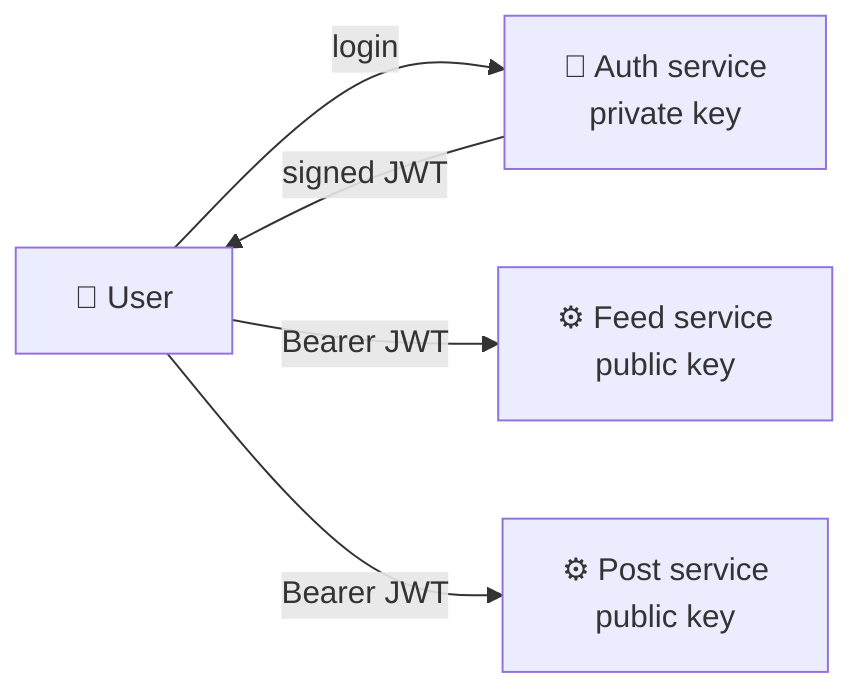

# 11 · JWT

> [!info] Topic info
> **Subject:** System Design · **Chapter:** API Fundamentals · **Priority:** 🔥 High · **Status:** ✅ done · **Last reviewed:** 2026-11-19
>
> [← Back to API Fundamentals](README.md) · [Interview questions →](questions/api-fundamentals-qa.md)

> [!abstract] In one line
> A **JWT** (JSON Web Token) is a **signed, self-contained** token — `header.payload.signature` — that any service can **verify without a database lookup**; it's **signed, not encrypted**, and **hard to revoke** before it expires.

---

## 1. The problem

Our app now has 30 microservices. If each request makes every service call a central auth service ("who is token abc?"), that auth service handles **millions of calls/sec** and becomes a [single point of failure](../core-concepts/04-single-point-of-failure.md).

We want each service to trust the token **on its own**.

---

## 2. How it works

A JWT has three base64url parts joined by dots:

```
header  . payload                                   . signature
{alg}     {sub: 42, role: user, exp: 1763550000}      sign(header.payload, key)
```

- **Header** — the signing algorithm.
- **Payload** — **claims**: `sub` (user ID), `exp` (expiry), `iat` (issued at), `iss` (issuer), `aud` (audience), roles.
- **Signature** — proves nobody changed the header or payload.

The auth service **signs** at login. Every other service **verifies** the signature and `exp` locally.



### HS256 vs RS256

| | HS256 | RS256 / ES256 |
|---|---|---|
| **Keys** | One shared secret | Private key signs, public key verifies |
| **Who can create tokens** | Anyone with the secret | Only the auth service |
| **Fits** | Single app | **Microservices** — share only the public key |

Public keys are often published at a **JWKS** endpoint (a URL listing current public keys) so services can fetch them and keys can be **rotated** using a `kid` (key ID) in the header.

> [!tip] 🎤 Say it like this
> "A JWT is a signed token holding claims like user ID, roles and expiry. The auth service signs it with a private key; every service verifies it with the public key — no network call, so it scales well. It's signed, not encrypted, so anyone can read the payload. The big downside is revocation: a valid JWT works until it expires, so I keep access tokens short — around 15 minutes — and use revocable refresh tokens."

---

## 3. The revocation problem

User reports a stolen phone. We ban the account — but the JWT on the stolen phone is still valid for its remaining lifetime. Options:

1. **Short expiry** (5–15 min) + revocable refresh token — the usual answer.
2. **Denylist** — store revoked token IDs (`jti`) in Redis until they expire. Small list, but every request now does a lookup.
3. **Token version** — store `tokenVersion` per user; bump it on logout-all / password change. Also needs a lookup (often cached).

> [!note] The irony
> Options 2 and 3 bring back a per-request lookup — partly giving up "stateless". That's fine: a tiny Redis check is still cheaper than a full session system. Just say the trade-off out loud.

---

## 4. Rules and pitfalls

**✅ Pros**
- No lookup per request — scales across services
- Carries identity + roles with it
- Standard, supported everywhere

**❌ Cons**
- Hard to revoke
- Bigger than a session ID; sent on **every** request
- Claims go stale (role changed → old token still says `user`)

> [!failure] Interview traps
> - Putting secrets or PII in the payload — it's only base64, anyone can decode it.
> - Accepting `alg: none` or not pinning the expected algorithm.
> - Not checking `exp`, `iss` and `aud`.
> - Long-lived access tokens (days) with no revocation plan.
> - Storing JWTs in localStorage (XSS can steal them) — see [Session vs Token](10-session-vs-token-auth.md).

---

## Summary

- Structure: header.payload.signature; **signed, not encrypted**.
- Verify locally with the public key → no auth-service bottleneck.
- Use **RS256/ES256 + JWKS + `kid`** in microservices for key rotation.
- Revocation: short expiry + refresh tokens; denylist if instant kill needed.

> [!success] Key takeaway
> JWTs trade **easy revocation** for **lookup-free verification**. Keep them short-lived, small, and free of secrets.
