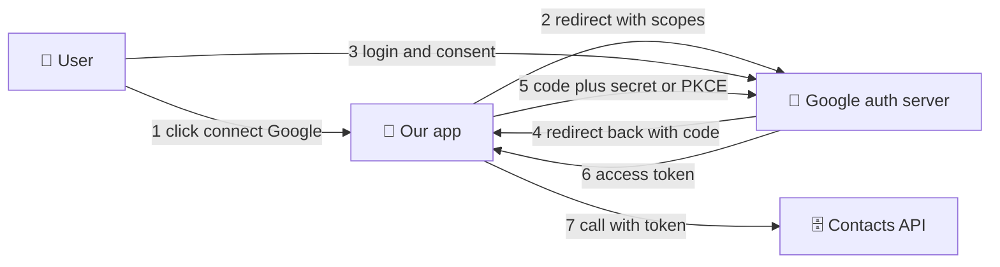

# 12 · OAuth 2.0

> [!info] Topic info
> **Subject:** System Design · **Chapter:** API Fundamentals · **Priority:** ⚡ Medium · **Status:** ✅ done · **Last reviewed:** 2026-11-19
>
> [← Back to API Fundamentals](README.md) · [Interview questions →](questions/api-fundamentals-qa.md)

> [!abstract] In one line
> **OAuth 2.0** is a standard for **delegated authorization**: it lets an app access your data on another service (with **limited scopes**) **without ever seeing your password**. **OpenID Connect (OIDC)** adds login on top.

---

## 1. The problem

Our social media app wants to "Find friends from your Google Contacts". The old way: ask the user for their **Google password**. Terrible — we'd get full access to their Gmail, forever, and they can't revoke it without changing the password.

We want: limited access (contacts only), for a limited time, revocable, password never shared.

---

## 2. The four roles

| Role | In our example |
|---|---|
| **Resource owner** | The user |
| **Client** | Our social media app |
| **Authorization server** | Google's login/consent server — issues tokens |
| **Resource server** | Google Contacts API — accepts tokens |

**Scopes** say what's allowed, e.g. `contacts.readonly`. The user sees them on the consent screen.

---

## 3. Authorization Code flow (+ PKCE)

The standard flow for web and mobile apps.

- The **code** is short-lived and goes through the browser; the **token** is fetched in a back-channel call (step 5), so it's not exposed in the URL.
- **PKCE** (Proof Key for Code Exchange) — the app makes a random secret, sends its hash first, and the secret at step 5. A stolen code is useless without it. Needed for mobile/SPAs that can't keep a client secret.
- **state** param — protects the redirect from CSRF.

Diagram with every parameter: [Auth and Security §11](../../computer-networks/06-auth-and-security.md).

### Other grant types

| Grant | Use for |
|---|---|
| **Authorization Code + PKCE** | Web, mobile, SPAs — the default |
| **Client Credentials** | Service-to-service, no user (a cron job calling an API) |
| **Refresh Token** | Get a new access token without asking the user again |
| **Device Code** | Smart TVs / CLIs — "go to this URL and enter code ABCD" |
| ~~Implicit~~, ~~Password~~ | Deprecated — don't use |

> [!tip] 🎤 Say it like this
> "OAuth 2.0 is about delegated authorization — letting an app act on my behalf with limited scopes, without sharing my password. The standard is the authorization code flow with PKCE: the user logs in at the provider, the app gets a short-lived code, and exchanges it in a back-channel call for an access token. OAuth by itself doesn't tell you who the user is — that's what OpenID Connect adds with an ID token."

---

## 4. OAuth vs OIDC

- **OAuth 2.0** → **access token**: "this app may read contacts". For calling APIs.
- **OIDC** → adds an **ID token** (a JWT): "this is user `sub=123`, email priya@…". For **login**.

"Sign in with Google" = OIDC. Using OAuth access tokens as proof of login is a classic mistake.

> [!failure] Interview traps
> - Calling OAuth an **authentication** protocol — it's authorization; OIDC does authentication.
> - Using the Implicit flow or skipping PKCE on mobile/SPA.
> - Asking for broad scopes "just in case" — request the minimum.
> - Not validating `state` and the exact `redirect_uri` → token/code theft.

---

## Summary

- Delegated, scoped, revocable access — no password sharing.
- Roles: owner, client, authorization server, resource server.
- **Auth Code + PKCE** for users; **Client Credentials** for services.
- OAuth = authorization (access token); **OIDC** = login (ID token).

> [!success] Key takeaway
> OAuth answers "**what can this app do for me**", OIDC answers "**who is this user**". Default to Authorization Code + PKCE.
