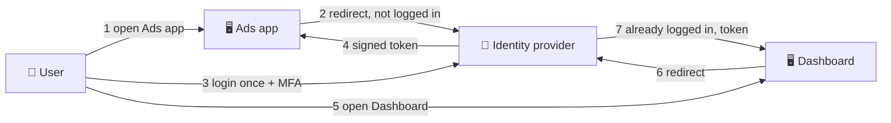

# 13 · SSO

> [!info] Topic info
> **Subject:** System Design · **Chapter:** API Fundamentals · **Priority:** ⚡ Medium · **Status:** ✅ done · **Last reviewed:** 2026-11-19
>
> [← Back to API Fundamentals](README.md) · [Interview questions →](questions/api-fundamentals-qa.md)

> [!abstract] In one line
> **SSO (Single Sign-On)** lets a user **log in once** at a central **identity provider (IdP)** and then use **many apps** without logging in again — built on **OIDC** or **SAML**.

---

## 1. The problem

Our company now runs the social app, a creator dashboard, an ads manager, and internal tools. Each has its own login and password table.

Users juggle 4 passwords. Employees who leave keep access to 2 tools someone forgot to disable. Every app re-implements login, MFA, and password reset — badly.

---

## 2. How it works

One **IdP** (Okta, Google Workspace, Microsoft Entra ID, Keycloak) owns login. Apps (called **service providers** or relying parties) trust it.

The trick is step 7: the IdP has its **own session cookie** in the browser. When the second app redirects there, the IdP sees the user is already logged in and immediately sends a token back — no password prompt.

Each app then creates its **own local session** from that token.

---

## 3. OIDC vs SAML

| | OIDC | SAML |
|---|---|---|
| **Built on** | [OAuth 2.0](12-oauth2.md) | XML standard (older) |
| **Token** | ID token — a [JWT](11-jwt.md) | XML assertion, signed |
| **Good for** | Modern web, mobile, APIs | Enterprise / legacy apps |
| **Example** | "Sign in with Google" | Corporate login into Salesforce |

New systems: prefer **OIDC**. Support SAML when enterprise customers demand it. More in [SAML](../security/06-saml.md).

> [!tip] 🎤 Say it like this
> "With SSO, a central identity provider handles login, and every app trusts it. When an app sees an unauthenticated user, it redirects to the IdP; if the user already has a session there, the IdP immediately returns a signed token, so they never type a password again. I'd use OIDC for modern apps and SAML for enterprise integrations. The big wins are one place for MFA and instant off-boarding."

---

## 4. Trade-offs

**✅ Pros**
- One password + MFA for everything → better UX and security
- **Central off-boarding** — disable once, access to all apps gone
- Apps don't store passwords at all

**❌ Cons**
- IdP is a **single point of failure** — IdP down = nobody logs in anywhere. Needs high availability.
- One stolen login opens **every** app — strong MFA is a must
- **Single logout** is hard — each app has its own local session that must also be ended

> [!warning] Logout is the hard part
> Logging out of the IdP doesn't automatically kill each app's local session. Use short app sessions, or OIDC back-channel logout so the IdP tells each app to end the session.

> [!failure] Interview traps
> - Treating SSO as a protocol — it's a **pattern**; OIDC/SAML are the protocols.
> - Confusing SSO with "Login with Google" on one site — that's social login (which uses the same OIDC mechanics).
> - Forgetting IdP availability and logout in the design.

---

## Summary

- Central **IdP** owns login; apps trust its signed tokens.
- IdP session cookie is what makes "log in once" work.
- **OIDC** for modern apps, **SAML** for enterprise.
- Wins: one MFA, central off-boarding. Risks: IdP outage, single logout.

> [!success] Key takeaway
> SSO moves login into **one well-protected place**. Make that place highly available and protected by MFA, and plan how logout reaches every app.
