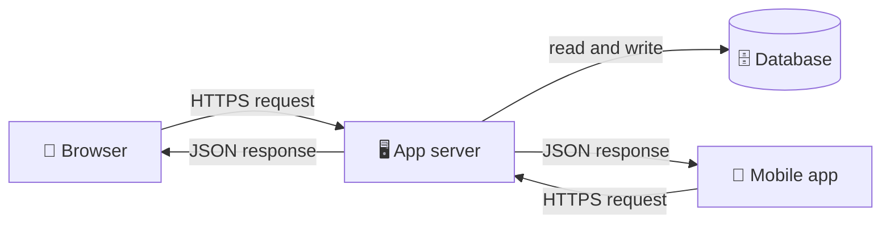

# 01 · Client-Server Architecture

> [!info] Topic info
> **Subject:** System Design · **Chapter:** Architectural Patterns · **Priority:** 🔥 High · **Status:** ✅ done · **Last reviewed:** 2026-11-19
>
> [← Back to Architectural Patterns](README.md) · [Interview questions →](questions/architectural-patterns-qa.md)

> [!abstract] In one line
> **Clients** (browser, mobile app) send **requests**; a central **server** owns the data and logic and sends back **responses**.

---

## 1. The problem

Our social media app has 10 million phones and browsers. Each one wants to see the same feed, the same likes, the same profile.

If every phone kept its own copy of the data, nobody would agree on anything. We need **one place** that owns the truth and that everyone asks.

---

## 2. How it works

- **Client** — the thing the user touches. It shows the UI and asks for data. It is **untrusted**: anyone can modify it.
- **Server** — always on, owns the database and the business rules. It **validates everything**.
- They talk over a network, usually **HTTP** (request → response). See [HTTP & HTTPS](../networking/04-http-https.md).

The key rule: **the client initiates**. The server doesn't call the client out of nowhere — for server push you need extra tools like [WebSockets](../communication-patterns/03-websockets.md) or [SSE](../communication-patterns/02-server-sent-events.md).

> [!tip] 🎤 Say it like this
> "Client-server means clients make requests and a central server owns the data and the rules. The client is just a view — it's untrusted, so the server validates everything. It's the default model for almost every web and mobile app."

---

## 3. Tiers — how the server side grows

"Tier" = a layer that can run on its own machine.

| Tier | Layers | Example |
|---|---|---|
| **1-tier** | UI + logic + data in one program | A desktop app with a local SQLite file |
| **2-tier** | Client ↔ database directly | Old desktop apps hitting a shared DB |
| **3-tier** | Client ↔ app server ↔ database | Almost every modern web app |
| **N-tier** | Adds load balancer, cache, queues, services | Our social media app at scale |

**3-tier** is the one to know. The client never touches the database — the app server sits in the middle, enforces rules, and can be scaled out.

> [!note] Thin vs thick client
> A **thin client** (simple web page) does little work — the server renders and decides. A **thick client** (React SPA, mobile app) does a lot locally: rendering, caching, offline mode. Even with a thick client, the server stays the source of truth.

---

## 4. Trade-offs

**✅ Pros**
- **Central control** — one place for data, security, and updates.
- **Easy to reason about** — one source of truth, clear request flow.
- **Clients stay light** — fix a bug on the server and every user gets it instantly.

**❌ Cons**
- **Server is the bottleneck** — 10M users hit the same backend. Fix: [horizontal scaling](../core-concepts/01-scalability.md) + [load balancers](../load-balancing/01-load-balancers.md).
- **Server is a [single point of failure](../core-concepts/04-single-point-of-failure.md)** unless you add redundancy.
- **Network dependent** — no network, no app (unless the client caches offline).

> [!example] Client-server vs peer-to-peer
> Client-server is a restaurant: you order, the kitchen cooks. [Peer-to-peer](06-peer-to-peer.md) is a potluck: everyone brings and takes food. Most apps are restaurants.

> [!failure] Interview traps
> - Trusting the client — "the app already checked the price" is how people get free stuff. **Always validate on the server.**
> - Thinking client-server means "one server". It means one **logical** server side — behind it can be 500 machines.
> - Forgetting the server can't push by default — mention WebSockets/SSE when you need real-time.

---

## Summary

- Clients ask, the server owns data and rules.
- 3-tier (client → app server → DB) is the standard shape.
- The server side becomes the bottleneck and SPOF — scale it out and add redundancy.
- Never trust the client.

> [!success] Key takeaway
> Client-server is the default starting point for every design. Everything else in system design is about making the "server" side bigger, faster, and harder to break.
