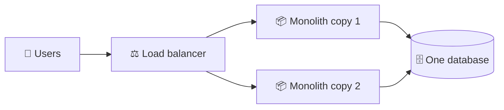

# 02 · Monolith

> [!info] Topic info
> **Subject:** System Design · **Chapter:** Architectural Patterns · **Priority:** ⚡ Medium · **Status:** ✅ done · **Last reviewed:** 2026-11-19
>
> [← Back to Architectural Patterns](README.md) · [Interview questions →](questions/architectural-patterns-qa.md)

> [!abstract] In one line
> A **monolith** is one **codebase**, built and **deployed as a single unit**, usually with **one shared database**.

---

## 1. The problem

We're starting the social media app with 4 engineers. We need users, posts, feed, and likes — fast.

Splitting into 10 services on day one means 10 deploy pipelines, network calls everywhere, and distributed bugs. We just want to **ship**.

---

## 2. How it works

All features live in one app. Modules call each other with plain **function calls** — no network. One build, one deploy, one database.

> [!note] Monoliths scale too
> You can run 20 copies of the same monolith behind a load balancer. Shopify and Stack Overflow ran huge traffic on monoliths. "Monolith" is about **how code is deployed**, not "only one server".

---

## 3. Pros, cons, and where it breaks

**✅ Pros**
- **Simple** — one repo, one deploy, easy local setup.
- **Fast calls** — in-process, no network latency or partial failures.
- **Easy transactions** — one DB, so a normal ACID transaction covers everything.
- **Easy debugging** — one stack trace, one log.

**❌ Cons (they show up as the team grows)**
- **Slow deploys** — a 1-line fix ships the whole app; a 40-minute build blocks everyone.
- **Team collisions** — 100 engineers in one codebase step on each other.
- **Scale everything together** — the image resizer needs CPU, but you must scale the whole app.
- **One bug can take it all down** — a memory leak in reports crashes login too.
- **Locked to one tech stack.**

> [!warning] The "big ball of mud"
> The real danger isn't the monolith — it's a monolith **without boundaries**, where every module reaches into every other module's tables. That's what makes it impossible to change or split later.

---

## 4. Modular monolith — the smart middle ground

Keep **one deploy**, but split code into **modules with clear boundaries**: `users`, `posts`, `feed`. Each module owns its tables and talks to others only through a public interface.

You get monolith simplicity today, and a clean seam to extract a [microservice](03-microservices.md) later — only if you actually need to.

> [!tip] 🎤 Say it like this
> "I'd start with a modular monolith. It's one deployable, so it's simple and fast to build, but the code is split into modules with strict boundaries. When a module needs to scale on its own or a team needs to deploy on its own, I extract that one module into a service."

> [!failure] Interview traps
> - Saying "monoliths don't scale" — they scale horizontally just fine. The pain is **organizational**, not traffic.
> - Jumping to microservices for a startup with 5 engineers.
> - Thinking "monolith" means messy code. A modular monolith can be very clean.

---

## Summary

| Stage | Good choice |
|---|---|
| **Startup, small team** | Monolith |
| **Growing, 20–50 engineers** | Modular monolith |
| **Many teams, parts need separate scaling** | Extract services one by one |

> [!success] Key takeaway
> Start with a (modular) monolith. Split only when team size or uneven scaling actually hurts — see [Microservices](03-microservices.md) for when.
