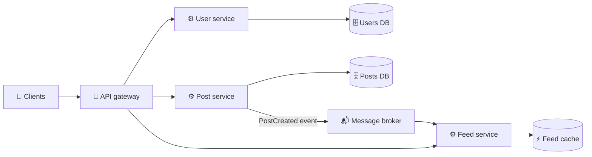

# 03 · Microservices

> [!info] Topic info
> **Subject:** System Design · **Chapter:** Architectural Patterns · **Priority:** 🔥 High · **Status:** ✅ done · **Last reviewed:** 2026-11-19
>
> [← Back to Architectural Patterns](README.md) · [Interview questions →](questions/architectural-patterns-qa.md)

> [!abstract] In one line
> **Microservices** split an app into **small, independently deployable services**, each owning **one business capability** and **its own data**.

---

## 1. The problem

Our social media app is now a [monolith](02-monolith.md) with 200 engineers. A deploy takes 45 minutes and needs 6 teams to sign off.

During a viral moment, the **feed** needs 10× more servers, but we have to scale the whole app. One bad change in **ads** crashed **login** last week.

---

## 2. How it works

Each service is a small app with its own repo, deploy pipeline, and database. Services talk over the network — sync (REST/gRPC) or async (events).

The rules that make it "micro":

- **Split by business capability** (users, posts, payments) — not by tech layer (UI, logic, DB).
- **Database per service** — no other service reads your tables. They ask your API or listen to your events.
- **Deploy independently** — the feed team ships 10 times a day without asking anyone.
- **One team owns it** end to end ("you build it, you run it").

> [!tip] 🎤 Say it like this
> "Microservices split the system by business capability. Each service owns its data and deploys on its own, so teams move independently and we can scale just the hot parts. The price is distributed-systems complexity — network failures, no easy joins or transactions across services, and a lot more ops work."

---

## 3. Monolith vs microservices

| | Monolith | Microservices |
|---|---|---|
| **Deploy** | Whole app at once | Each service alone |
| **Scaling** | Scale everything together | Scale only the hot service |
| **Calls between parts** | Function call, ~ns | Network call, ~ms, can fail |
| **Transactions** | One ACID transaction | [Sagas](../distributed-transactions/04-saga-pattern.md), eventual consistency |
| **Data** | One shared DB, easy joins | DB per service, no cross-service joins |
| **Debugging** | One stack trace | Need [distributed tracing](../observability/05-distributed-tracing.md) |
| **Failure** | One bug can crash all | Failures isolated — if done right |
| **Team fit** | Small team, one codebase | Many teams, clear ownership |
| **Ops cost** | Low | High — CI/CD, containers, monitoring per service |

---

## 4. The new problems you buy

Every one of these has its own note — don't re-solve them from scratch in an interview, just name them.

| Problem | Pattern |
|---|---|
| **Clients shouldn't call 30 services** | [API gateway](../microservices-patterns/02-api-gateway.md), [BFF](../microservices-patterns/03-backend-for-frontend.md) |
| **Where is service X right now?** | [Service discovery](../microservices-patterns/01-service-discovery.md) |
| **One slow service drags down others** | [Circuit breaker](../microservices-patterns/05-circuit-breaker.md), [Bulkhead](../microservices-patterns/06-bulkhead.md) |
| **Retries, mTLS, metrics in every service** | [Sidecar](../microservices-patterns/04-sidecar.md), [Service mesh](../microservices-patterns/08-service-mesh.md) |
| **Transaction across services** | [Saga](../distributed-transactions/04-saga-pattern.md), [Outbox](../distributed-transactions/05-outbox-pattern.md) |
| **Migrating off the monolith** | [Strangler fig](../microservices-patterns/07-strangler-fig.md) |

> [!warning] The distributed monolith
> If services share one database, or must deploy together, or a request chains through 8 sync calls — you have all the pain of microservices and none of the benefits. Each sync hop also multiplies failure: 5 services at 99.9% each ≈ **99.5%** for the chain.

---

## 5. When to split

Start with a **modular monolith**. Extract a service when you see a real reason:

- **Team pain** — many teams blocked on one deploy pipeline.
- **Different scaling needs** — video transcoding needs GPUs, the rest doesn't.
- **Different reliability needs** — payments must stay up even if recommendations crash.
- **Clear, stable boundary** — the module already has its own tables and a clean API.

> [!question] Ask the interviewer
> How many engineers and teams? Which parts get the most load? Do we already have strong DevOps (CI/CD, containers, monitoring)?

> [!failure] Interview traps
> - "Microservices because Netflix does it." Netflix has thousands of engineers — you might have 6.
> - Splitting by layer (frontend service, DB service) instead of by business capability.
> - Sharing one database between services — that's a coupling trap.
> - Forgetting the cost: network latency, eventual consistency, tracing, on-call for 40 services.

---

## Summary

- Small services, split by business capability, each with its own DB and deploy.
- Wins: independent deploys, targeted scaling, fault isolation, team autonomy.
- Costs: network failures, no cross-service transactions, heavy ops.
- Mostly an **organizational** choice — it helps big teams more than big traffic.

> [!success] Key takeaway
> Microservices solve people-scaling problems by adding technical complexity. Start modular, split when it hurts, and avoid the distributed monolith.
