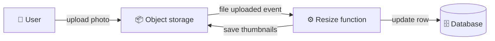

# 04 · Serverless

> [!info] Topic info
> **Subject:** System Design · **Chapter:** Architectural Patterns · **Priority:** ⚡ Medium · **Status:** ✅ done · **Last reviewed:** 2026-11-19
>
> [← Back to Architectural Patterns](README.md) · [Interview questions →](questions/architectural-patterns-qa.md)

> [!abstract] In one line
> **Serverless** means you deploy **functions**, the cloud runs them **on demand**, **scales them automatically** (even to zero), and you **pay per request**.

---

## 1. The problem

Our social media app resizes every uploaded photo. Uploads spike to 5,000/sec at 9 PM and drop to almost 0 at 4 AM.

Keeping 50 servers running all night for a job that's idle most of the time wastes money. And someone has to patch and scale those servers.

---

## 2. How it works

There are still servers — you just don't manage them. You upload a function (AWS Lambda, Google Cloud Functions). An **event** triggers it: an HTTP call, a file upload, a queue message, a cron.

- 1 upload → 1 function run. 5,000 uploads → the platform runs thousands in parallel.
- No uploads → **zero** instances, **zero** cost.
- Functions are **stateless** — anything to keep goes to a DB, cache, or storage.

> [!note] Serverless is wider than functions
> Managed services with no servers to size — DynamoDB, S3, SQS, Aurora Serverless — are also called "serverless". Functions are called **FaaS** (Function as a Service).

> [!tip] 🎤 Say it like this
> "Serverless means I write functions and the cloud runs them per event, scaling from zero to thousands automatically, and I pay only per invocation. It's great for spiky or event-driven work. The catches are cold starts, execution time limits, vendor lock-in, and it can get expensive at steady high traffic."

---

## 3. The catches

**🥶 Cold starts** — the first call to a new instance has to boot it: ~100 ms to a few seconds (worse for Java/.NET, big packages, VPCs). Bad for a login API with a p99 target of 200 ms. Fixes: provisioned/warm instances, smaller packages, lighter runtimes.

**⏱️ Limits** — max run time (AWS Lambda: 15 min), memory caps, payload size limits. A 2-hour video encode doesn't fit — split it or use containers.

**🔌 DB connection storms** — 3,000 functions start at once, each opens its own DB connection, and Postgres (often ~100–500 max connections) falls over. Fix: a connection proxy/pooler — see [Connection pooling](../database-scaling/08-connection-pooling.md) — or use an HTTP-based DB.

**💰 Cost model** — you pay per request + per GB-second. Cheap when spiky or low traffic; at steady high load (say 10,000 req/s all day) plain containers are usually **cheaper**.

**🔒 Vendor lock-in and debugging** — triggers and configs are cloud-specific; local testing and tracing across many functions is harder.

---

## 4. When to use it

| | Good fit | Bad fit |
|---|---|---|
| **Traffic** | Spiky, unpredictable, or low | Steady and high |
| **Work type** | Short, event-driven jobs | Long-running, stateful |
| **Examples** | Image resize, webhooks, cron jobs, small APIs, glue code | WebSocket servers, game servers, video encoding, low-latency trading |

> [!failure] Interview traps
> - Saying "serverless = no servers" — there are servers, you just don't manage them.
> - Ignoring cold starts for latency-sensitive user APIs.
> - Letting thousands of functions open DB connections directly.
> - Assuming it's always cheaper — do the math at steady load.

---

## Summary

- Functions run per event, auto-scale to zero, pay per use.
- Stateless — state lives in DBs, caches, storage.
- Watch: cold starts, time limits, connection storms, cost at high steady load, lock-in.

> [!success] Key takeaway
> Serverless is perfect for spiky, short, event-driven work. For steady, heavy, or long-running work, containers usually win.
