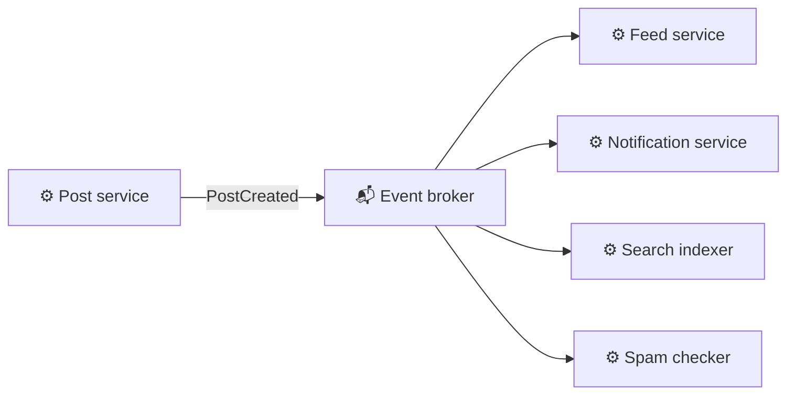

# 05 · Event-Driven Architecture

> [!info] Topic info
> **Subject:** System Design · **Chapter:** Architectural Patterns · **Priority:** 🔥 High · **Status:** ✅ done · **Last reviewed:** 2026-11-19
>
> [← Back to Architectural Patterns](README.md) · [Interview questions →](questions/architectural-patterns-qa.md)

> [!abstract] In one line
> In **event-driven architecture**, services **publish events** ("something happened") to a broker, and other services **react** — the producer **doesn't know or wait** for who listens.

---

## 1. The problem

When a user creates a post, the Post service must: update followers' feeds, send notifications, index it for search, and run spam checks.

If Post service calls all 4 directly, one slow call makes posting slow, one dead service makes posting fail. And every new feature means editing Post service again.

---

## 2. How it works

Post service saves the post and publishes **one event**: `PostCreated`. It's done. Everyone who cares subscribes.

- **Producer** — publishes the event. Doesn't know who listens.
- **Broker** — Kafka, RabbitMQ, SNS/SQS. Stores and delivers events. See [Message brokers](../communication-patterns/08-message-brokers.md) and [Pub/Sub](../communication-patterns/07-pub-sub.md).
- **Consumers** — subscribe and react, each at its own speed.

Adding an "analytics" feature tomorrow? Just subscribe a new consumer. Post service doesn't change.

> [!tip] 🎤 Say it like this
> "In event-driven architecture, a service announces that something happened and doesn't care who reacts. That decouples services — the producer stays fast and up even if a consumer is slow or down, and new features just subscribe. The cost is eventual consistency and harder debugging, since there's no single call chain to follow."

---

## 3. Events vs commands

| | Event | Command |
|---|---|---|
| **Meaning** | Something **happened** (past tense) | Please **do** this (imperative) |
| **Example** | `PostCreated`, `PaymentFailed` | `SendEmail`, `ChargeCard` |
| **Receivers** | 0, 1, or many — sender doesn't care | Exactly one, expected to handle it |
| **Can it be rejected?** | No — it's a fact | Yes — it can fail or be refused |

Name events in the **past tense**. If you're telling one specific service what to do, that's a command, not an event.

---

## 4. Choreography vs orchestration

When a business flow spans several services (order → pay → ship), who drives it?

- **Choreography** — no boss. Each service listens to events and emits the next one. Very decoupled, but the full flow is hard to see.
- **Orchestration** — one **orchestrator** tells each service what to do, step by step. Easy to see and change, but it's a central piece.

| | Choreography | Orchestration |
|---|---|---|
| **Control** | Spread out, via events | Central orchestrator |
| **Coupling** | Lowest | Services coupled to orchestrator |
| **Visibility** | Hard — flow lives in many places | Easy — flow in one place |
| **Best for** | Simple flows, 2–4 steps | Complex flows with many steps and rollbacks |

Both are used to implement the [Saga pattern](../distributed-transactions/04-saga-pattern.md) for multi-service transactions.

---

## 5. What gets harder

> [!warning] Eventual consistency
> After posting, the feed may update 200 ms later. The user might refresh and not see their own post. Fix tricks: show it from the client side right away, or read-your-own-writes from the primary. See [CAP theorem](../core-concepts/07-cap-theorem.md).

- **Duplicates** — brokers usually deliver **at least once**, so consumers must be **idempotent**. See [Delivery semantics](../communication-patterns/09-delivery-semantics.md).
- **Ordering** — events can arrive out of order; Kafka only orders within a partition, so key by `postId` or `userId`.
- **Dual write** — saving to DB and publishing the event can half-fail. Use the [Outbox pattern](../distributed-transactions/05-outbox-pattern.md).
- **Poison messages** — a bad event that always fails goes to a [Dead letter queue](../communication-patterns/10-dead-letter-queues.md).
- **Debugging** — no single stack trace; use correlation IDs and [distributed tracing](../observability/05-distributed-tracing.md).

**✅ Pros:** loose coupling, producer stays fast, absorbs spikes, easy to add consumers.

**❌ Cons:** eventual consistency, duplicates/ordering issues, harder to trace and test.

> [!failure] Interview traps
> - Using events when you need an immediate answer — "is the password correct?" should be a sync call.
> - Forgetting idempotent consumers.
> - Writing to DB and broker separately without an outbox.
> - Calling everything an event — `SendEmail` is a command.

---

## Summary

- Producers publish facts; consumers react independently.
- Events = past facts, many listeners. Commands = requests to one handler.
- Choreography for simple flows, orchestration for complex ones.
- Pay for decoupling with eventual consistency, idempotency, and tracing work.

> [!success] Key takeaway
> Use events for side effects that don't need to finish before you reply to the user. Keep the critical path sync, push everything else to events.
