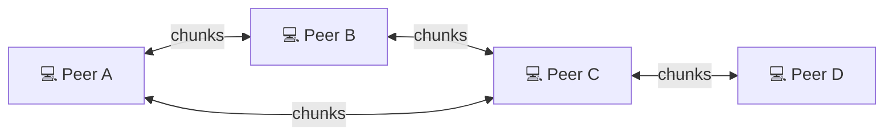

# 06 · Peer-to-Peer (P2P)

> [!info] Topic info
> **Subject:** System Design · **Chapter:** Architectural Patterns · **Priority:** 💤 Low · **Status:** ✅ done · **Last reviewed:** 2026-11-19
>
> [← Back to Architectural Patterns](README.md) · [Interview questions →](questions/architectural-patterns-qa.md)

> [!abstract] In one line
> In **peer-to-peer**, every node is **both client and server** — peers share data and work **directly with each other**, with **no central server** owning everything.

---

## 1. The problem

A 4 GB game update goes out to 10 million players. From one central server, that's 40 PB of bandwidth in a few hours — hugely expensive, and the server melts.

But every player who already downloaded it has the file sitting on their machine. Why not let them share it?

---

## 2. How it works

Each peer downloads pieces of the file from other peers and uploads pieces it already has. **More users = more capacity**, the opposite of client-server.

Peers find each other through a **tracker** (a small server that lists who has what) or a **DHT** — a distributed hash table spread across peers, built on ideas like [consistent hashing](../core-concepts/06-consistent-hashing.md).

**Real examples:** BitTorrent, Bitcoin/blockchains, [WebRTC](../communication-patterns/05-webrtc.md) video calls (media flows peer to peer), game patch distribution.

> [!tip] 🎤 Say it like this
> "In peer-to-peer every node is both a client and a server, so capacity grows with the number of users and there's no central bottleneck. The trade-offs are trust, discovery, and consistency — peers can be slow, offline, or malicious, so you need hashing to verify data and some way to find peers."

---

## 3. Trade-offs

**✅ Pros**
- **Scales with users** — every new peer adds bandwidth.
- **No single point of failure**, cheap for the publisher.

**❌ Cons**
- **Untrusted peers** — verify every chunk with a hash (see [Merkle trees](../data-structures/10-merkle-trees.md)).
- **Churn** — peers come and go constantly.
- **NAT/firewalls** — home devices are hard to reach directly; need hole punching or relay servers.
- **Hard to control** — no central place to update, moderate, or delete.

> [!failure] Interview traps
> - Saying P2P has "no servers at all" — most real systems still use trackers, signalling, or relay servers.
> - Proposing P2P for things that need strong consistency or central control, like bank balances or a social feed.

---

## Summary

| | Client-server | Peer-to-peer |
|---|---|---|
| **Who serves** | Central server | Every peer |
| **More users means** | More load | More capacity |
| **Control and trust** | Easy | Hard |

> [!success] Key takeaway
> P2P shines for distributing big files or direct media streams. For most apps, client-server wins because control and consistency matter more.
