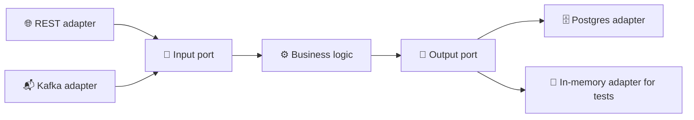

# 07 · Hexagonal Architecture (Ports & Adapters)

> [!info] Topic info
> **Subject:** System Design · **Chapter:** Architectural Patterns · **Priority:** 💤 Low · **Status:** ✅ done · **Last reviewed:** 2026-11-19
>
> [← Back to Architectural Patterns](README.md) · [Interview questions →](questions/architectural-patterns-qa.md)

> [!abstract] In one line
> **Hexagonal architecture** keeps **business logic in the center**, free of frameworks and databases; the outside world plugs in through **ports** (interfaces) and **adapters** (implementations).

---

## 1. The problem

Our "create post" logic has SQL queries, HTTP request parsing, and S3 calls mixed into one function.

Now we want to move from MySQL to Postgres, add a Kafka consumer that also creates posts, and unit test the rules. Every change touches business logic, and tests need a real DB.

---

## 2. How it works

- **Core (domain)** — pure business rules: "a post can't be over 5,000 chars", "banned users can't post". No SQL, no HTTP.
- **Ports** — interfaces the core defines: `PostRepository.save()`, `Notifier.send()`.
- **Adapters** — the real tech that implements or calls the ports: a Postgres adapter, a REST controller, a Kafka consumer.

The key rule: **dependencies point inward**. The core never imports a database driver or web framework. Same idea as "Clean Architecture" and "Onion Architecture".

> [!tip] 🎤 Say it like this
> "Hexagonal architecture puts business logic in the middle and hides all tech behind interfaces called ports. Adapters plug real things in — REST, Kafka, Postgres. So I can swap a database or test the logic with in-memory fakes without touching the rules."

---

## 3. Trade-offs

**✅ Pros:** easy unit tests, swap tech without rewriting logic, many entry points (HTTP, queue, CLI) share one core.

**❌ Cons:** more interfaces and files — overkill for a simple CRUD service.

> [!failure] Interview traps
> - Confusing it with microservices — hexagonal is about the **inside** of one service, not how services are split.
> - Using it for a tiny CRUD app where it only adds boilerplate.

---

## Summary

- Core = business rules, no tech. Ports = interfaces. Adapters = tech.
- Dependencies point inward.
- Pays off in services with real business logic and long life.

> [!success] Key takeaway
> Keep the rules in the middle and the tech at the edges, so you can change the edges without breaking the rules.
