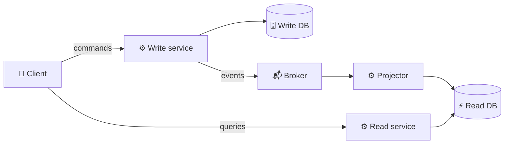

# 08 · CQRS (Command Query Responsibility Segregation)

> [!info] Topic info
> **Subject:** System Design · **Chapter:** Architectural Patterns · **Priority:** ⚡ Medium · **Status:** ✅ done · **Last reviewed:** 2026-11-19
>
> [← Back to Architectural Patterns](README.md) · [Interview questions →](questions/architectural-patterns-qa.md)

> [!abstract] In one line
> **CQRS** uses **separate models** — often separate stores — for **writes (commands)** and **reads (queries)**, so each can be shaped and scaled for its own job.

---

## 1. The problem

Our app does 1,000 writes/sec (new posts, likes) but 100,000 reads/sec (feeds, profiles). That's 100:1.

Writes want normalized tables with strict rules. The feed read wants one fast, pre-joined lookup. One model can't be good at both — the feed query joins 5 tables and slows down writes too.

---

## 2. How it works

- **Command side** — handles changes (`CreatePost`, `LikePost`). Validates rules, writes to a normalized DB.
- **Query side** — handles reads. Uses **read models** shaped exactly for each screen (denormalized, maybe in Redis or Elasticsearch).
- **Sync** — every write emits an event; a projector updates the read models.

Now we can scale reads to 50 nodes and writes to 3, and use different databases for each.

> [!note] Lighter versions exist
> CQRS doesn't always mean two databases. Even separate read/write classes on one DB, or a [materialized view](../database-scaling/07-materialized-views.md), is a light form of it. [Read replicas](../database-scaling/03-replication.md) are similar in spirit but use the **same** model.

> [!tip] 🎤 Say it like this
> "CQRS splits writes and reads into separate models. Writes go to a normalized store that enforces the rules; reads come from denormalized views built for each screen and kept in sync by events. It's great when reads and writes look very different or scale very differently, but the read side becomes eventually consistent."

---

## 3. Worth it vs overkill

| | Worth it | Overkill |
|---|---|---|
| **Read/write load** | Very uneven, e.g. 100:1 | Roughly even, low traffic |
| **Read shapes** | Many different views — feed, search, analytics | Simple CRUD screens |
| **Domain** | Complex rules on the write side | Basic forms |
| **Consistency** | Reads can lag a bit | Must read your write instantly everywhere |

**❌ Cons:** eventual consistency, more moving parts, two models to keep in sync, harder debugging.

Often paired with [Event Sourcing](09-event-sourcing.md) — events are the write model, and read models are projections of them. But you can use CQRS **without** event sourcing.

> [!failure] Interview traps
> - Thinking CQRS requires event sourcing — it doesn't.
> - Using it for a simple CRUD app.
> - Forgetting that a user may not see their own write right away — plan for it (read your own write from the write side, or update the UI optimistically).

---

## Summary

- Commands write, queries read — separate models, often separate stores.
- Events keep read models in sync → eventually consistent.
- Use it for read-heavy, multi-view, complex-domain systems.

> [!success] Key takeaway
> CQRS lets reads and writes each be fast in their own way. Only reach for it when one model is clearly failing both jobs.
