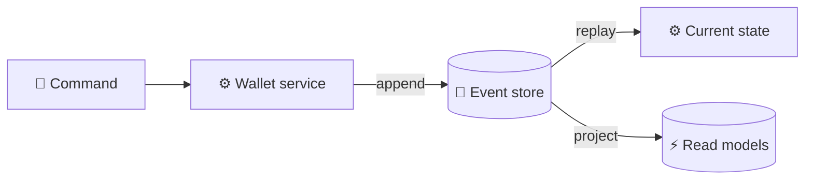

# 09 · Event Sourcing

> [!info] Topic info
> **Subject:** System Design · **Chapter:** Architectural Patterns · **Priority:** ⚡ Medium · **Status:** ✅ done · **Last reviewed:** 2026-11-19
>
> [← Back to Architectural Patterns](README.md) · [Interview questions →](questions/architectural-patterns-qa.md)

> [!abstract] In one line
> **Event sourcing** stores **every change as an immutable event** in an append-only log; the current state is **rebuilt by replaying** those events.

---

## 1. The problem

A user's wallet in our app shows a balance of $50. They say "I had $80 yesterday — where did $30 go?"

A normal table only stores `balance = 50`. The old value is overwritten. We have no history, no audit trail, and no way to see what the balance was last Tuesday.

---

## 2. How it works

Instead of updating a row, we **append events**:

| # | Event |
|---|---|
| 1 | `WalletOpened` |
| 2 | `MoneyAdded $100` |
| 3 | `MoneySpent $20` |
| 4 | `MoneySpent $30` |

Balance = replay: 0 + 100 − 20 − 30 = **$50**. Events are **never edited or deleted** — a mistake is fixed by adding a new event like `RefundIssued`.

- **Snapshots** — replaying 1 million events on every read is slow. Save the state every N events (say 1,000) and replay only what came after.
- **Projections** — build query-friendly views from the events. That's [CQRS](08-cqrs.md) — the two often go together.

> [!example] Analogy
> A bank statement. The bank doesn't just store your balance — it stores every transaction. The balance is the sum.

> [!tip] 🎤 Say it like this
> "Event sourcing stores every change as an immutable event instead of overwriting state. Current state is a replay of those events, with snapshots to keep it fast. You get a full audit trail and time travel for free, but schema changes, replays, and querying get harder, so it's worth it mainly for audit-heavy domains like money or orders."

---

## 3. Worth it vs overkill

**✅ Pros**
- **Full audit trail** — every change, who, and when.
- **Time travel** — rebuild state at any point; great for debugging.
- **New read models any time** — replay history into a new view.
- Fits naturally with [event-driven](05-event-driven.md) systems.

**❌ Cons**
- **Event schema changes are hard** — old events live forever; you need versioning/upcasting.
- **Querying is hard** — "all users with balance > $100" needs a projection.
- **Eventual consistency** on read models.
- **Deleting personal data** (GDPR) is tricky in an append-only log — often handled by encrypting per-user data and throwing away the key.

| | Worth it | Overkill |
|---|---|---|
| **Domain** | Money, orders, inventory, bookings | Profiles, settings, blog posts |
| **Audit need** | Legal or business requirement | Nobody asks for history |
| **Team** | Comfortable with events and CQRS | Small team doing CRUD |

> [!failure] Interview traps
> - Confusing event sourcing with event-driven architecture. ES = how **one service stores** its data. EDA = how **services talk**.
> - Forgetting snapshots — replay time grows forever.
> - Editing or deleting past events instead of adding a correcting event.
> - Using it everywhere instead of only in the parts that need history.

---

## Summary

- Store events, not current state. State = replay.
- Snapshots for speed, projections for queries (CQRS).
- Strong for audit-heavy domains, overkill for plain CRUD.

> [!success] Key takeaway
> Event sourcing turns your data into a history book. Great when the history matters, expensive when it doesn't.
