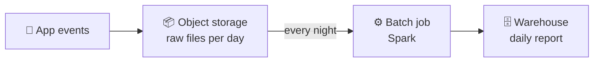
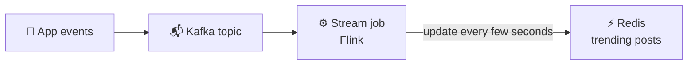

# 01 · Batch vs Stream Processing

> [!info] Topic info
> **Subject:** System Design · **Chapter:** Big Data Processing · **Priority:** 🔥 High · **Status:** ✅ done · **Last reviewed:** 2026-11-19
>
> [← Back to Big Data Processing](README.md) · [Interview questions →](questions/big-data-qa.md)

> [!abstract] In one line
> **Batch processing** works on a **big, finished chunk of data** on a schedule (high latency, high throughput). **Stream processing** works on **each event as it arrives** (low latency, always running).

---

## 1. The problem

Our social media app now has **50 million users** creating **~2 billion events a day** — post views, likes, follows, clicks.

The product team wants two very different things:

- 📊 A **daily report**: "views per post, per country, yesterday." Nobody minds if it's ready at 6 AM.
- 🔥 A **trending** list: "what's blowing up in the last 5 minutes." If it's an hour late, it's useless.

Same data, two different time needs. That's the whole batch vs stream question.

---

## 2. Batch processing

Collect data for a period (an hour, a day), then run one big job over **all of it at once**.

- The input is **bounded** — it has a start and an end. The job knows when it's done.
- If the job has a bug, fix the code and **re-run it** on the same files. Easy.
- Tools: **Spark**, Hadoop [MapReduce](03-mapreduce.md), SQL in a [warehouse](06-data-warehousing.md).

**✅ Pros**
- Simple to reason about and to re-run.
- Very high throughput — scans terabytes cheaply.
- Can see **all** the data, so joins and exact counts are easy.

**❌ Cons**
- High latency — results are hours old.
- Big spiky load at job time.

---

## 3. Stream processing

Process each event (or tiny group of events) **as soon as it arrives**, and keep running forever.

- The input is **unbounded** — it never ends. So "count views" really means "count views **in a window**", e.g. the last 5 minutes. See [Streaming Engines](10-streaming-engines.md).
- The job keeps **state** (running counts) in memory and checkpoints it so it survives crashes.
- Tools: **Flink**, **Kafka Streams**, **Spark Structured Streaming**.

**✅ Pros**
- Latency in **seconds or milliseconds**.
- Smooth, steady load instead of one big nightly spike.

**❌ Cons**
- Harder: late events, out-of-order events, state, exactly-once.
- Re-processing old data is harder (you replay the log).

> [!tip] 🎤 Say it like this
> "Batch takes a bounded chunk of data — say yesterday's logs — and processes it all at once. It's simple and high-throughput, but results are hours old. Streaming processes unbounded data event by event, so results are seconds old, but you now have to handle state, late events and failures while the job keeps running."

---

## 4. Side by side

| | Batch | Stream |
|---|---|---|
| **Data** | Bounded (a day's files) | Unbounded (never ends) |
| **Latency** | Minutes to hours | Milliseconds to seconds |
| **Throughput** | Very high | High, but per-event cost |
| **Correctness** | Easy — sees all data | Harder — late / out-of-order data |
| **Re-run on bug** | Just re-run the job | Replay the log from an offset |
| **Typical use** | Daily reports, ML training, billing | Trending, fraud alerts, live dashboards |
| **Tools** | Spark, MapReduce, warehouse SQL | Flink, Kafka Streams, Spark Streaming |

> [!note] Micro-batch sits in between
> **Spark Structured Streaming** (classic mode) runs tiny batches every ~1 second. It looks like streaming to users but is batch inside. Good enough for most "near real-time" needs.

---

## 5. Which one should I pick?

Ask: **"How fresh must the answer be?"**

- **Hours are fine** → batch. Cheaper and simpler.
- **Seconds matter** → stream. Fraud detection, trending, live counters, alerts.
- **Both** → many companies run both. That's the [Lambda Architecture](08-lambda-architecture.md). Or do everything as a stream: [Kappa Architecture](09-kappa-architecture.md).

> [!example] Social media app split
> - 🔥 Trending hashtags (last 10 min) → **stream**
> - 👀 Live view counter on a post → **stream**
> - 📊 Creator's monthly earnings report → **batch**
> - 🤖 Training the feed-ranking model → **batch**

> [!question] Ask the interviewer
> "How fresh does this metric need to be — seconds, minutes, or is a daily number fine?" The answer decides the whole pipeline.

> [!failure] Interview traps
> - Saying "streaming is always better". It costs more and is harder to get right — only use it when freshness pays.
> - Forgetting that streams are **unbounded**, so every aggregation needs a **window**.
> - Ignoring **late data** — a phone that was offline sends events 2 hours late.
> - Thinking batch can't be frequent. A batch job every 15 minutes is still batch.

---

## Summary

| Question | Batch | Stream |
|---|---|---|
| **When** | On a schedule | Always on |
| **Input** | Bounded chunk | Endless events |
| **Freshness** | Hours | Seconds |
| **Hard part** | Latency | State, late data, failures |

> [!success] Key takeaway
> Pick by **freshness need**. Default to batch for reports and ML; use streaming only where seconds matter — trending, alerts, fraud.
