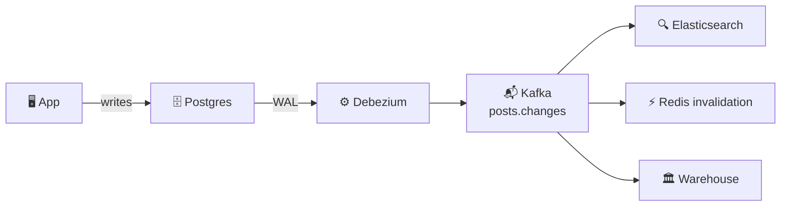

# 02 · Change Data Capture (CDC)

> [!info] Topic info
> **Subject:** System Design · **Chapter:** Big Data Processing · **Priority:** ⚡ Medium · **Status:** ✅ done · **Last reviewed:** 2026-11-19
>
> [← Back to Big Data Processing](README.md) · [Interview questions →](questions/big-data-qa.md)

> [!abstract] In one line
> **Change Data Capture** turns every **insert, update and delete** in a database into an **event stream**, usually by reading the database's own **change log** (WAL / binlog).

---

## 1. The problem

Our app stores posts in **Postgres**. But the same data must also live in **Elasticsearch** (search), **Redis** (cache) and the **warehouse** (analytics).

The naive fix is **dual writes**: the app writes to Postgres, then to Elasticsearch. If the second write fails, or two writes race, the copies drift apart forever. 💥

We want one source of truth, and everything else following it automatically.

---

## 2. How it works

Every database already writes a **log** of changes before applying them — Postgres calls it the **WAL** (write-ahead log), MySQL calls it the **binlog**. It's used for replication and crash recovery.

CDC tools like **Debezium** pretend to be a replica, read that log, and publish each change as an event to Kafka.

Each event looks like: `{op: update, table: posts, before: {...}, after: {...}, ts: ...}`.

> [!tip] 🎤 Say it like this
> "Instead of the app writing to many systems, it writes only to the database. A CDC tool like Debezium reads the database's write-ahead log and publishes every row change to Kafka. Search, cache and analytics just consume that stream, so they all follow the database in the same order, with no dual-write bugs."

---

## 3. Ways to capture changes

| Method | How | Good | Bad |
|---|---|---|---|
| **Log-based** ⭐ | Read WAL / binlog | Catches every change incl. deletes, in order, almost no DB load | Needs log access, DB-specific setup |
| **Polling / query** | `SELECT ... WHERE updated_at > last_seen` every N sec | Simple, works anywhere | Misses deletes, misses fast double-updates, adds load, delay |
| **Triggers** | DB trigger writes each change to an audit table | Catches everything | Slows every write, logic hidden in DB |

Log-based is the default answer in interviews.

---

## 4. Common use cases

- 🔍 **Sync a search index** — posts table → Elasticsearch. See [Full-Text Search](../databases/09-full-text-search.md).
- ⚡ **Cache invalidation** — on update, delete the Redis key. See [Cache Invalidation](../caching/04-cache-invalidation.md).
- 🏛️ **Feed the warehouse / lake** — near real-time analytics without nightly full dumps.
- 📬 **Outbox pattern** — the service writes its event into an `outbox` table in the same transaction; CDC publishes it. See [Outbox Pattern](../distributed-transactions/05-outbox-pattern.md).
- 🔀 **Migrations** — stream data from an old DB into a new one while both run.

**✅ Pros**
- No dual writes — the DB is the single source of truth.
- Keeps order per row, captures deletes.
- App code doesn't change.

**❌ Cons**
- Consumers are **eventually consistent** — a few hundred ms behind.
- **Schema changes** in the DB break consumers unless you manage them.
- Exposes internal table structure as a public event format.

> [!failure] Interview traps
> - Proposing dual writes from the app. Always mention the partial-failure problem.
> - Saying polling `updated_at` catches deletes — it doesn't (the row is gone).
> - Forgetting the initial **snapshot**: the log only has recent changes, so CDC first copies the existing table, then follows the log.
> - Assuming exactly-once — consumers should be **idempotent** (upsert by primary key). See [Reliability](../core-concepts/03-reliability.md).

---

## Summary

- CDC = database changes → event stream.
- Best way: **log-based** (Debezium reading WAL / binlog) → Kafka.
- Uses: search sync, cache invalidation, analytics, outbox, migrations.
- Consumers lag slightly and must be idempotent.

> [!success] Key takeaway
> "Write once to the database, let CDC fan it out." It replaces fragile dual writes with one ordered change stream.
