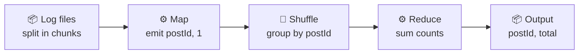

# 03 · MapReduce

> [!info] Topic info
> **Subject:** System Design · **Chapter:** Big Data Processing · **Priority:** 💤 Low · **Status:** ✅ done · **Last reviewed:** 2026-11-19
>
> [← Back to Big Data Processing](README.md) · [Interview questions →](questions/big-data-qa.md)

> [!abstract] In one line
> **MapReduce** is a batch model that splits a huge job into a **map** step (process chunks in parallel), a **shuffle** (group by key), and a **reduce** step (combine each group).

---

## 1. The problem

We have **10 TB** of view logs for yesterday and want "views per post". One machine reading 10 TB at 200 MB/s takes ~14 hours.

Split it across **1,000 machines** and it's under a minute of reading each. But now you need a simple way to split the work, move data between machines, and survive crashes.

---

## 2. How it works

1. **Map** — each worker reads one chunk, near where it's stored, and emits key-value pairs: `(post42, 1)`.
2. **Shuffle** — the framework sends all pairs with the same key to the same reducer (by hashing the key).
3. **Reduce** — each reducer adds up its keys: `(post42, 18_340)`.

If a worker dies, the master just **re-runs that chunk** on another machine. Inputs are immutable files, so it's safe.

> [!tip] 🎤 Say it like this
> "MapReduce splits a big batch job into map, shuffle and reduce. Mappers process chunks in parallel and emit key-value pairs, the shuffle groups them by key across the network, and reducers combine each group. Failed tasks are simply re-run, which is why it scales to thousands of machines."

---

## 3. Where it stands today

Classic Hadoop MapReduce writes to disk between every step, so multi-step jobs are slow. **Spark** replaced it for most work by keeping data **in memory** and chaining many steps. The map → shuffle → reduce idea still lives inside Spark, Flink and warehouse engines.

> [!failure] Interview traps
> - Proposing Hadoop MapReduce for a new design — say **Spark** instead, and mention MapReduce as the idea behind it.
> - Forgetting the **shuffle** is the expensive part (network). A **combiner** pre-sums on the mapper to send less data.
> - **Data skew**: one viral post sends millions of pairs to one reducer, which becomes the bottleneck.

---

## Summary

- Map (parallel) → Shuffle (group by key) → Reduce (combine).
- Fault tolerance = re-run failed tasks on immutable input.
- Today: use Spark; the model is the same.

> [!success] Key takeaway
> Know the three steps, why shuffle is costly, and that Spark is the modern choice.
