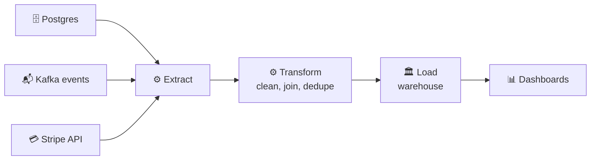

# 04 · ETL Pipelines

> [!info] Topic info
> **Subject:** System Design · **Chapter:** Big Data Processing · **Priority:** ⚡ Medium · **Status:** ✅ done · **Last reviewed:** 2026-11-19
>
> [← Back to Big Data Processing](README.md) · [Interview questions →](questions/big-data-qa.md)

> [!abstract] In one line
> **ETL** = **Extract** data from sources, **Transform** it (clean, join, reshape), **Load** it into an analytics store. **ELT** loads raw data first and transforms it **inside the warehouse**.

---

## 1. The problem

The analytics team wants "daily active users by country". The data is spread out: users in **Postgres**, events in **Kafka**, payments in **Stripe**.

Running heavy analytics queries on the production DB would slow the app for real users. So we need to copy data into a separate analytics store — cleaned and shaped for queries.

---

## 2. How it works

- **Extract** — pull data: full dumps, incremental (`updated_at > last_run`), or [CDC](02-change-data-capture.md).
- **Transform** — fix types, drop bad rows, remove duplicates, join users with events, hide PII (personal data like emails).
- **Load** — write into the [warehouse](06-data-warehousing.md) or [lake](05-data-lakes.md).

An **orchestrator** like **Airflow** runs the steps on a schedule as a DAG (a graph of tasks with dependencies), retries failures and alerts on errors.

---

## 3. ETL vs ELT

| | ETL | ELT |
|---|---|---|
| **Order** | Transform **before** loading | Load raw, transform **inside** warehouse |
| **Where transform runs** | Separate engine (Spark, scripts) | Warehouse SQL (often with **dbt**) |
| **Raw data kept?** | Usually no | Yes — can re-transform anytime |
| **Good for** | Strict privacy, limited warehouse power | Modern cloud warehouses (Snowflake, BigQuery) |
| **Today** | Older default | Most common now |

ELT won because cloud warehouses are cheap and fast, and keeping raw data means a bug in the transform can be fixed by just re-running SQL.

> [!tip] 🎤 Say it like this
> "ETL extracts data from sources, transforms it, then loads it into the warehouse. ELT flips the last two: load raw data first, then transform with SQL inside the warehouse. ELT is the modern default because warehouses are powerful and you keep the raw data to reprocess later."

---

## 4. What makes a pipeline good

- **Idempotent** — running the same day twice gives the same result (overwrite the day's partition, don't append). See [Reliability](../core-concepts/03-reliability.md).
- **Incremental** — process only new data, not the whole history each time.
- **Backfill-able** — you can re-run for any past date after fixing a bug.
- **Data quality checks** — row counts, null checks, freshness alerts.

> [!failure] Interview traps
> - Running analytics on the production primary DB.
> - Appending on retry → **duplicate rows**. Make loads idempotent.
> - No monitoring — pipelines fail **silently** and dashboards show stale numbers for days.
> - Breaking when a source **schema changes** (a renamed column). Add schema checks.

---

## Summary

- ETL: transform then load. ELT: load then transform in the warehouse (modern default).
- Orchestrate with a DAG tool like Airflow.
- Make pipelines idempotent, incremental, backfill-able and monitored.

> [!success] Key takeaway
> Keep analytics off the production DB, load raw data, transform in the warehouse, and make every run safe to repeat.
