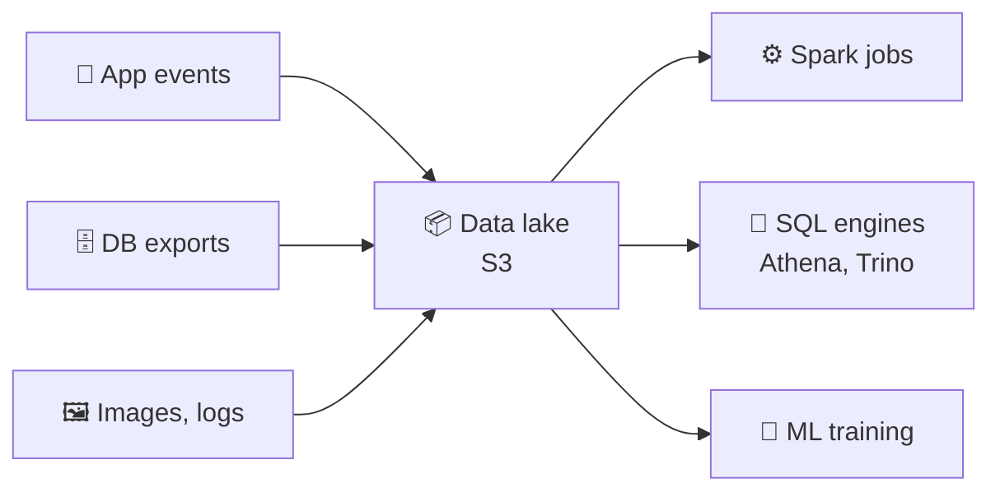

# 05 · Data Lakes

> [!info] Topic info
> **Subject:** System Design · **Chapter:** Big Data Processing · **Priority:** ⚡ Medium · **Status:** ✅ done · **Last reviewed:** 2026-11-19
>
> [← Back to Big Data Processing](README.md) · [Interview questions →](questions/big-data-qa.md)

> [!abstract] In one line
> A **data lake** is cheap **object storage** (like S3) holding **raw data of any type** — JSON, logs, images, Parquet — with the structure applied only **when you read it** (**schema-on-read**).

---

## 1. The problem

Our app produces **5 TB a day**: click logs, uploaded images, ML features, raw API events. Most of it doesn't fit nicely into warehouse tables, and storing it all in a warehouse is expensive.

But we don't want to throw it away — the ML team may need two years of raw clicks next quarter.

---

## 2. How it works

Dump everything into [object storage](../storage-systems/03-object-storage.md) — S3, GCS, Azure Blob — at about **$20 per TB per month**. Then point any engine at it.

- **Schema-on-read** — files are stored as-is; the reader decides the structure at query time.
- **Separate storage and compute** — storage is cheap and always there; spin up Spark only when needed.
- **Columnar formats** like **Parquet** store data column by column and compress well, so a query reading 3 columns skips the other 50.
- **Partitioning** by folder, e.g. `events/date=2026-11-19/`, lets queries skip whole days they don't need.

### Zones (a common layout)

- 🥉 **Raw / bronze** — exactly as received.
- 🥈 **Cleaned / silver** — deduped, typed, joined.
- 🥇 **Curated / gold** — business-ready tables for reports.

> [!tip] 🎤 Say it like this
> "A data lake is raw data of any format sitting in cheap object storage like S3. You apply the schema when you read it, and you bring whatever compute you want — Spark, Trino, ML jobs. It's great for cheap long-term storage and data science, but without governance it turns into a data swamp."

**✅ Pros**
- Very cheap, scales to petabytes.
- Any data type, including unstructured.
- Keep raw history forever, reprocess anytime.

**❌ Cons**
- No transactions — a half-written job leaves broken files. No easy updates or deletes (hard for GDPR).
- Slower for BI queries than a warehouse.
- Easily becomes a **data swamp** — nobody knows what's in it.

> [!failure] Interview traps
> - Saying "data lake = Hadoop". Today it's object storage.
> - Storing millions of tiny JSON files — queries crawl. Compact into larger Parquet files (~128 MB–1 GB).
> - No catalog — always mention a **metadata catalog** (e.g. Glue, Hive Metastore) so people can find tables.

---

## Summary

- Lake = raw files in object storage, schema-on-read.
- Use Parquet + date partitions for fast queries.
- Weak spots (no ACID, swamp risk) are what the [Lakehouse](07-data-lakehouse.md) fixes.

> [!success] Key takeaway
> Lake = cheap, flexible, raw storage for everything. Compare with the structured [Data Warehouse](06-data-warehousing.md).
