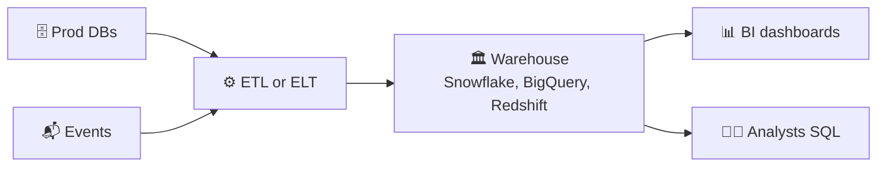

# 06 · Data Warehousing

> [!info] Topic info
> **Subject:** System Design · **Chapter:** Big Data Processing · **Priority:** ⚡ Medium · **Status:** ✅ done · **Last reviewed:** 2026-11-19
>
> [← Back to Big Data Processing](README.md) · [Interview questions →](questions/big-data-qa.md)

> [!abstract] In one line
> A **data warehouse** is a database built for **analytics (OLAP)**: clean, structured tables with a fixed schema (**schema-on-write**), stored in **columns**, so big aggregate queries run in seconds.

---

## 1. The problem

The CEO asks: "Revenue by country by month for the last 2 years." On our production Postgres, that query scans **billions** of rows, takes 20 minutes, and slows the app for everyone.

Production DBs are built for **OLTP** — many small reads and writes ("get post 42"). Analytics needs **OLAP** — few huge scans ("sum all views by month").

---

## 2. How it works

Data arrives through [ETL / ELT pipelines](04-etl-pipelines.md). Three ideas make it fast:

- **Columnar storage** — `SUM(views)` reads only the `views` column, not whole rows. Columns of similar values compress 5–10x.
- **Massively parallel processing (MPP)** — the query is split across many nodes.
- **Storage separate from compute** — modern cloud warehouses scale them independently.

### Star schema

The classic table layout:

- **Fact table** — one row per event, mostly numbers and IDs: `fact_post_views(post_id, user_id, date_id, country_id, watch_ms)`.
- **Dimension tables** — descriptions around it: `dim_user`, `dim_post`, `dim_date`, `dim_country`.

Queries join the big fact table to small dimensions. Simple for analysts, fast for the engine.

---

## 3. OLTP vs OLAP

| | OLTP (Postgres, MySQL) | OLAP (Warehouse) |
|---|---|---|
| **Query** | Read/write a few rows | Scan and aggregate millions |
| **Users** | The app, millions of users | Analysts, dashboards |
| **Storage** | Row-oriented | Column-oriented |
| **Schema** | Normalized | Star schema, denormalized |
| **Latency goal** | Milliseconds | Seconds |

> [!tip] 🎤 Say it like this
> "A warehouse is a separate database tuned for analytics. Data is loaded in a clean, fixed schema, stored by column, and queried in parallel across many nodes, so a scan of billions of rows takes seconds. It keeps heavy reporting away from the production database."

**✅ Pros**
- Fast SQL for BI, clean trusted data.
- ACID tables, access control, easy for non-engineers.

**❌ Cons**
- More expensive per TB than a lake.
- Structured data only; schema changes need work.
- Not for serving the app — queries take seconds, not ms.

> [!failure] Interview traps
> - Using the warehouse as the app's backend — it's not built for thousands of tiny low-latency queries.
> - Confusing row vs column storage — know why columnar wins for aggregates.
> - Forgetting data is **hours old** with batch loads; say so when asked about freshness.

---

## Summary

- Warehouse = OLAP: columnar, MPP, schema-on-write.
- Star schema: fact table + dimension tables.
- Keeps analytics off the production DB.

> [!success] Key takeaway
> Warehouse for clean, fast BI SQL; [lake](05-data-lakes.md) for cheap raw storage; [lakehouse](07-data-lakehouse.md) tries to be both.
