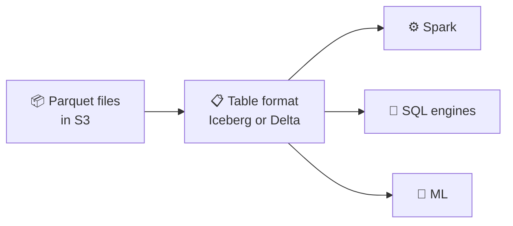

# 07 · Data Lakehouse

> [!info] Topic info
> **Subject:** System Design · **Chapter:** Big Data Processing · **Priority:** 💤 Low · **Status:** ✅ done · **Last reviewed:** 2026-11-19
>
> [← Back to Big Data Processing](README.md) · [Interview questions →](questions/big-data-qa.md)

> [!abstract] In one line
> A **lakehouse** keeps data as open files in **cheap object storage** (like a lake) but adds a **table format** layer — **Delta Lake, Apache Iceberg, Apache Hudi** — that gives **ACID transactions, schemas and fast SQL** (like a warehouse).

---

## 1. The problem

Many companies ran **both**: a [lake](05-data-lakes.md) for raw data and ML, plus a [warehouse](06-data-warehousing.md) for BI. That means two copies of data, extra ETL between them, and numbers that don't match.

Why not make the lake itself reliable enough for BI?

---

## 2. How it works

The table format keeps a **transaction log / metadata** next to the files that says "these exact files make up version 57 of the table".

- **ACID writes** — a job's new files only become visible when the log commit succeeds. No half-written tables.
- **Updates and deletes** — needed for GDPR "delete my data" and CDC upserts.
- **Time travel** — query the table as it was yesterday.
- **Schema enforcement and evolution** — reject bad data, add columns safely.

> [!tip] 🎤 Say it like this
> "A lakehouse stores data as open Parquet files in object storage, but adds a table format like Iceberg or Delta Lake that tracks which files belong to each version. That gives you ACID, updates, deletes and time travel on cheap storage, so one copy of data serves both BI and ML."

---

## 3. Lake vs warehouse vs lakehouse

| | Data Lake | Data Warehouse | Lakehouse |
|---|---|---|---|
| **Storage** | Object storage, open files | Proprietary, managed | Object storage, open files |
| **Data types** | Anything | Structured only | Mostly structured + semi |
| **Schema** | On read | On write | On write, can evolve |
| **ACID / updates** | ❌ | ✅ | ✅ |
| **Cost** | Lowest | Highest | Low |
| **Best for** | Raw storage, ML | BI dashboards | Both, one copy |
| **Examples** | S3 + Parquet | Snowflake, BigQuery | Databricks, Iceberg tables |

> [!failure] Interview traps
> - Thinking a lakehouse is a new storage system — it's a **metadata layer on top of** normal files.
> - Saying warehouses are obsolete — many teams still use them; the lines are blurring.

---

## Summary

- Lakehouse = lake files + table format (Delta / Iceberg / Hudi).
- Adds ACID, updates/deletes, time travel, schemas.
- Goal: one copy of data for BI and ML.

> [!success] Key takeaway
> "Warehouse features on lake prices" — powered by an open table format.
