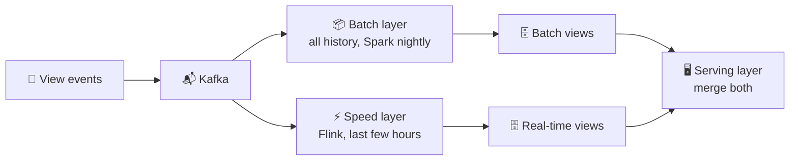

# 08 · Lambda Architecture

> [!info] Topic info
> **Subject:** System Design · **Chapter:** Big Data Processing · **Priority:** ⚡ Medium · **Status:** ✅ done · **Last reviewed:** 2026-11-19
>
> [← Back to Big Data Processing](README.md) · [Interview questions →](questions/big-data-qa.md)

> [!abstract] In one line
> **Lambda architecture** runs **two pipelines on the same data**: a **batch layer** for complete, accurate results and a **speed layer** for fast, approximate recent results, then **merges** them at query time.

---

## 1. The problem

Creators want a **view count** on each post that is:

- **Fresh** — updates within seconds while the post is going viral.
- **Exact** — used for payouts, so no double counts or missed events.

Older stream engines were fast but could lose or double-count events on failure. Batch was exact but hours late. So people ran **both**.

---

## 2. How it works

- **Batch layer** — stores the full, immutable event history and recomputes totals from scratch every night. Slow but correct.
- **Speed layer** — counts only events since the last batch run. Fast, may be slightly off.
- **Serving layer** — answers queries as `batch total up to midnight + speed count since midnight`.

When tonight's batch finishes, it overwrites the speed layer's numbers — so any streaming mistakes get **corrected** by morning.

> [!tip] 🎤 Say it like this
> "Lambda runs a batch pipeline and a streaming pipeline side by side. Batch recomputes accurate results over all history; the speed layer covers the last few hours with low latency. Queries merge both. The big downside is you write and maintain the same logic twice."

**✅ Pros**
- Fresh **and** eventually exact.
- Batch layer can fix any bug by recomputing from raw history.
- Fault tolerant — raw data is immutable.

**❌ Cons**
- **Two codebases** for the same logic (Spark + Flink) — they drift and give different numbers.
- Double the infrastructure and on-call.
- Merge logic in the serving layer adds complexity.

---

## 3. Lambda vs Kappa

| | Lambda | [Kappa](09-kappa-architecture.md) |
|---|---|---|
| **Pipelines** | Batch + stream | Stream only |
| **Code** | Written twice | Written once |
| **Reprocessing** | Re-run batch job | Replay the log |
| **Complexity** | High | Lower |
| **Best when** | Heavy historical batch jobs, ML, or weak stream engine | Modern engine with exactly-once, long log retention |

> [!failure] Interview traps
> - Proposing Lambda without mentioning the **two-codebase** pain.
> - Thinking the speed layer must be perfect — it's meant to be temporary and get overwritten.
> - Not knowing that modern exactly-once engines ([Streaming Engines](10-streaming-engines.md)) made Kappa a real alternative.

---

## Summary

- Batch layer = accurate, slow. Speed layer = fast, approximate. Serving = merge.
- Batch output overwrites speed output, fixing errors.
- Main cost: same logic in two systems.

> [!success] Key takeaway
> Lambda buys freshness + accuracy by paying for two pipelines. Today, prefer Kappa unless you need heavy batch recomputation.
