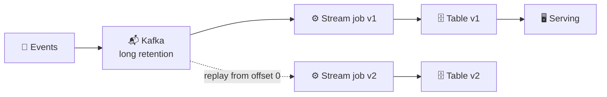

# 09 · Kappa Architecture

> [!info] Topic info
> **Subject:** System Design · **Chapter:** Big Data Processing · **Priority:** 💤 Low · **Status:** ✅ done · **Last reviewed:** 2026-11-19
>
> [← Back to Big Data Processing](README.md) · [Interview questions →](questions/big-data-qa.md)

> [!abstract] In one line
> **Kappa architecture** drops the batch layer: **everything is a stream**. To reprocess history, you **replay the event log** through a new version of the same streaming job.

---

## 1. The problem

With [Lambda](08-lambda-architecture.md), our view-count logic lives in Spark **and** Flink. A bug fix in one is forgotten in the other, and creators see two different numbers. 😩

Idea: if the stream engine is already correct (exactly-once), why keep batch at all?

---

## 2. How it works

- Keep all events in a durable log (Kafka with long retention, or archived to a lake).
- One streaming job (e.g. Flink) computes the results.
- **To change logic or fix a bug:** start job v2 reading from the **beginning** of the log, writing to a new table. When it catches up, switch reads to v2 and delete v1.

> [!tip] 🎤 Say it like this
> "Kappa treats everything as a stream. There's one pipeline and one codebase. If I need to fix a bug or recompute history, I replay the event log from the start through a new version of the job, then switch traffic to its output once it catches up."

**✅ Pros**
- One codebase, one system to run.
- Same logic for real-time and history — numbers always match.

**❌ Cons**
- Replaying months of data through a stream job can be slow and costly.
- Needs long log retention (storage cost) and a strong exactly-once engine.
- Some heavy jobs (ML training, big historical joins) are still easier in batch.

> [!failure] Interview traps
> - Forgetting that Kappa needs the **full event history** kept somewhere replayable.
> - Overwriting the live table during replay — write to a **new** table and swap.

---

## Summary

- One streaming pipeline; reprocess by replaying the log.
- Simpler than Lambda; relies on exactly-once engines and long retention.
- See the comparison table in [Lambda Architecture](08-lambda-architecture.md).

> [!success] Key takeaway
> Kappa = "the log is the source of truth, and reprocessing is just replay."
