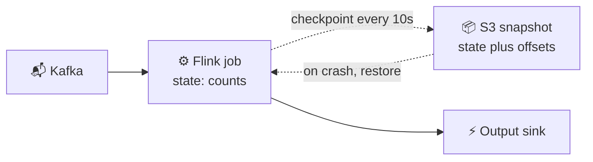

# 10 · Streaming Engines

> [!info] Topic info
> **Subject:** System Design · **Chapter:** Big Data Processing · **Priority:** ⚡ Medium · **Status:** ✅ done · **Last reviewed:** 2026-11-19
>
> [← Back to Big Data Processing](README.md) · [Interview questions →](questions/big-data-qa.md)

> [!abstract] In one line
> A **streaming engine** (Flink, Kafka Streams, Spark Structured Streaming) runs code continuously over an endless event stream, handling **windows**, **event time**, **late data** and **state recovery** for you.

---

## 1. The problem

We want "top 10 trending hashtags in the **last 5 minutes**". Writing a plain Kafka consumer with a HashMap works — until:

- the consumer crashes and loses all its counts,
- a phone sends events **10 minutes late** after losing signal,
- traffic grows and one machine isn't enough.

Streaming engines solve these for us.

---

## 2. The main engines

| Engine | What it is | Pick it when |
|---|---|---|
| **Apache Flink** | Dedicated cluster, true event-by-event | Low latency, big state, complex event-time logic |
| **Kafka Streams** | A Java **library** inside your app; Kafka only | Already on Kafka, want no extra cluster |
| **Spark Structured Streaming** | Micro-batches every ~1s on Spark | Team already uses Spark; seconds of latency is fine |

---

## 3. Windows

An endless stream has no "total", so we aggregate over **windows** (time buckets).

- **Tumbling** — fixed, non-overlapping: 12:00–12:05, 12:05–12:10. → "views per 5 min".
- **Sliding (hopping)** — fixed size, overlapping: 5-min window every 1 min. → "trending in last 5 min, refreshed each minute".
- **Session** — grouped by activity, closes after a gap (e.g. 30 min idle). → "how long was this user's session".

---

## 4. Event time, late data and watermarks

- **Event time** — when it actually happened (timestamp set on the phone).
- **Processing time** — when the engine sees it.

They differ because of network delays and offline phones. Correct analytics use **event time**, otherwise a late view lands in the wrong window.

But then: when is the 12:00–12:05 window "done"? A **watermark** is the engine's estimate: "I believe I've now seen all events up to 12:05". E.g. watermark = latest event time − 30 s. When the watermark passes 12:05, the window closes and emits a result.

Events that arrive after that are **late** — you can drop them, send them to a side output, or allow a grace period and update the result.

> [!example] Trade-off
> Bigger watermark delay → more complete results but slower output. Smaller → faster but more late events dropped.

---

## 5. State and exactly-once

The engine keeps **state** (counts per hashtag) locally and takes **checkpoints**: periodic snapshots of state + the Kafka offsets it has read, saved to S3.

On a crash, it restores the last checkpoint and **rewinds Kafka** to the saved offsets. State and input are back in sync, so each event affects state **exactly once**.

For the **output** to be exactly-once too, the sink must be **transactional** (commit with the checkpoint) or **idempotent** (upsert by key). See [Delivery Semantics](../communication-patterns/09-delivery-semantics.md).

> [!tip] 🎤 Say it like this
> "A streaming engine like Flink groups events into windows by event time, uses watermarks to decide when a window is complete, and handles late events with a grace period. It checkpoints its state together with the Kafka offsets, so after a crash it restores both and processes each event exactly once — as long as the sink is idempotent or transactional."

> [!failure] Interview traps
> - Using processing time for analytics — results change with network delays.
> - Claiming exactly-once **end to end** without an idempotent or transactional sink. Inside the engine it's "effectively once".
> - Ignoring **hot keys** — one viral hashtag overloads one worker. Pre-aggregate or split the key.
> - Unbounded state — always set a TTL or windows so state doesn't grow forever.

---

## Summary

| Concept | One line |
|---|---|
| **Windows** | Tumbling, sliding, session — how to bucket endless data |
| **Event time** | Use when it happened, not when it arrived |
| **Watermark** | "All events up to time T have probably arrived" |
| **Checkpoints** | Snapshot state + offsets → exactly-once on restore |

> [!success] Key takeaway
> Name the engine (Flink by default), then talk windows, event time + watermarks, and checkpoints. That covers 90% of streaming interview questions.
