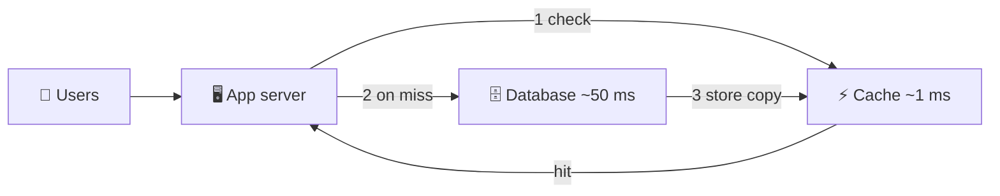

# 01 · What Is Caching

> [!info] Topic info
> **Subject:** System Design · **Chapter:** Caching · **Priority:** 🔥 High · **Status:** ✅ done · **Last reviewed:** 2026-11-19
>
> [← Back to Caching](README.md) · [Interview questions →](questions/caching-qa.md)

> [!abstract] In one line
> A **cache** is a small, **fast** store that keeps a **copy** of data you read often, so you don't pay the **slow, expensive** trip to the real source every time.

---

## 1. The problem

Our social media app shows a home feed. Building it means a DB query that joins posts, users and likes — about **50 ms**. With **20,000 reads/sec**, the database melts.

But 90% of those reads ask for the **same** popular posts and profiles. We are doing the same slow work again and again.

> [!note] Recap
> [Scalability](../core-concepts/01-scalability.md) (section 9) already introduced cache-aside with Redis. This chapter goes deeper: strategies, eviction, invalidation, CDNs, distributed caches and failure modes.

---

## 2. How it works

Keep the answer of an expensive read in fast memory. Next time, check memory first.

- **Cache hit** — the data is in the cache. Fast.
- **Cache miss** — not there. Go to the source, then usually save a copy.
- **Hit ratio** — hits ÷ total reads. The key health metric. Aim for **90%+** on hot data.

> [!example] Why hit ratio matters so much
> Cache = 1 ms, DB = 50 ms.
> At **90%** hits: average ≈ 0.9×1 + 0.1×51 ≈ **6 ms**.
> At **99%** hits: average ≈ **1.5 ms**, and the DB gets **10x fewer** queries than at 90%.

Why it works: real traffic is **skewed**. A small set of hot items (top posts, celebrity profiles) gets most of the reads. Caching just that slice gives a huge win.

---

## 3. Where caches live — the cache levels

A request passes through many caches before it reaches the database.

| Level | What it stores | Typical speed | Notes |
|---|---|---|---|
| **Browser** | Images, JS, CSS, some API replies | 0 ms (no network) | Controlled by HTTP headers like `Cache-Control` |
| **CDN** | Static files, public pages | 10–30 ms | Servers near the user. See [CDN](05-cdn.md) |
| **App in-memory** | Config, hot small objects | < 0.1 ms | Fastest server-side, but each server has its own copy |
| **Distributed cache** | Sessions, feeds, profiles | ~1 ms | Redis/Memcached, shared by all servers. See [Distributed Cache](06-distributed-cache.md) |
| **DB buffer pool** | Hot DB pages in RAM | — | The DB caches itself; you get this for free |

The closer to the user, the faster — but the harder it is to **invalidate** (clear old data).

---

## 4. What to cache — and what not to

**Good to cache:**
- Read a lot, changed rarely (profiles, product pages, feeds).
- Expensive to compute (aggregations, rendered HTML, ML results).
- OK to be a few seconds stale (like counts, follower counts).

**Bad to cache:**
- Data that must be exactly right every time (bank balance, stock left at checkout).
- Data read only once (a one-time report).
- Data that changes on every write (a live counter being incremented).

> [!tip] 🎤 Say it like this
> "A cache keeps a copy of hot data in fast memory so most reads skip the database. It works because traffic is skewed — a few items get most of the reads. The price is staleness: the cache can disagree with the source, so I only cache data that can tolerate being a little old, and I watch the hit ratio."

**✅ Pros**
- Much lower latency (50 ms → 1 ms).
- Huge reduction in DB load — cheaper than scaling the DB.
- Absorbs traffic spikes on hot data.

**❌ Cons**
- **Stale data** — the copy can be out of date.
- More moving parts: invalidation, eviction, failure handling.
- If the cache dies, the DB suddenly gets all the traffic (see [Cache Stampede](07-cache-stampede.md)).

> [!failure] Interview traps
> - Saying "just add a cache" without saying **what** to cache, **how** it's updated, and **how stale** it can be.
> - Treating the cache as the **source of truth**. It's a copy; it can be lost at any time.
> - Forgetting that a cold or crashed cache sends **100%** of traffic to a DB sized for 10%.

---

## Summary

- Cache = fast copy of hot data. Hit → fast, miss → go to the source.
- **Hit ratio** is the number to watch; small gains near 100% matter a lot.
- Caches exist at every level: browser → CDN → app memory → Redis → DB buffer.
- Cache data that is read-heavy, expensive, and OK to be slightly stale.

> [!success] Key takeaway
> Caching trades **freshness** for **speed**. Always say how stale the data may be and what happens when the cache is empty.
