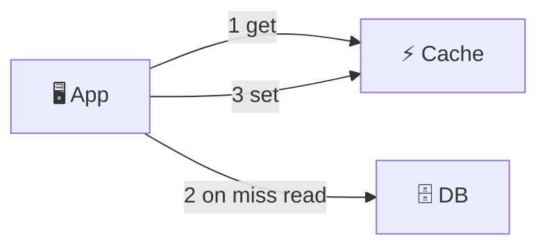
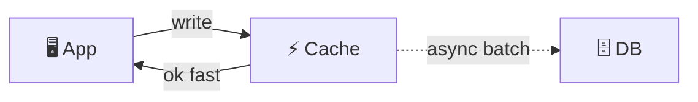

# 02 · Caching Strategies

> [!info] Topic info
> **Subject:** System Design · **Chapter:** Caching · **Priority:** 🔥 High · **Status:** ✅ done · **Last reviewed:** 2026-11-19
>
> [← Back to Caching](README.md) · [Interview questions →](questions/caching-qa.md)

> [!abstract] In one line
> A **caching strategy** decides **who** talks to the cache and the database, and **in what order**, on **reads** (cache-aside, read-through) and **writes** (write-through, write-behind, write-around).

---

## 1. The problem

We added Redis to our social media app. Now every read and write has questions:

- On a miss, who loads the data — the app or the cache?
- When a user edits their bio, do we update the cache, the DB, or both? In which order?

Each answer gives a different mix of **speed**, **freshness** and **risk of losing data**.

---

## 2. Read strategies

### Cache-aside (lazy loading) — the default

The **app** manages everything. Check cache → on miss, read DB → put it in cache.

- Only data that is actually read gets cached. Cache stays small.
- If the cache is down, the app can still read the DB.
- First read of each key is slow (a miss). Data can go stale until TTL or delete.

### Read-through

Same idea, but the **cache library/service** loads from the DB on a miss. The app only ever talks to the cache.

- Cleaner app code — loading logic lives in one place.
- Needs a cache that supports a loader (e.g. a caching library, DAX for DynamoDB).

> [!note] Cache-aside vs read-through
> Same data flow. The only difference is **who** fetches on a miss: the app (cache-aside) or the cache (read-through).

---

## 3. Write strategies

### Write-through

Write to the **cache and the DB together**, as one step. The request finishes only when both succeed.

- Cache is always fresh after a write.
- Every write pays for two writes → slower writes.
- Caches data that may never be read.

### Write-behind (write-back)

Write to the **cache only**, reply to the user, and flush to the DB **later** in batches.

- Very fast writes, and batching cuts DB load (1,000 like updates → 1 DB write).
- **Risk of data loss**: if the cache crashes before flushing, those writes are gone.
- Good for counters, view counts, analytics — not for payments.

### Write-around

Write to the **DB only**. Don't touch the cache (or just delete the key). The next read loads it.

- Doesn't fill the cache with data nobody reads (e.g. logs, old archives).
- A read right after the write is a miss.

> [!important] The most common real setup
> **Cache-aside for reads + update DB then delete the cache key on writes.** Simple, safe, and the cache rebuilds itself. See [Cache Invalidation](04-cache-invalidation.md).

---

## 4. Comparison

| Strategy | Who writes/loads | Read after write | Write speed | Data-loss risk | Best for |
|---|---|---|---|---|---|
| **Cache-aside** | App, on read miss | Miss or stale until invalidated | — | None | General purpose, read-heavy |
| **Read-through** | Cache, on read miss | Same as cache-aside | — | None | Cleaner code, same use cases |
| **Write-through** | App writes both | Fresh hit | Slower | Low | Read-after-write must be fresh (profile edits) |
| **Write-behind** | Cache, DB later | Fresh hit | Fastest | **High** | Counters, likes, metrics |
| **Write-around** | DB only | Miss | Normal | None | Write-heavy, rarely re-read data |

> [!tip] 🎤 Say it like this
> "For reads I default to cache-aside: check Redis, on a miss read the DB and populate the cache with a TTL. For writes I update the database and delete the cache key, so the next read reloads fresh data. If writes are very heavy and losing a few is acceptable — like view counts — I'd use write-behind to batch them."

> [!failure] Interview traps
> - Using **write-behind** for money or orders — a cache crash loses committed writes.
> - Thinking write-through means "always consistent". If the DB write fails after the cache write (or the other way round), they still drift apart.
> - Forgetting a **TTL** with cache-aside — one missed invalidation means stale data forever.

---

## Summary

| Strategy | One-line idea |
|---|---|
| **Cache-aside** | App loads cache on miss — default choice |
| **Read-through** | Cache loads itself on miss |
| **Write-through** | Write cache + DB together — fresh, slower writes |
| **Write-behind** | Write cache, DB later — fast, can lose data |
| **Write-around** | Write DB only — avoid polluting the cache |

> [!success] Key takeaway
> Pick the strategy by asking: how fresh must reads be, how fast must writes be, and can I afford to lose a write?
