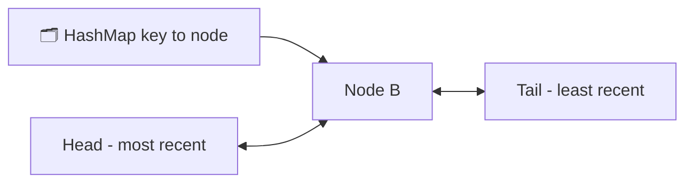

# 03 · Cache Eviction Policies

> [!info] Topic info
> **Subject:** System Design · **Chapter:** Caching · **Priority:** 🔥 High · **Status:** ✅ done · **Last reviewed:** 2026-11-19
>
> [← Back to Caching](README.md) · [Interview questions →](questions/caching-qa.md)

> [!abstract] In one line
> When the cache is **full**, an **eviction policy** decides **which key to throw out** — most commonly the **least recently used (LRU)** one.

---

## 1. The problem

Our Redis box has **16 GB** of RAM. The app has **2 TB** of posts and profiles. We can't cache everything.

When memory is full and a new item arrives, something must go. Throw out the wrong thing and the hit ratio drops — the DB gets hammered again.

> [!note] Eviction vs expiration
> **Eviction** = removed because the cache is **full**. **Expiration (TTL)** = removed because it's **too old**. Different reasons, often used together.

---

## 2. The main policies

| Policy | Throws out… | Good when | Weak spot |
|---|---|---|---|
| **LRU** — Least Recently Used | The key not touched for the longest time | Recent = likely again (feeds, sessions) | One big scan of old data pushes out hot keys |
| **LFU** — Least Frequently Used | The key with the fewest hits | Stable popularity (top products, celebrity profiles) | Old popular keys stick around; new keys get evicted fast |
| **FIFO** — First In, First Out | The oldest inserted key | Simple, cheap | Ignores usage — may evict the hottest key |
| **TTL-based** | Keys whose time is up | Data with a natural freshness limit | Not a full policy — doesn't help when memory fills before TTL |
| **Random** | A random key | Very cheap, surprisingly OK | Unpredictable |

> [!example] Quick example — capacity 3
> Access order: **A B C A D**
> - **LRU** evicts **B** (A was just used again, B is the oldest unused).
> - **FIFO** evicts **A** (inserted first) — even though it's hot.
> - **LFU** evicts **B or C** (A has 2 hits, B and C have 1).

---

## 3. How LRU is built — O(1) get and put

Classic interview question. Use **two structures together**:

- **Hash map**: key → node. Finds any key in **O(1)**.
- **Doubly linked list**: order of use. **Head = most recent**, **tail = least recent**.

- **get(key)**: look up in map → move node to the **head** → return value.
- **put(key)**: if it exists, update and move to head. Else add at head; if over capacity, **remove the tail** and delete it from the map.

Why doubly linked? To unlink a node from the middle in **O(1)** you need its `prev` pointer.

> [!note] Real systems approximate
> Redis doesn't keep a perfect LRU list — it **samples** a few random keys and evicts the oldest of them. Cheaper, and almost as good. Redis policies include `allkeys-lru`, `allkeys-lfu`, `volatile-ttl` and `noeviction`.

---

## 4. Choosing a policy

- **Default: LRU.** Works well for most web workloads.
- **LFU** when popularity is stable and you get scans (e.g. a batch job reading every product once).
- **TTL on every key**, on top of the policy, so stale data dies on its own.

> [!tip] 🎤 Say it like this
> "When the cache is full, LRU evicts the key that hasn't been used for the longest time. I'd build it with a hash map for O(1) lookup plus a doubly linked list for usage order — move to head on access, evict from the tail. If a big scan could flush hot keys, LFU is a better fit."

> [!failure] Interview traps
> - Mixing up **eviction** (memory full) and **expiration** (TTL).
> - Implementing LRU with a plain array or singly linked list — that makes updates **O(n)**.
> - Using `noeviction` in Redis as a cache — when memory fills, **writes start failing**.

---

## Summary

- Eviction = what to drop when memory is full.
- **LRU** (recency) is the default; **LFU** (frequency) for stable hot sets; **FIFO** is simple but naive.
- LRU = **hash map + doubly linked list** → O(1) get/put.
- Always combine a policy with **TTLs**.

> [!success] Key takeaway
> The right policy keeps the hottest data in RAM. Default to LRU, explain the hash map + linked list, and know when LFU wins.
