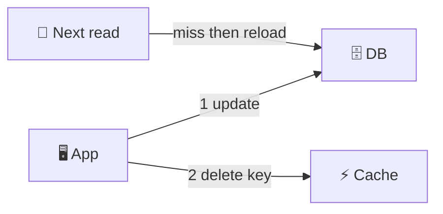

# 04 · Cache Invalidation

> [!info] Topic info
> **Subject:** System Design · **Chapter:** Caching · **Priority:** 🔥 High · **Status:** ✅ done · **Last reviewed:** 2026-11-19
>
> [← Back to Caching](README.md) · [Interview questions →](questions/caching-qa.md)

> [!abstract] In one line
> **Cache invalidation** is how you **remove or refresh** cached data when the **source changes**, so users don't see **stale** data for too long.

---

## 1. The problem

A user changes their display name from "bob" to "Bob Smith". The DB is updated. But Redis still holds `user:42 → bob`.

For the next hour, everyone sees the old name. The user thinks the edit failed and tries again. This is a **stale read** — the cache disagrees with the source of truth.

> [!note] Why it's "hard"
> The cache and DB are two separate systems. There is no single atomic write across both, so with concurrency and failures, they **can** drift apart. The goal is to keep the gap **small and bounded**.

---

## 2. The main techniques

### TTL (time to live)

Every key expires after a set time, e.g. `SET user:42 ... EX 300` (5 minutes).

- Simple, and a **safety net**: even if you forget to invalidate, staleness is capped at the TTL.
- Short TTL = fresher but more misses. Long TTL = more hits but staler.

### Delete on write (explicit invalidation)

When you update the DB, **delete** the cache key. The next read misses and loads fresh data (cache-aside).

### Versioned keys

Put a version in the key: `user:42:v7`. On update, bump the version to `v8` and read the new key. Old keys are never read again and just expire.

- No race on delete — you never overwrite, you switch.
- Great for static assets too: `app.3f9a.js` — new deploy, new file name, so CDNs and browsers never serve the old one.

### Event-driven invalidation

The DB change is published as an event (e.g. via [Change Data Capture](../big-data/02-change-data-capture.md) or a message queue). A worker deletes the matching keys — useful when **many services** cache the same data.

---

## 3. Delete vs update — and the race condition

Why **delete** the key instead of **writing** the new value into the cache? Because two concurrent writes can land in the wrong order:

1. Request A sets name = "X" in DB. Request B sets name = "Y" in DB (B wins in DB).
2. B writes "Y" to cache, then A (slow) writes "X" to cache.
3. Now DB = **Y**, cache = **X** — wrong until TTL.

Deleting is safe here: both requests just delete, and the next read loads "Y".

> [!warning] Delete still has a small race
> Reader misses, reads **old** value from DB → writer updates DB and deletes key → reader puts the **old** value into cache. Rare, but real.
> Fixes: keep a **TTL** as backup, use a **delayed second delete** (delete again ~1 s later), or use versioned keys.

> [!important] Order matters
> **Update the DB first, then delete the cache.** If you delete first, a reader can refill the cache with the old value before your DB write lands.

---

## 4. Choosing the approach

| Technique | Staleness | Complexity | Use for |
|---|---|---|---|
| **TTL only** | Up to the TTL | Lowest | Like counts, trending lists |
| **Delete on write + TTL** | Very small | Low | Most app data — the default |
| **Versioned keys** | None for the new reader | Medium | Static files, config, data with clear versions |
| **Event-driven** | Seconds | Highest | Many services caching the same data |

> [!tip] 🎤 Say it like this
> "I update the database first, then delete the cache key, and every key also has a TTL as a safety net. I delete instead of update because concurrent writers can put values into the cache out of order. For static assets I use versioned file names, so invalidation is just a new URL."

> [!failure] Interview traps
> - Updating the cache value on write instead of deleting it — out-of-order writes leave wrong data.
> - Deleting the cache **before** writing the DB.
> - No TTL at all — one missed delete means stale data forever.
> - Forgetting **derived** keys: changing a name must also clear feeds or pages that embed that name.

---

## Summary

- Stale reads happen because cache and DB are two separate systems.
- **TTL** caps staleness; **delete on write** keeps it small; **versioned keys** avoid races.
- Write DB first, then **delete** (not update) the key.

> [!success] Key takeaway
> You can't make the cache perfectly consistent cheaply — so **bound** the staleness with TTLs and invalidate on writes.
