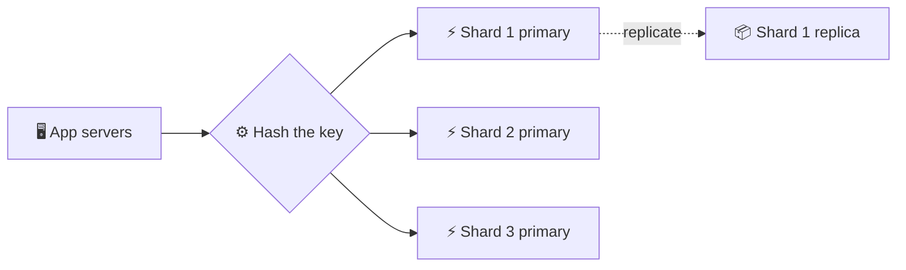

# 06 · Distributed Cache

> [!info] Topic info
> **Subject:** System Design · **Chapter:** Caching · **Priority:** 🔥 High · **Status:** ✅ done · **Last reviewed:** 2026-11-19
>
> [← Back to Caching](README.md) · [Interview questions →](questions/caching-qa.md)

> [!abstract] In one line
> A **distributed cache** spreads cached data across **many nodes** (sharding) and copies it (replication), giving all app servers one **shared**, **large**, **fault-tolerant** cache — e.g. **Redis** or **Memcached**.

---

## 1. The problem

We have **50 app servers**. If each keeps its own in-memory cache:

- The same profile is cached **50 times** — wasted RAM.
- Server 1 deletes a stale key, servers 2–50 still serve the old value.
- Each server only sees 1/50 of the traffic, so the hit ratio is poor.

And one shared Redis box with 64 GB is not enough for 500 GB of hot data or 1M ops/sec.

---

## 2. How it works

All app servers talk to a **cluster** of cache nodes. Each key lives on one shard, picked by hashing the key.

### Sharding

`hash(key) % N` breaks badly when N changes — almost every key moves, and the cache is suddenly empty. So we use [consistent hashing](../core-concepts/06-consistent-hashing.md): adding a node moves only ~1/N of the keys.

> [!note] Redis Cluster
> Redis Cluster uses **16,384 hash slots**. Each key maps to a slot, and slots are assigned to nodes. Moving slots = rebalancing.

### Replication

Each shard has a **primary** and one or more **replicas**. If the primary dies, a replica is promoted, so the shard's data isn't all lost to misses at once. Replication is usually **async**, so a failover can lose the last few writes — fine for a cache.

---

## 3. Redis vs Memcached

| | **Redis** | **Memcached** |
|---|---|---|
| **Data types** | Strings, hashes, lists, sets, sorted sets, streams | Strings (blobs) only |
| **Persistence** | Optional (snapshots, append-only log) | None — RAM only |
| **Replication / failover** | Built in | None built in |
| **Threads** | Mostly single-threaded command execution | Multi-threaded |
| **Extras** | Pub/sub, Lua scripts, TTLs, atomic counters, locks | Very simple, very fast |
| **Pick when** | Almost always — leaderboards, sessions, counters, rate limits | Pure, simple key-value caching at huge scale |

> [!tip] 🎤 Say it like this
> "I'd use a Redis cluster shared by all app servers. Keys are spread across shards with consistent hashing so adding a node only moves a small part of the data, and each shard has a replica for failover. Redis over Memcached because I also get data structures like sorted sets for leaderboards and atomic counters for likes."

---

## 4. Hot keys

A celebrity with **100M followers** posts. Every feed read wants `post:999`. All that traffic hits **one shard** — it maxes out its CPU or network while other shards sit idle.

Fixes:
- **Local in-memory cache** for that key on each app server (a few seconds TTL).
- **Replicate the hot key**: store it as `post:999#1` … `post:999#10` on different shards and read a random copy.
- **Read from replicas** of that shard.

> [!warning] Big keys are a cousin of hot keys
> A 50 MB value (a huge list) blocks a single-threaded Redis while it's being sent. Keep values small; split big ones.

---

## 5. Failure handling

- A cache node dies → its keys become misses → DB load jumps. Size the DB to survive losing one shard.
- Whole cache down → don't let 100% of traffic hit the DB. Use [Cache Stampede](07-cache-stampede.md) defences, rate limits and [circuit breakers](../microservices-patterns/05-circuit-breaker.md).
- Set **timeouts** on cache calls (~10–50 ms). A slow cache must not make the app slow — treat it as a miss.

> [!failure] Interview traps
> - Using `hash % N` and then adding a node — near-total cache miss storm.
> - Treating the cache as durable storage. Replication is async; data can be lost.
> - Ignoring **hot keys** — the cluster looks fine on average while one shard melts.

---

## Summary

- Shared cluster → one copy per key, consistent view, much more RAM.
- **Consistent hashing** for sharding, **replicas** for failover.
- **Redis** is the default; Memcached for very simple key-value caching.
- Plan for hot keys and node failures.

> [!success] Key takeaway
> A distributed cache is sharded + replicated RAM. The interview questions are always: how do keys spread, what happens when a node dies, and what about hot keys?
