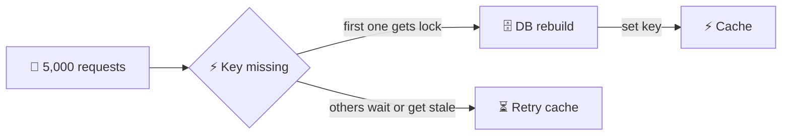

# 07 · Cache Stampede

> [!info] Topic info
> **Subject:** System Design · **Chapter:** Caching · **Priority:** ⚡ Medium · **Status:** ✅ done · **Last reviewed:** 2026-11-19
>
> [← Back to Caching](README.md) · [Interview questions →](questions/caching-qa.md)

> [!abstract] In one line
> A **cache stampede** (thundering herd) is when a **hot key expires** or the cache goes **empty**, and **thousands of requests** miss at once and all hit the **database** together.

---

## 1. The problem

The trending feed is read **10,000 times/sec** and is cached with a 60 s TTL. Rebuilding it takes a 500 ms DB query.

At second 60 the key expires. In the next 500 ms, **5,000 requests** miss and run the same heavy query. The DB slows down, queries take longer, even more requests miss → the DB falls over.

> [!note] Recap
> [Availability](../core-concepts/02-availability.md) (section 11) lists this as a cascading-failure cause. Here are the fixes in detail.

---

## 2. Fixes

### Request coalescing / locking

Only **one** request rebuilds the key. Others wait briefly or get the old value.

- Lock with Redis: `SET lock:feed 1 NX EX 5` — only one caller succeeds.
- Within one server, a "single flight" map does the same for in-process callers.

### TTL jitter

Add randomness: TTL = 60 s **± 10 s**. Keys written together don't all expire together.

### Stale-while-revalidate

Keep serving the **old** value while **one background job** refreshes it. Users never wait, the DB sees one query.

### Early (probabilistic) refresh

Before the TTL ends, each read has a small chance to refresh early — the chance grows as expiry gets closer. One request usually refreshes before the key ever expires.

### Warm the cache

Before a restart or a big event, pre-load hot keys. See [Cache Warming](08-cache-warming.md).

> [!tip] 🎤 Say it like this
> "A stampede is when a hot key expires and thousands of requests rebuild it at the same time, overloading the DB. I'd make sure only one request rebuilds — with a lock or request coalescing — and serve the stale value to everyone else meanwhile. I'd add TTL jitter so keys don't expire together, and pre-warm the cache after restarts."

> [!failure] Interview traps
> - Thinking a **longer TTL** fixes it — it only makes it happen less often.
> - Locks without a **timeout** — if the rebuilder crashes, everyone waits forever.
> - Forgetting the **cold start** case: a restarted empty cache is a stampede on every key.

---

## Summary

| Fix | What it does |
|---|---|
| **Lock / coalescing** | One rebuild per key |
| **TTL jitter** | Spreads out expiries |
| **Stale-while-revalidate** | Serve old value, refresh in background |
| **Early refresh** | Refresh before expiry |
| **Warming** | No cold cache at start |

> [!success] Key takeaway
> Never let a miss on a hot key turn into N identical DB queries — make it **one** query.
