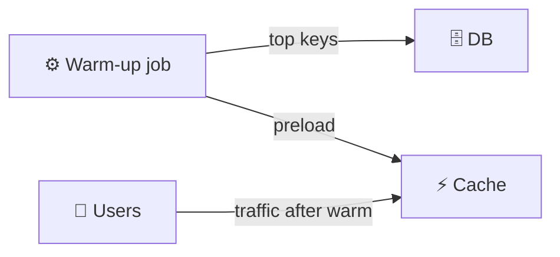

# 08 · Cache Warming

> [!info] Topic info
> **Subject:** System Design · **Chapter:** Caching · **Priority:** 💤 Low · **Status:** ✅ done · **Last reviewed:** 2026-11-19
>
> [← Back to Caching](README.md) · [Interview questions →](questions/caching-qa.md)

> [!abstract] In one line
> **Cache warming** means **pre-loading** hot data into the cache **before** real traffic arrives, so users don't hit a **cold** (empty) cache.

---

## 1. The problem

We deploy a new Redis cluster, or a node restarts. The cache is **empty** — hit ratio 0%.

The DB was sized for the 5% of traffic that normally misses. Now it gets 100%. Users see slow pages, and in the worst case it's a [stampede](07-cache-stampede.md).

---

## 2. How it works

Run a job that reads the **hot keys** from the DB and writes them into the cache before switching traffic over.

How to find what's hot:
- **Access logs / analytics** — top 10,000 most-read keys from yesterday.
- **Known events** — a big sale, a match, a celebrity post scheduled for 8 PM.
- **Copy from the old cache** — dump keys from the old cluster into the new one.

Other ways to avoid a cold start:
- **Gradual traffic shift** — send 5%, then 20%, then 100% to the new cache, so it fills naturally.
- **Slow start** on the load balancer for new app servers with local caches.

> [!tip] 🎤 Say it like this
> "Before switching traffic to a new or restarted cache, I'd pre-load the hottest keys — found from access logs or known upcoming events — so the database never sees 100% of reads. If I can't do that, I shift traffic gradually so the cache fills up slowly."

> [!failure] Interview traps
> - Warming **everything** — wastes time and memory, and evicts itself. Warm only the hot set.
> - The warm-up job itself hammering the DB — throttle it.

---

## Summary

- Cold cache = DB gets all traffic.
- Pre-load the hot set, or ramp traffic gradually.

> [!success] Key takeaway
> Plan for the empty-cache moment: deploys, restarts and big events should never start cold.
