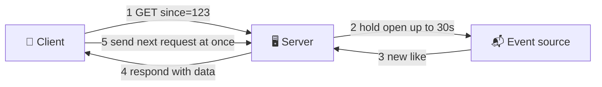

# 01 · Long Polling

> [!info] Topic info
> **Subject:** System Design · **Chapter:** Communication Patterns · **Priority:** ⚡ Medium · **Status:** ✅ done · **Last reviewed:** 2026-11-19
>
> [← Back to Communication Patterns](README.md) · [Interview questions →](questions/communication-patterns-qa.md)

> [!abstract] In one line
> **Long polling** is when the client asks "anything new?" and the server **holds the request open** until there is data or a **timeout** — real-time-ish updates over **plain HTTP**.

---

## 1. The problem

HTTP is **request → response**. The server can't talk first. But our social media app wants to show "Priya liked your post" the moment it happens.

The naive fix is **short polling**: ask every 2 seconds. With **1M online users**, that's **500k req/s** — and 99% of the answers are "nothing new". Huge waste, and updates are still up to 2 s late.

---

## 2. How it works

1. Client sends `GET /notifications?since=123`.
2. Server **does not answer right away**. It waits until a new event arrives or ~30 s pass.
3. Server responds (with data, or empty on timeout).
4. Client **immediately** sends the next request.

So there's almost always one request "parked" at the server. When data appears, it's sent instantly — latency is near-zero, not "up to 2 s".

> [!note] Don't lose events between requests
> In the tiny gap between a response and the next request, new events may arrive. The client sends a **cursor** (`since=<last id>`) so the server can return what it missed.

---

## 3. Short polling vs long polling

| | Short polling | Long polling |
|---|---|---|
| **When server answers** | Immediately, even if empty | Only when data exists or timeout |
| **Wasted requests** | Very many | Few |
| **Latency** | Up to the poll interval | Near real-time |
| **Server cost** | Many short requests | Many **open** connections held |

**✅ Pros**
- Works everywhere — plain HTTP, every proxy, firewall and old browser.
- Simple to build; no special protocol or load balancer setup.

**❌ Cons**
- Each message still costs a **full HTTP request** (headers, maybe TLS work).
- Server holds many idle connections — needs an **async / event-loop** server (Node, Go), not one thread per request.
- Bursty data means many back-to-back requests; ordering and duplicates need a cursor.

> [!tip] 🎤 Say it like this
> "Long polling is the HTTP trick for server push. The client sends a request and the server holds it open until there's new data or a timeout, then the client reconnects straight away. It works through any proxy, so it's a good fallback — but every message costs a new request, so for high-frequency updates I'd use SSE or WebSockets."

> [!failure] Interview traps
> - Saying long polling keeps **one** connection forever — no, it's a **new request after each response**.
> - Forgetting the **timeout**: proxies and load balancers often kill idle requests after 60 s, so keep it below that (e.g. 30 s).
> - Using a thread-per-request server — 100k parked requests = 100k blocked threads.

---

## 4. When to use it

- **Fallback** when WebSockets/SSE are blocked (corporate proxies, old infra). Socket.IO starts with long polling for this reason.
- **Low-frequency** updates: job status, "your export is ready", simple chat in a small app.
- Not for games, live cursors or stock tickers — too many requests per second.

Full comparison of polling, SSE and WebSockets: [API communication patterns](../../computer-networks/05-api-communication-patterns.md).

---

## Summary

- Short polling = ask often, mostly empty answers.
- Long polling = server **waits** to answer → near real-time over plain HTTP.
- Needs a cursor, a timeout under the proxy limit, and an async server.
- Best as a **fallback** or for rare updates.

> [!success] Key takeaway
> Long polling fakes server push with held-open HTTP requests. Easy and universal, but each message costs a request — move to SSE/WebSockets when updates are frequent.
