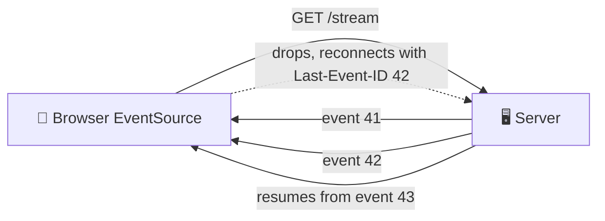

# 02 · Server-Sent Events (SSE)

> [!info] Topic info
> **Subject:** System Design · **Chapter:** Communication Patterns · **Priority:** ⚡ Medium · **Status:** ✅ done · **Last reviewed:** 2026-11-19
>
> [← Back to Communication Patterns](README.md) · [Interview questions →](questions/communication-patterns-qa.md)

> [!abstract] In one line
> **SSE** is a **one-way stream** from server to client over **one long-lived HTTP response**, with **auto-reconnect** built into the browser.

---

## 1. The problem

[Long polling](01-long-polling.md) works, but every notification costs a new HTTP request. Our app sends live like counts, comment updates and notifications — dozens per minute per user.

We don't need the client to talk back on the same channel. We just need the **server to keep pushing**.

---

## 2. How it works

The client opens a normal HTTP request. The server replies with `Content-Type: text/event-stream` and **never closes** the response. It writes small text events whenever something happens.

```text
id: 42
event: like
data: {"postId": 7, "likes": 121}

```

In the browser, `new EventSource('/stream')` handles it all — parsing, events, and reconnects.



> [!note] Resume after a drop
> Each event can carry an `id`. On reconnect the browser sends `Last-Event-ID`, so the server can replay what was missed — as long as it kept recent events somewhere (e.g. Redis, a log).

---

## 3. SSE vs WebSockets

| | SSE | WebSockets |
|---|---|---|
| **Direction** | Server → client only | Both ways |
| **Protocol** | Plain HTTP | Upgrades to its own protocol |
| **Data** | Text (UTF-8) | Text + binary |
| **Reconnect** | Built in, with resume | You build it |
| **Proxies / LBs** | Just HTTP — easy | Need upgrade support |

**✅ Pros**
- Very simple; works with existing HTTP auth, cookies, load balancers.
- Free auto-reconnect and resume.
- Great over **HTTP/2** — many streams share one TCP connection.

**❌ Cons**
- One-way only — client sends via normal POST requests.
- Text only (binary must be base64 — bigger).
- On **HTTP/1.1**, browsers allow only **~6 connections per domain**, so many tabs can block each other.
- Still one open connection per user on the server — same scaling concerns as WebSockets.

> [!tip] 🎤 Say it like this
> "SSE is a one-way push channel over a normal HTTP response. The browser's EventSource reconnects automatically and resumes with Last-Event-ID. If the server only needs to push — notifications, live scores, streaming AI tokens — SSE is simpler than WebSockets and plays nicely with existing HTTP infra."

> [!failure] Interview traps
> - Picking WebSockets for a **one-way** feed by default — SSE is usually simpler.
> - Forgetting proxy **buffering**: some proxies (e.g. Nginx default) buffer responses, so events arrive late in batches. Turn buffering off for the stream.
> - Ignoring idle timeouts — send a small **heartbeat comment** every ~15–30 s to keep the connection alive.

---

## 4. When to use it

- Notifications, live feeds, activity streams.
- Live scores, dashboards, progress bars.
- **Streaming LLM responses** token by token (ChatGPT-style UIs).

Use WebSockets instead when the client also sends often (chat typing, games). More detail and code: [API communication patterns](../../computer-networks/05-api-communication-patterns.md).

---

## Summary

- One HTTP response that stays open; server writes events into it.
- Built-in reconnect + resume via event `id` / `Last-Event-ID`.
- One-way, text-only — perfect for push-only features.

> [!success] Key takeaway
> If data flows only server → client, reach for SSE first. It's plain HTTP, auto-reconnects, and avoids the extra complexity of WebSockets.
