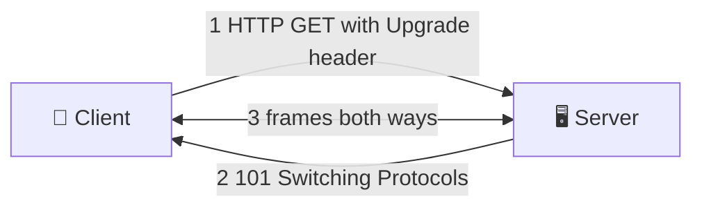
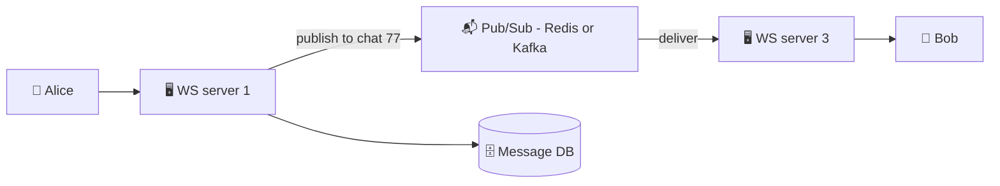

# 03 · WebSockets

> [!info] Topic info
> **Subject:** System Design · **Chapter:** Communication Patterns · **Priority:** 🔥 High · **Status:** ✅ done · **Last reviewed:** 2026-11-19
>
> [← Back to Communication Patterns](README.md) · [Interview questions →](questions/communication-patterns-qa.md)

> [!abstract] In one line
> A **WebSocket** is a **persistent, full-duplex** connection — both client and server can send messages **any time** over one TCP connection.

---

## 1. The problem

Our social media app adds **DMs and live typing indicators**. Now both sides talk constantly: the user types, sends, reacts; the server pushes new messages and "Priya is typing…".

[SSE](02-server-sent-events.md) is one-way. [Long polling](01-long-polling.md) costs a request per message. We need a cheap **two-way pipe** that stays open.

---

## 2. How it works

1. Client sends a normal HTTP request with `Upgrade: websocket`.
2. Server replies `101 Switching Protocols`.
3. The same TCP connection now carries small **WebSocket frames** both ways — just a few bytes of overhead each, no HTTP headers.

- **Heartbeats (ping/pong)** detect dead connections — a phone going into a tunnel doesn't send a clean "close".
- The **client must reconnect** itself, with backoff, and re-sync missed messages (e.g. "give me messages after id 980").
- Use `wss://` (TLS), and authenticate during the handshake (cookie or token) — avoid tokens in the URL, URLs get logged.

> [!tip] 🎤 Say it like this
> "A WebSocket starts as an HTTP request that upgrades to a persistent, two-way connection. After that, both sides send tiny frames whenever they want, with no per-message HTTP overhead. I use it for chat, multiplayer games and collaborative editing — anything where both sides talk often with low latency."

---

## 3. Scaling WebSockets — the senior part

HTTP servers are **stateless**; WebSocket servers are **stateful** — each server holds live connections. That changes everything.

### a) Connection count per server

Each open connection costs memory (roughly **10–50 KB** with buffers) and a file descriptor. A tuned server can hold **~50k–100k+** idle connections.

So **10M online users ≈ 100–200 gateway servers**. The bottleneck is usually memory and messages per second, not CPU.

### b) Load balancing and sticky connections

- The LB must support the **Upgrade** and long **idle timeouts** (default 60 s will kill quiet sockets — use heartbeats).
- A WebSocket is already "sticky" — it lives on one server until it drops. **Sticky sessions** matter for fallbacks like long polling (Socket.IO) where many requests must reach the same server.
- Use **L4 or WebSocket-aware L7** LBs. See [Load balancers](../load-balancing/01-load-balancers.md).

### c) Fan-out across servers

Alice is connected to **server 1**, Bob to **server 3**. Alice's message lands on server 1 — how does it reach Bob?

- Every server **subscribes** to the channels of its connected users (or keeps a "user → server" map in Redis).
- Messages are **saved to a DB first**, then fanned out — so offline users get them later.
- This is the [Pub/Sub](07-pub-sub.md) pattern.

### d) Deploys and reconnect storms

Restarting a server drops all its 100k connections at once — and they all reconnect at once. Drain servers slowly and use **jittered backoff** on the client.

**✅ Pros**
- Lowest latency, two-way, tiny per-message overhead.
- Supports binary data.

**❌ Cons**
- Stateful servers — harder to scale, deploy and balance.
- Reconnect, resume, heartbeats and auth are **your** job.
- Some proxies/firewalls still interfere.

> [!failure] Interview traps
> - Saying "just add servers behind the LB" — without **pub/sub between servers**, users on different servers can't talk.
> - Treating the socket as the source of truth — always **persist** messages; a socket can drop any time.
> - Using WebSockets for a one-way feed where **SSE** would be simpler.
> - Forgetting **reconnect storms** after a deploy or outage.

---

## 4. When to use it

| Use case | Pick |
|---|---|
| **Chat, typing indicators, presence** | WebSocket |
| **Multiplayer games, live cursors, collaborative docs** | WebSocket |
| **Notifications, live scores, AI streaming** | SSE (simpler) |
| **Rare updates, locked-down networks** | Long polling |

Handshake and comparison details: [API communication patterns](../../computer-networks/05-api-communication-patterns.md).

---

## Summary

- HTTP upgrade → one persistent two-way connection.
- Servers become **stateful**: plan for connections per server, LB timeouts, heartbeats.
- Cross-server delivery needs **pub/sub**; persist messages before fan-out.
- Clients must reconnect with backoff and re-sync.

> [!success] Key takeaway
> WebSockets are easy for one server and hard at scale. In an interview, the win is explaining **connection gateways + pub/sub fan-out + reconnect/resync**.
